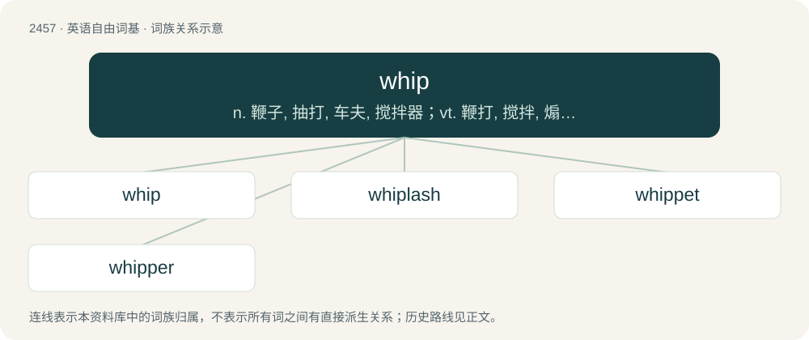

# 2560 · whip — n. 鞭子, 抽打, 车夫, 搅拌器；vt. 鞭打, 搅拌, 煽动, 召集, 仓促制成；vi. 拍击, 急走, 抽打

[总目录](../00_总目录_按常用程度.md)

**类型**：英语自由词基　｜　**来源语言**：见词源记录

## 核心含义与来源

- 核心含义：n. 鞭子, 抽打, 车夫, 搅拌器；vt. 鞭打, 搅拌, 煽动, 召集, 仓促制成；vi. 拍击, 急走, 抽打
- 英文含义：A lash; a pliant, flexible instrument, such as a rod (commonly of cane or rattan) or a plaited or braided rope or thong (commonly of leather) used to create a sharp "crack" sound for directing or herding animals.
- 词形：whip

**来源记录 1**（名词；A lash; a pliant, flexible instrument, such as a rod (commonly of cane or rattan) or a plaited or braided rope or thong (commonly of leather) used to create a sharp "crack" sound for directing or herding animals.）

From Middle English whippen, wippen (“to flap violently”), from Middle Dutch wippen (“to swing, leap, dance, oscillate”) and Middle Low German wippen (“to move quickly”), from Proto-Germanic \*wippōną (“to move back and forth”), ultimately from Proto-Indo-European \*weyp- (“to shake; to swing”). (See Swedish vippa and Danish vippe (“to shake”)). The unetymological wh- is probably expressive of the sound of a whip; compare the same development in whisk and onomatopoeias such as whack and whoosh. The political senses are from whipper-in (“huntsman who keeps the hounds from wandering”), from 18th-century hunting terminology.

## 词族图

## 单词速览（常用到不常用）

| 单词 | 音标 | 释义 |
|---|---|---|
| [whip](#w-1) | /ˈwɪp/ | n. 鞭子, 抽打, 车夫, 搅拌器；vt. 鞭打, 搅拌, 煽动, 召集, 仓促制成；vi. 拍击, 急走, 抽打 |
| [whiplash](#w-2) | /ˈwɪpˌlæʃ/ | n. 鞭子的顶端, 鞭绳 |
| [whippet](#w-3) | /ˈ(h)wipit/ | n. (赛跑用的)小灵狗, 轻型战车 |
| [whipper](#w-4) | /ˈhwipə/ | n. 鞭打者；抽打者；似用鞭子抽打者 |

## 逐词详解

### 1. whip

**词性**：名词　｜　**音标**：/ˈwɪp/

**中文释义**：n. 鞭子, 抽打, 车夫, 搅拌器；vt. 鞭打, 搅拌, 煽动, 召集, 仓促制成；vi. 拍击, 急走, 抽打

**英文义项**：A lash; a pliant, flexible instrument, such as a rod (commonly of cane or rattan) or a plaited or braided rope or thong (commonly of leather) used to create a sharp "crack" sound for directing or herding animals. / The same instrument used to strike a person or animal for corporal punishment or torture.

**词源与演化**：

From Middle English whippen, wippen (“to flap violently”), from Middle Dutch wippen (“to swing, leap, dance, oscillate”) and Middle Low German wippen (“to move quickly”), from Proto-Germanic \*wippōną (“to move back and forth”), ultimately from Proto-Indo-European \*weyp- (“to shake; to swing”). (See Swedish vippa and Danish vippe (“to shake”)). The unetymological wh- is probably expressive of the sound of a whip; compare the same development in whisk and onomatopoeias such as whack and whoosh. The political senses are from whipper-in (“huntsman who keeps the hounds from wandering”), from 18th-century hunting terminology.

**例句**：

> Once he ran out of appeals, he knew he would soon feel the sting of the whip.

该用例对应义项：The same instrument used to strike a person or animal for corporal punishment or torture.

### 2. whiplash

**词性**：名词　｜　**音标**：/ˈwɪpˌlæʃ/

**中文释义**：n. 鞭子的顶端, 鞭绳

**英文义项**：The lash of a whip. / An injury to the upper spine connected to a violent jerk of the head in either a backward or forward or side to side direction, resembling the motion of a whip.

**构词拆分**：whip + lash

**词源与演化**：

From whip + lash.

**用法示例／搭配（非完整句）**：

> tonal whiplash

该用例对应义项：An abrupt and unexpected change, or the resulting feeling of shock.

### 3. whippet

**词性**：名词　｜　**音标**：/ˈ(h)wipit/

**中文释义**：n. (赛跑用的)小灵狗, 轻型战车

**英文义项**：A dog of a certain breed, similar to a small greyhound, originating in Britain and bred for racing.

**构词拆分**：whip (“to move quickly”) + -et

**词源与演化**：

Probably from whip (“to move quickly”) + -et.

### 4. whipper

**词性**：名词　｜　**音标**：/ˈhwipə/

**中文释义**：n. 鞭打者；抽打者；似用鞭子抽打者

**英文义项**：A person or thing that whips. / A device that whips a substance, such as cream.

**构词拆分**：From whip + -er.

**词源与演化**：

From whip + -er.
