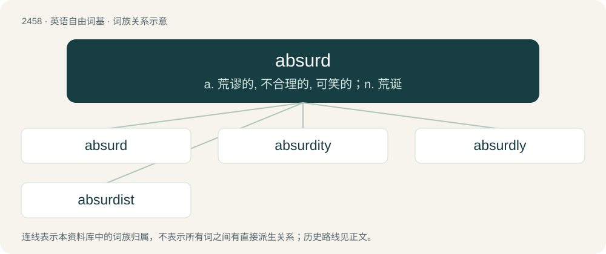

# 2561 · absurd — a. 荒谬的, 不合理的, 可笑的；n. 荒诞

[总目录](../00_总目录_按常用程度.md)

**类型**：英语自由词基　｜　**来源语言**：见词源记录

## 核心含义与来源

- 核心含义：a. 荒谬的, 不合理的, 可笑的；n. 荒诞
- 英文含义：Contrary to reason or propriety; obviously and flatly opposed to manifest truth; inconsistent with the plain dictates of common sense; logically contradictory; nonsensical; ridiculous; silly.
- 词形：absurd

**来源记录 1**（形容词；Contrary to reason or propriety; obviously and flatly opposed to manifest truth; inconsistent with the plain dictates of common sense; logically contradictory; nonsensical; ridiculous; silly.）

First attested in 1557. From Middle French absurde, from Latin absurdus (“incongruous, dissonant, out of tune”), from ab (“away from, out”) + surdus (“silent, deaf, dull-sounding”). Compare surd.

## 词族图

## 单词速览（常用到不常用）

| 单词 | 音标 | 释义 |
|---|---|---|
| [absurd](#w-1) | 英 /əbˈsɜːd/；美 /əbˈsɚd/ | a. 荒谬的, 不合理的, 可笑的；n. 荒诞 |
| [absurdity](#w-2) | 英 /əbˈsɜːd.ɪ.ti/；美 /æbˈsɝd.ɪ.ti/ | n. 荒谬, 悖理, 荒谬的言行 |
| [absurdly](#w-3) | 英 /əbˈsɜːd.li/；美 /æbˈsɝd.li/ | adv. 荒谬地, 荒唐地, 愚蠢地 |
| [absurdist](#w-4) | 英 /əbˈsɜːd.əst/；美 /æbˈsɝd.əst/ | n. 荒诞主义者 |

## 逐词详解

### 1. absurd

**词性**：形容词　｜　**音标**：英 /əbˈsɜːd/；美 /əbˈsɚd/

**中文释义**：a. 荒谬的, 不合理的, 可笑的；n. 荒诞

**英文义项**：Contrary to reason or propriety; obviously and flatly opposed to manifest truth; inconsistent with the plain dictates of common sense; logically contradictory; nonsensical; ridiculous; silly. / Having no rational or orderly relationship to people's lives; meaningless; lacking order or value.

**词源与演化**：

First attested in 1557. From Middle French absurde, from Latin absurdus (“incongruous, dissonant, out of tune”), from ab (“away from, out”) + surdus (“silent, deaf, dull-sounding”). Compare surd.

**例句**：

> The absurd predicament of seeming to argue that virtue is highly desirable but intensely unpleasant.

该用例对应义项：inconsistent with reason or logic or common sense

### 2. absurdity

**词性**：名词　｜　**音标**：英 /əbˈsɜːd.ɪ.ti/；美 /æbˈsɝd.ɪ.ti/

**中文释义**：n. 荒谬, 悖理, 荒谬的言行

**英文义项**：That which is absurd; an absurd action; a logical contradiction. / The quality of being absurd or inconsistent with obvious truth, reason, or sound judgment.

**构词拆分**：absurd + -ity

**词源与演化**：

First attested around 1472. From Middle English absurdite, then from either Middle French absurdité, or from Late Latin absurditas (“dissonance, incongruity”), from Latin absurdus + -itas (“quality, state, degree”). Equivalent to absurd + -ity.

**例句**：

> They say everything's bigger in Texas, and that includes absurdity in law enforcement.

### 3. absurdly

**词性**：副词　｜　**音标**：英 /əbˈsɜːd.li/；美 /æbˈsɝd.li/

**中文释义**：adv. 荒谬地, 荒唐地, 愚蠢地

**英文义项**：In an absurd fashion. / To an extreme degree.

**构词拆分**：absurd + -ly

**词源与演化**：

From absurd + -ly.

**例句**：

> The critics were absurdly extravagant with their praise.

该用例对应义项：To an extreme degree.

### 4. absurdist

**词性**：名词　｜　**音标**：英 /əbˈsɜːd.əst/；美 /æbˈsɝd.əst/

**中文释义**：n. 荒诞主义者

**英文义项**：An advocate of absurdism, in particular a writer of absurd topics.

**构词拆分**：absurd + -ist

**词源与演化**：

From absurd + -ist.
