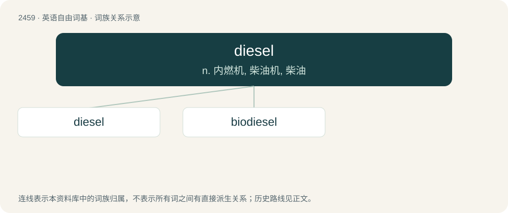

# 2563 · diesel — n. 内燃机, 柴油机, 柴油

[总目录](../00_总目录_按常用程度.md)

**类型**：英语自由词基　｜　**来源语言**：见词源记录

## 核心含义与来源

- 核心含义：n. 内燃机, 柴油机, 柴油
- 英文含义：A fuel derived from petroleum (or other oils) but heavier than gasoline/petrol. Used to power diesel engines which burn this fuel using the heat produced when air is compressed.
- 词形：diesel

**来源记录 1**（名词；A fuel derived from petroleum (or other oils) but heavier than gasoline/petrol. Used to power diesel engines which burn this fuel using the heat produced when air is compressed.）

From German Diesel, named after inventor Rudolf Diesel, who developed a heavy-duty engine in Germany (1892–1897) and perfected it throughout his life.

## 词族图

## 单词速览（常用到不常用）

| 单词 | 音标 | 释义 |
|---|---|---|
| [diesel](#w-1) | 美 /ˈdisəl/；/ˈdiːzəl/ | n. 内燃机, 柴油机, 柴油 |
| [biodiesel](#w-2) | /ˈbaɪəʊdiːzl/ | 生物柴油 |

## 逐词详解

### 1. diesel

**词性**：名词　｜　**音标**：美 /ˈdisəl/；/ˈdiːzəl/

**中文释义**：n. 内燃机, 柴油机, 柴油

**英文义项**：A fuel derived from petroleum (or other oils) but heavier than gasoline/petrol. Used to power diesel engines which burn this fuel using the heat produced when air is compressed. / A vehicle powered by a diesel engine.

**词源与演化**：

From German Diesel, named after inventor Rudolf Diesel, who developed a heavy-duty engine in Germany (1892–1897) and perfected it throughout his life.

**例句**：

> They were chagrined to see that the price of diesel had climbed past six dollars a gallon.

该用例对应义项：A fuel derived from petroleum (or other oils) but heavier than gasoline/petrol. Used to power diesel engines which burn this fuel using the heat produced when air is compressed.

### 2. biodiesel

**词性**：名词　｜　**音标**：/ˈbaɪəʊdiːzl/

**中文释义**：生物柴油

**英文义项**：Fuel for diesel engines made from renewable organic raw materials, as opposed to fossil hydrocarbons.

**构词拆分**：bio- + diesel

**词源与演化**：

From bio- + diesel.
