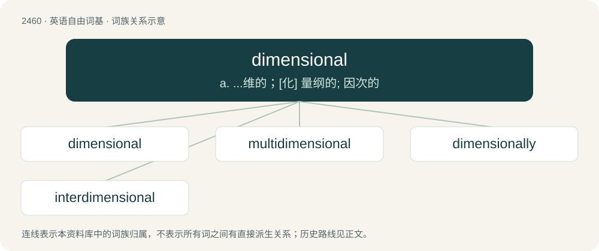

# 2564 · dimensional — a. ...维的；\[化\] 量纲的; 因次的

[总目录](../00_总目录_按常用程度.md)

**类型**：英语自由词基　｜　**来源语言**：见词源记录

## 核心含义与来源

- 核心含义：a. ...维的；\[化\] 量纲的; 因次的
- 英文含义：Of or pertaining to dimensions.
- 词形：dimensional

**来源记录 1**（形容词；Of or pertaining to dimensions.）

From dimension + -al.

## 词族图

## 单词速览（常用到不常用）

| 单词 | 音标 | 释义 |
|---|---|---|
| [dimensional](#w-1) | 英 /daɪˈmɛn.ʃə.nəl/ | a. ...维的；\[化\] 量纲的; 因次的 |
| [multidimensional](#w-2) | /.mʌltidiˈmenʃənl/ | a. 多面的, 多维的 |
| [dimensionally](#w-3) |  | adv. 在幅员上, 在尺寸上 |
| [interdimensional](#w-4) |  | 【英文】Between dimensions. |

## 逐词详解

### 1. dimensional

**词性**：形容词　｜　**音标**：英 /daɪˈmɛn.ʃə.nəl/

**中文释义**：a. ...维的；\[化\] 量纲的; 因次的

**英文义项**：Of or pertaining to dimensions. / Having dimension or dimensions; three-dimensional.

**构词拆分**：dimension + -al

**词源与演化**：

From dimension + -al.

**例句**：

> Never matures as a dimensional character; he is pasty, bland, faceless.

该用例对应义项：having dimension--the quality or character or stature proper to a person

### 2. multidimensional

**词性**：形容词　｜　**音标**：/.mʌltidiˈmenʃənl/

**中文释义**：a. 多面的, 多维的

**英文义项**：Having multiple dimensions (aspects). / Having more than two dimensions.

**构词拆分**：multi- + dimensional

**词源与演化**：

From multi- + dimensional.

**例句**：

> Tom is a multidimensional being whose real name is unpronounceable.

### 3. dimensionally

**词性**：副词

**中文释义**：adv. 在幅员上, 在尺寸上

**英文义项**：With regard to dimension.

**构词拆分**：dimensional + -ly

**词源与演化**：

From dimensional + -ly.

### 4. interdimensional

**词性**：形容词

**英文义项**：Between dimensions.

**构词拆分**：inter- + dimensional

**词源与演化**：

From inter- + dimensional.

**例句**：

> The spaceship made an interdimensional jump.

该用例对应义项：Between dimensions.
