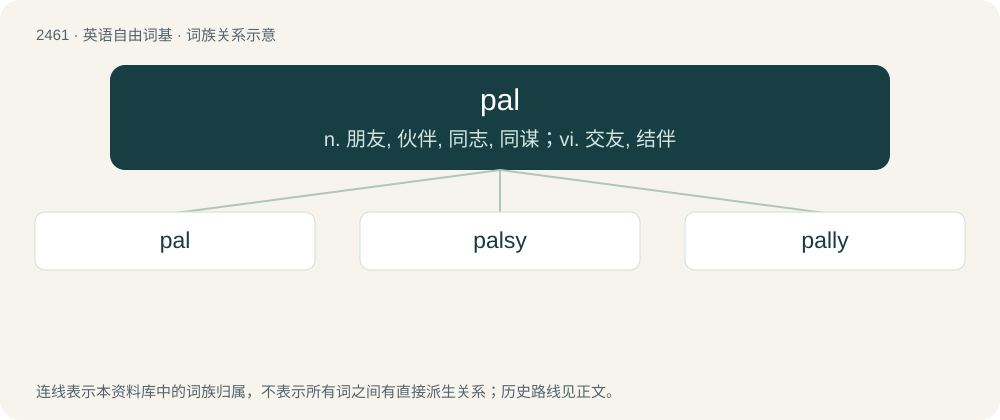

# 2565 · pal — n. 朋友, 伙伴, 同志, 同谋；vi. 交友, 结伴

[总目录](../00_总目录_按常用程度.md)

**类型**：英语自由词基　｜　**来源语言**：见词源记录

## 核心含义与来源

- 核心含义：n. 朋友, 伙伴, 同志, 同谋；vi. 交友, 结伴
- 英文含义：A friend, buddy, mate, cobber; someone to hang around with.
- 词形：pal

**来源记录 1**（名词；A friend, buddy, mate, cobber; someone to hang around with.）

Borrowed from Angloromani pal (“brother, friend”), from Romani phral (“brother”), from Sanskrit भ्रातृ (bhrātṛ, “brother”). Doublet of bhai, brother, bru, frater, friar, and vai.

## 词族图

## 单词速览（常用到不常用）

| 单词 | 音标 | 释义 |
|---|---|---|
| [pal](#w-1) | /pæl/ | n. 朋友, 伙伴, 同志, 同谋；vi. 交友, 结伴 |
| [palsy](#w-2) | 英 /ˈpælzi/ | 【英文】Chummy, friendly. |
| [pally](#w-3) | 英 /ˈpali/ | a. 亲密的 |

## 逐词详解

### 1. pal

**词性**：名词　｜　**音标**：/pæl/

**中文释义**：n. 朋友, 伙伴, 同志, 同谋；vi. 交友, 结伴

**英文义项**：A friend, buddy, mate, cobber; someone to hang around with. / An informal term of address, often used ironically in a hostile way.

**词源与演化**：

Borrowed from Angloromani pal (“brother, friend”), from Romani phral (“brother”), from Sanskrit भ्रातृ (bhrātṛ, “brother”). Doublet of bhai, brother, bru, frater, friar, and vai.

**例句**：

> Don't you threaten me, pal – I'll report you to the police.

该用例对应义项：An informal term of address, often used ironically in a hostile way.

### 2. palsy

**词性**：形容词　｜　**音标**：英 /ˈpælzi/

**英文义项**：Chummy, friendly.

**构词拆分**：From pal + -sy.

**词源与演化**：

From pal + -sy.

### 3. pally

**词性**：形容词　｜　**音标**：英 /ˈpali/

**中文释义**：a. 亲密的

**英文义项**：Like a pal; friendly.

**构词拆分**：pal + -y (adjectival suffix)

**词源与演化**：

From pal + -y (adjectival suffix). Piecewise doublet of friary.
