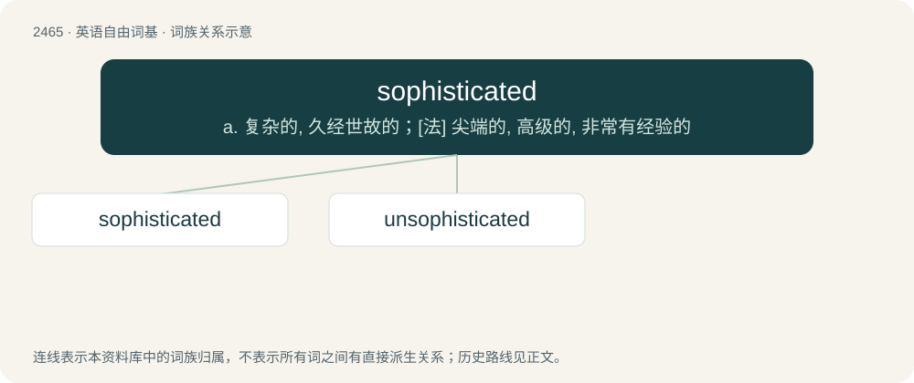

# 2566 · sophisticated — a. 复杂的, 久经世故的；\[法\] 尖端的, 高级的, 非常有经验的

[总目录](../00_总目录_按常用程度.md)

**类型**：英语自由词基　｜　**来源语言**：见词源记录

## 核心含义与来源

- 核心含义：a. 复杂的, 久经世故的；\[法\] 尖端的, 高级的, 非常有经验的
- 英文含义：Of a person: having obtained worldly experience, and lacking naiveté; cosmopolitan, worldly-wise.
- 词形：sophisticated

**来源记录 1**（形容词；Of a person: having obtained worldly experience, and lacking naiveté; cosmopolitan, worldly-wise.）

First English usage circa 1601. From Medieval Latin sophisticatus.

## 词族图

## 单词速览（常用到不常用）

| 单词 | 音标 | 释义 |
|---|---|---|
| [sophisticated](#w-1) | /səˈfistikeitid/ | a. 复杂的, 久经世故的；\[法\] 尖端的, 高级的, 非常有经验的 |
| [unsophisticated](#w-2) | /.ʌnsəˈfistikeitid/ | a. 不懂世故的, 单纯的, 不精细的, 纯洁的 |

## 逐词详解

### 1. sophisticated

**词性**：形容词　｜　**音标**：/səˈfistikeitid/

**中文释义**：a. 复杂的, 久经世故的；\[法\] 尖端的, 高级的, 非常有经验的

**英文义项**：Of a person: having obtained worldly experience, and lacking naiveté; cosmopolitan, worldly-wise. / Of art or other things: appealing to the tastes of an intellectual or sophisticated (sense 1) person; cerebral; also, cultured, elegant, refined.

**词源与演化**：

First English usage circa 1601. From Medieval Latin sophisticatus.

**例句**：

> A sophisticated electronic control system.

该用例对应义项：ahead in development; complex or intricate

### 2. unsophisticated

**词性**：形容词　｜　**音标**：/.ʌnsəˈfistikeitid/

**中文释义**：a. 不懂世故的, 单纯的, 不精细的, 纯洁的

**英文义项**：Not sophisticated; lacking sophistication.

**构词拆分**：From un- + sophisticated.

**词源与演化**：

From un- + sophisticated.

**例句**：

> Either too unsophisticated or too honest to promise more than he could deliver.

该用例对应义项：not wise in the ways of the world
