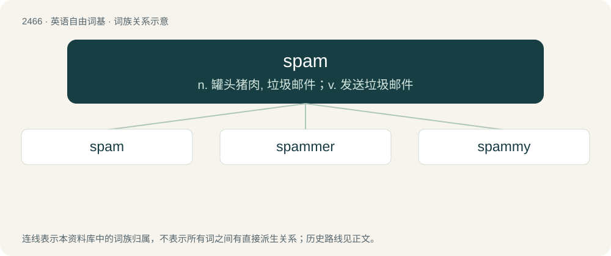

# 2567 · spam — n. 罐头猪肉, 垃圾邮件；v. 发送垃圾邮件

[总目录](../00_总目录_按常用程度.md)

**类型**：英语自由词基　｜　**来源语言**：见词源记录

## 核心含义与来源

- 核心含义：n. 罐头猪肉, 垃圾邮件；v. 发送垃圾邮件
- 英文含义：Unsolicited bulk electronic messages.
- 词形：spam

**来源记录 1**（名词；Unsolicited bulk electronic messages.）

The original sense (canned ham) is a proprietary name registered by Geo. A. Hormel & Co. in U.S., 1937. It is presumed to be a conflation of either "spiced ham" or "shoulder of pork and ham" but was soon extended to other kinds of canned meat. Hormel spells the trademarked name in all upper case. The use for unsolicited and unwanted email derives from a Monty Python's Flying Circus sketch. In the 1970 sketch, a group of Vikings in a restaurant repeatedly chant the word "spam". The earliest recorded real-life use for this sense occurs around 1993 which finds reference in a newsgroup post dated March 31, 1993, but the term may have been in use on "Multi-User Dungeons" (MUDs) in the 1980s.

## 词族图

## 单词速览（常用到不常用）

| 单词 | 音标 | 释义 |
|---|---|---|
| [spam](#w-1) | 英 /spæm/；/spæm/ | n. 罐头猪肉, 垃圾邮件；v. 发送垃圾邮件 |
| [spammer](#w-2) | /ˈspæmə/ | n. 垃圾邮件制作者 |
| [spammy](#w-3) | 英 /ˈspæm.i/ | 【英文】Resembling or characteristic of spam (the meat product). |

## 逐词详解

### 1. spam

**词性**：名词　｜　**音标**：英 /spæm/；/spæm/

**中文释义**：n. 罐头猪肉, 垃圾邮件；v. 发送垃圾邮件

**英文义项**：Unsolicited bulk electronic messages. / Any undesired electronic content automatically generated for commercial purposes.

**词源与演化**：

The original sense (canned ham) is a proprietary name registered by Geo. A. Hormel & Co. in U.S., 1937. It is presumed to be a conflation of either "spiced ham" or "shoulder of pork and ham" but was soon extended to other kinds of canned meat. Hormel spells the trademarked name in all upper case. The use for unsolicited and unwanted email derives from a Monty Python's Flying Circus sketch. In the 1970 sketch, a group of Vikings in a restaurant repeatedly chant the word "spam". The earliest recorded real-life use for this sense occurs around 1993 which finds reference in a newsgroup post dated March 31, 1993, but the term may have been in use on "Multi-User Dungeons" (MUDs) in the 1980s.

**例句**：

> I received 58 spams yesterday.

该用例对应义项：Unsolicited bulk electronic messages.

### 2. spammer

**词性**：名词　｜　**音标**：/ˈspæmə/

**中文释义**：n. 垃圾邮件制作者

**英文义项**：Someone who sends spam.

**构词拆分**：From spam + -er.

**词源与演化**：

From spam + -er.

### 3. spammy

**词性**：形容词　｜　**音标**：英 /ˈspæm.i/

**英文义项**：Resembling or characteristic of spam (the meat product). / Of, pertaining to, being, or resembling spam (junk e-mail).

**构词拆分**：spam + -y

**词源与演化**：

From spam + -y.

**例句**：

> I don't think your posts are spammy.
