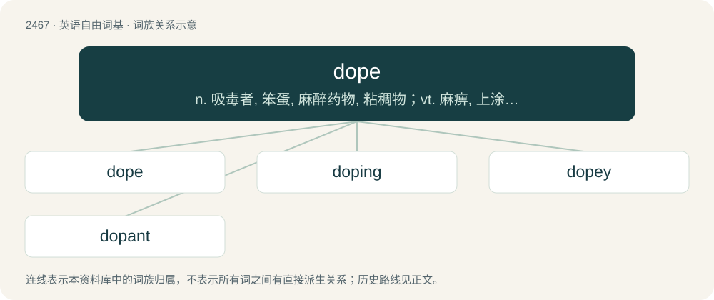

# 2568 · dope — n. 吸毒者, 笨蛋, 麻醉药物, 粘稠物；vt. 麻痹, 上涂料, 预测出；vi. 吸毒

[总目录](../00_总目录_按常用程度.md)

**类型**：英语自由词基　｜　**来源语言**：见词源记录

## 核心含义与来源

- 核心含义：n. 吸毒者, 笨蛋, 麻醉药物, 粘稠物；vt. 麻痹, 上涂料, 预测出；vi. 吸毒
- 英文含义：Any viscous liquid or paste, such as a lubricant, used in preparing a surface.
- 词形：dope

**来源记录 1**（名词；Any viscous liquid or paste, such as a lubricant, used in preparing a surface.）

From Dutch doop (“thick dipping sauce”), from Dutch dopen (“to dip”), from Middle Dutch dopen, from Old Dutch \*dōpen, from Frankish \*daupijan, from Proto-Germanic \*daupijaną. “Doop” in the sense “narcotic drug” ultimately refers to viscous opium juice, the drug of choice of the ancient Greeks; “insider information” perhaps from knowing which horse had been doped in a race. Sense of "stupid person" perhaps following from the drug sense (i.e. relating to those intoxicated on opium), compare dope up. Related to English dip and German taufen. Unrelated to dopamine.

## 词族图

## 单词速览（常用到不常用）

| 单词 | 音标 | 释义 |
|---|---|---|
| [dope](#w-1) | /dəup/ | n. 吸毒者, 笨蛋, 麻醉药物, 粘稠物；vt. 麻痹, 上涂料, 预测出；vi. 吸毒 |
| [doping](#w-2) | 美 /ˈdoʊpɪŋ/ | \[计\] 掺杂；\[化\] 掺杂 |
| [dopey](#w-3) | /ˈdəʊpi/ | a. 被麻醉的, 呆笨的, 迟钝的 |
| [dopant](#w-4) | /ˈdəʊpənt/ | n. 掺杂物, 掺杂剂；\[计\] 掺杂物 |

## 逐词详解

### 1. dope

**词性**：名词　｜　**音标**：/dəup/

**中文释义**：n. 吸毒者, 笨蛋, 麻醉药物, 粘稠物；vt. 麻痹, 上涂料, 预测出；vi. 吸毒

**英文义项**：Any viscous liquid or paste, such as a lubricant, used in preparing a surface. / An absorbent material used to hold a liquid.

**词源与演化**：

From Dutch doop (“thick dipping sauce”), from Dutch dopen (“to dip”), from Middle Dutch dopen, from Old Dutch \*dōpen, from Frankish \*daupijan, from Proto-Germanic \*daupijaną. “Doop” in the sense “narcotic drug” ultimately refers to viscous opium juice, the drug of choice of the ancient Greeks; “insider information” perhaps from knowing which horse had been doped in a race. Sense of "stupid person" perhaps following from the drug sense (i.e. relating to those intoxicated on opium), compare dope up. Related to English dip and German taufen. Unrelated to dopamine.

**例句**：

> What's the latest dope on the stock market?

该用例对应义项：Information, usually from an inside source, originally in horse racing and other sports.

### 2. doping

**词性**：名词　｜　**音标**：美 /ˈdoʊpɪŋ/

**中文释义**：\[计\] 掺杂；\[化\] 掺杂

**英文义项**：The use of drugs to improve athletic performance. / The addition of small quantities of an element (a dopant) to a semiconductor to change its characteristics.

**构词拆分**：dope + -ing

**词源与演化**：

From dope + -ing.

**例句**：

> The Olympic Games ceremoniously celebrate the triumph of nationalism, doping and commerce.

### 3. dopey

**词性**：形容词　｜　**音标**：/ˈdəʊpi/

**中文释义**：a. 被麻醉的, 呆笨的, 迟钝的

**英文义项**：Stupid, silly.

**构词拆分**：dope + -y

**词源与演化**：

From dope (“stupid person”) + -y.

**例句**：

> Tom often has a dopey expression on his face.

### 4. dopant

**词性**：名词　｜　**音标**：/ˈdəʊpənt/

**中文释义**：n. 掺杂物, 掺杂剂；\[计\] 掺杂物

**英文义项**：A substance added in small amounts to a pure material, such as semiconductor, to alter its original electrical or optical properties; a doping agent.

**构词拆分**：dope + -ant

**词源与演化**：

From dope + -ant.

**例句**：

> The dopant that gives rubies their red color is chromium.
