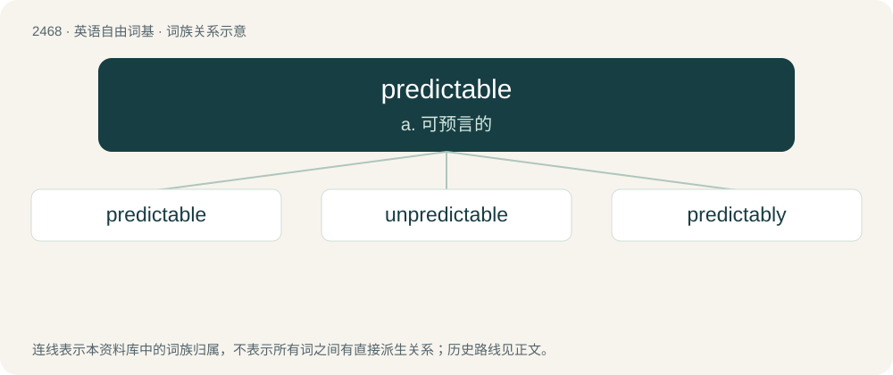

# 2569 · predictable — a. 可预言的

[总目录](../00_总目录_按常用程度.md)

**类型**：英语自由词基　｜　**来源语言**：见词源记录

## 核心含义与来源

- 核心含义：a. 可预言的
- 英文含义：Able to be predicted.
- 词形：predictable

**来源记录 1**（形容词；Able to be predicted.）

From predict + -able.

## 词族图

## 单词速览（常用到不常用）

| 单词 | 音标 | 释义 |
|---|---|---|
| [predictable](#w-1) | /pɹəˈdɪktəbləl/ | a. 可预言的 |
| [unpredictable](#w-2) | /.ʌnpriˈdiktəbl/ | a. 不可预知的 |
| [predictably](#w-3) | /pɹəˈdɪk.tə.bli/ | adv. 可预言地 |

## 逐词详解

### 1. predictable

**词性**：形容词　｜　**音标**：/pɹəˈdɪktəbləl/

**中文释义**：a. 可预言的

**英文义项**：Able to be predicted.

**构词拆分**：predict + -able

**词源与演化**：

From predict + -able.

**用法示例／搭配（非完整句）**：

> a boring film with a predictable ending

该用例对应义项：Able to be predicted.

### 2. unpredictable

**词性**：形容词　｜　**音标**：/.ʌnpriˈdiktəbl/

**中文释义**：a. 不可预知的

**英文义项**：Unable to be predicted.

**构词拆分**：un- + predictable

**词源与演化**：

From un- + predictable.

**例句**：

> It's a combination of life being unpredictable, and you being super dumb.

### 3. predictably

**词性**：副词　｜　**音标**：/pɹəˈdɪk.tə.bli/

**中文释义**：adv. 可预言地

**英文义项**：In a manner that can be expected or anticipated.

**构词拆分**：predictable + -ly

**词源与演化**：

From predictable + -ly.

**例句**：

> Predictably, he did not like the news.

该用例对应义项：in a predictable manner or to a predictable degree
