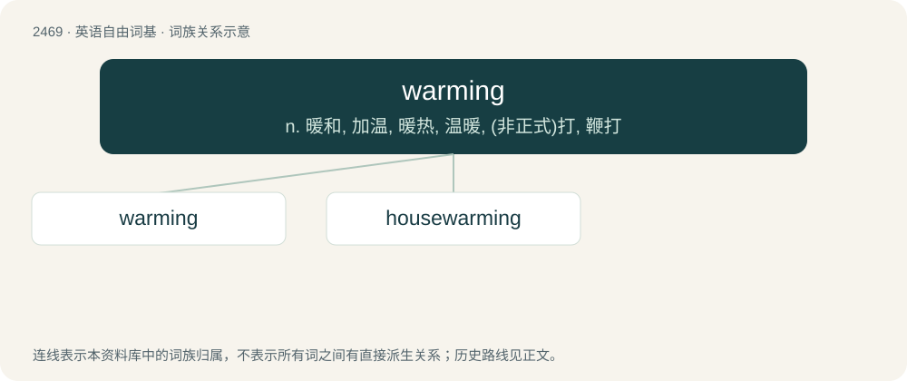

# 2570 · warming — n. 暖和, 加温, 暖热, 温暖, (非正式)打, 鞭打

[总目录](../00_总目录_按常用程度.md)

**类型**：英语自由词基　｜　**来源语言**：见词源记录

## 核心含义与来源

- 核心含义：n. 暖和, 加温, 暖热, 温暖, (非正式)打, 鞭打
- 英文含义：A small rise in temperature.
- 词形：warming

**来源记录 1**（名词；A small rise in temperature.）

From Middle English warmyng, warmynge, from Old English wærming, wirming, equivalent to warm + -ing.

## 词族图

## 单词速览（常用到不常用）

| 单词 | 音标 | 释义 |
|---|---|---|
| [warming](#w-1) | 英 /ˈwɔːmɪŋ/；美 /ˈwoɹmɪŋ/ | n. 暖和, 加温, 暖热, 温暖, (非正式)打, 鞭打 |
| [housewarming](#w-2) | /ˈhauswɒːmiŋ/ | n. 乔迁庆宴 |

## 逐词详解

### 1. warming

**词性**：名词　｜　**音标**：英 /ˈwɔːmɪŋ/；美 /ˈwoɹmɪŋ/

**中文释义**：n. 暖和, 加温, 暖热, 温暖, (非正式)打, 鞭打

**英文义项**：A small rise in temperature. / A beating; a thrashing.

**构词拆分**：warm + -ing

**词源与演化**：

From Middle English warmyng, warmynge, from Old English wærming, wirming, equivalent to warm + -ing.

**例句**：

> Red sky in morning; global warming. Red sky at night, reactor's alight.

### 2. housewarming

**词性**：名词　｜　**音标**：/ˈhauswɒːmiŋ/

**中文释义**：n. 乔迁庆宴

**英文义项**：A party to celebrate moving into a new home. / The act of welcoming a person/family to their newly purchased or newly rented home.

**构词拆分**：house + warming

**词源与演化**：

From house + warming.

**例句**：

> We bought our new neighbors a clock as a housewarming gift.
