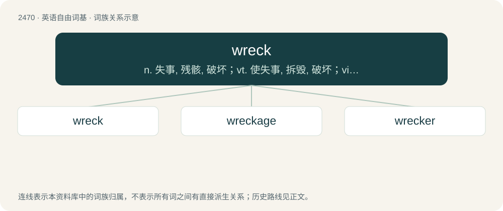

# 2571 · wreck — n. 失事, 残骸, 破坏；vt. 使失事, 拆毁, 破坏；vi. (船)失事, 营救失事船只

[总目录](../00_总目录_按常用程度.md)

**类型**：英语自由词基　｜　**来源语言**：见词源记录

## 核心含义与来源

- 核心含义：n. 失事, 残骸, 破坏；vt. 使失事, 拆毁, 破坏；vi. (船)失事, 营救失事船只
- 英文含义：Something or someone that has been ruined.
- 词形：wreck

**来源记录 1**（名词；Something or someone that has been ruined.）

From Middle English wrek, from Anglo-Norman wrek, from Old Norse \*wrek (whence Norwegian rek, Icelandic rek, Swedish vrak, Danish vrag), from Proto-Germanic \*wrekaną (“to pursue”, whence Old English wrecan (English wreak), Old Saxon wrekan, Old High German rëhhan, Gothic 𐍅𐍂𐌹𐌺𐌰𐌽 (wrikan)), from Proto-Indo-European \*wreg- (“to track; to hunt; to follow”).

## 词族图

## 单词速览（常用到不常用）

| 单词 | 音标 | 释义 |
|---|---|---|
| [wreck](#w-1) | /ˈɹɛk/ | n. 失事, 残骸, 破坏；vt. 使失事, 拆毁, 破坏；vi. (船)失事, 营救失事船只 |
| [wreckage](#w-2) | /ˈɹɛkɪdʒ/ | n. 残骸, 失事, 破坏；\[经\] (船双等的)失事遭难 |
| [wrecker](#w-3) | 美 /ˈɹɛkɚ/ | n. 寻觅失事船只者, 拆卸旧建筑物者, 破坏分子, 打捞者, 打捞船, 救险车 |

## 逐词详解

### 1. wreck

**词性**：名词　｜　**音标**：/ˈɹɛk/

**中文释义**：n. 失事, 残骸, 破坏；vt. 使失事, 拆毁, 破坏；vi. (船)失事, 营救失事船只

**英文义项**：Something or someone that has been ruined. / The remains of something that has been severely damaged or worn down.

**词源与演化**：

From Middle English wrek, from Anglo-Norman wrek, from Old Norse \*wrek (whence Norwegian rek, Icelandic rek, Swedish vrak, Danish vrag), from Proto-Germanic \*wrekaną (“to pursue”, whence Old English wrecan (English wreak), Old Saxon wrekan, Old High German rëhhan, Gothic 𐍅𐍂𐌹𐌺𐌰𐌽 (wrikan)), from Proto-Indo-European \*wreg- (“to track; to hunt; to follow”).

**例句**：

> He was an emotional wreck after the death of his wife.

该用例对应义项：Something or someone that has been ruined.

### 2. wreckage

**词性**：名词　｜　**音标**：/ˈɹɛkɪdʒ/

**中文释义**：n. 残骸, 失事, 破坏；\[经\] (船双等的)失事遭难

**英文义项**：Something wrecked, especially the remains or debris of something which has been severely damaged or destroyed.

**构词拆分**：wreck + -age

**词源与演化**：

From wreck + -age.

**例句**：

> They searched the wreckage for signs of survivors.

该用例对应义项：the remaining parts of something that has been wrecked

### 3. wrecker

**词性**：名词　｜　**音标**：美 /ˈɹɛkɚ/

**中文释义**：n. 寻觅失事船只者, 拆卸旧建筑物者, 破坏分子, 打捞者, 打捞船, 救险车

**英文义项**：A person or company that dismantles old or wrecked vehicles or other items, to reclaim useful parts. / One who breaks up situations or events.

**构词拆分**：wreck + -er

**词源与演化**：

From wreck + -er.

**用法示例／搭配（非完整句）**：

> home wrecker / marriage wrecker / party wrecker

该用例对应义项：One who breaks up situations or events.
