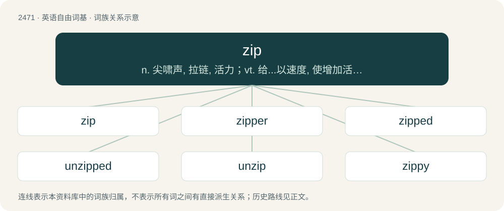

# 2572 · zip — n. 尖啸声, 拉链, 活力；vt. 给...以速度, 使增加活力, 拉(拉链)；vi. 有力而迅速地行动, 嘘嘘地响, 拉拉链

[总目录](../00_总目录_按常用程度.md)

**类型**：英语自由词基　｜　**来源语言**：见词源记录

## 核心含义与来源

- 核心含义：n. 尖啸声, 拉链, 活力；vt. 给...以速度, 使增加活力, 拉(拉链)；vi. 有力而迅速地行动, 嘘嘘地响, 拉拉链
- 英文含义：The high-pitched sound of a small object moving rapidly through air.
- 词形：zip

**来源记录 1**（名词；The high-pitched sound of a small object moving rapidly through air.）

Onomatopoeic.

## 词族图

## 单词速览（常用到不常用）

| 单词 | 音标 | 释义 |
|---|---|---|
| [zip](#w-1) | /zɪp/ | n. 尖啸声, 拉链, 活力；vt. 给...以速度, 使增加活力, 拉(拉链)；vi. 有力而迅速地行动, 嘘嘘地响, 拉拉链 |
| [zipper](#w-2) | 英 /ˈzɪpə(ɹ)/；美 /ˈzɪpɚ/ | n. 拉链 |
| [zipped](#w-3) |  | a. 用拉链扣上的 |
| [unzipped](#w-4) | /,ʌnˈzipt/ | a. 未拉上拉链的 |
| [unzip](#w-5) | /.ʌnˈzip/ | vi. 拉开拉链；vt. 拉开 |
| [zippy](#w-6) | 英 /ˈzɪpi/ | a. 元气旺盛的, 敏捷的, 活泼的 |
| [zippo](#w-7) | 英 /ˈzɪpəʊ/；美 /ˈzɪpoʊ/ | n. 汽油金属打火机 |
| [zipline](#w-8) | /ˈzɪpˌlaɪn/ | 【英文】A pulley suspended on a cable mounted on an incline, designed to enable a user to travel from one point to another by means of gravity. |

## 逐词详解

### 1. zip

**词性**：名词　｜　**音标**：/zɪp/

**中文释义**：n. 尖啸声, 拉链, 活力；vt. 给...以速度, 使增加活力, 拉(拉链)；vi. 有力而迅速地行动, 嘘嘘地响, 拉拉链

**英文义项**：The high-pitched sound of a small object moving rapidly through air. / Energy; vigor; vim.

**词源与演化**：

Onomatopoeic.

**例句**：

> I know zip about economics.

该用例对应义项：Zero; nothing.

### 2. zipper

**词性**：名词　｜　**音标**：英 /ˈzɪpə(ɹ)/；美 /ˈzɪpɚ/

**中文释义**：n. 拉链

**英文义项**：A zip fastener. / A pressure-sensitive plastic closure, as on a Ziploc bag.

**构词拆分**：zip + -er

**词源与演化**：

1925, zip + -er. The trade name was registered in 1925 by B.F. Goodrich for “boots made of rubber and fabric,” claiming use of the name since June 1923. No longer a registered trademark.

**例句**：

> He got his T-shirt stuck in the zipper of his jacket.

该用例对应义项：A zip fastener.

### 3. zipped

**词性**：形容词

**中文释义**：a. 用拉链扣上的

**英文义项**：Addressed with a zip code.

**构词拆分**：From zip + -ed.

**词源与演化**：

From zip + -ed.

**例句**：

> We zipped our two sleeping bags together to make one big sleeping bag.

### 4. unzipped

**词性**：形容词　｜　**音标**：/,ʌnˈzipt/

**中文释义**：a. 未拉上拉链的

**英文义项**：Not zipped (closed with a zip fastener). / Not zipped (compressed into a single and often smaller file, especially a zip file).

**构词拆分**：un- + zip + -ed

**词源与演化**：

From un- + zip + -ed.

**例句**：

> Tom put his duffel bag down on the ground, and then unzipped it.

### 5. unzip

**词性**：动词　｜　**音标**：/.ʌnˈzip/

**中文释义**：vi. 拉开拉链；vt. 拉开

**英文义项**：To open something using a zipper. / To come open by means of a zipper.

**构词拆分**：un- + zip

**词源与演化**：

From un- + zip.

**例句**：

> Unzip the outfit carefully if the baby is squirming.

### 6. zippy

**词性**：形容词　｜　**音标**：英 /ˈzɪpi/

**中文释义**：a. 元气旺盛的, 敏捷的, 活泼的

**英文义项**：Energetic and lively. / Quick, speedy.

**构词拆分**：zip (“to move in haste; to make (something) move quickly”) + -y (suffix forming adjectives meaning ‘having the quality of’)

**词源与演化**：

From zip (“to move in haste; to make (something) move quickly”) + -y (suffix forming adjectives meaning ‘having the quality of’).

### 7. zippo

**词性**：名词　｜　**音标**：英 /ˈzɪpəʊ/；美 /ˈzɪpoʊ/

**中文释义**：n. 汽油金属打火机

**英文义项**：Zero. Typically used for emphasis, as when the listener might expect a positive quantity.

**构词拆分**：zip + -o

**词源与演化**：

From zip + -o.

**例句**：

> We got 200 consoles and we sold 200 consoles and 200 minus 200 is ZIPPO, so I can't sell you anything right now.

该用例对应义项：Zero. Typically used for emphasis, as when the listener might expect a positive quantity.

### 8. zipline

**词性**：名词　｜　**音标**：/ˈzɪpˌlaɪn/

**英文义项**：A pulley suspended on a cable mounted on an incline, designed to enable a user to travel from one point to another by means of gravity. / A trip on a zipline.

**构词拆分**：zip + line

**词源与演化**：

From zip + line.

**例句**：

> Benedito wants to ride a zipline in Costa Rica.
