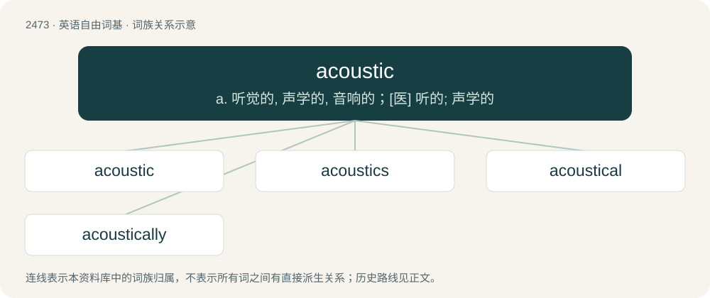

# 2574 · acoustic — a. 听觉的, 声学的, 音响的；\[医\] 听的; 声学的

[总目录](../00_总目录_按常用程度.md)

**类型**：英语自由词基　｜　**来源语言**：见词源记录

## 核心含义与来源

- 核心含义：a. 听觉的, 声学的, 音响的；\[医\] 听的; 声学的
- 英文含义：Used for soundproofing or modifying sound.
- 词形：acoustic

**来源记录 1**（形容词；Used for soundproofing or modifying sound.）

Borrowed from Medieval Latin acousticus, acūsticus, from Ancient Greek ἀκουστῐκός (akoustĭkós, “of or for hearing”), from ἀκούω (akoúō, “to hear”) + -ῐκός (-ĭkós, adjectival suffix).

## 词族图

## 单词速览（常用到不常用）

| 单词 | 音标 | 释义 |
|---|---|---|
| [acoustic](#w-1) | 英 /əˈkuː.stɪk/；美 /əˈku.stɪk/ | a. 听觉的, 声学的, 音响的；\[医\] 听的; 声学的 |
| [acoustics](#w-2) | /əˈkuː.stɪks/ | n. 音响效果, 声学；\[化\] 声学 |
| [acoustical](#w-3) | /əˈkuː.stɪk.əl/ | a. 听觉的, 声学的 |
| [acoustically](#w-4) | /əˈkuːstɪkəlɪ/ | adv. 听觉上；声学上 |

## 逐词详解

### 1. acoustic

**词性**：形容词　｜　**音标**：英 /əˈkuː.stɪk/；美 /əˈku.stɪk/

**中文释义**：a. 听觉的, 声学的, 音响的；\[医\] 听的; 声学的

**英文义项**：Used for soundproofing or modifying sound. / Of a device or system, using sound energy in its operation.

**词源与演化**：

Borrowed from Medieval Latin acousticus, acūsticus, from Ancient Greek ἀκουστῐκός (akoustĭkós, “of or for hearing”), from ἀκούω (akoúō, “to hear”) + -ῐκός (-ĭkós, adjectival suffix).

**用法示例／搭配（非完整句）**：

> acoustic guitar, acoustic piano

该用例对应义项：Naturally producing or produced by an instrument without electrical amplification or the need thereof.

### 2. acoustics

**词性**：名词　｜　**音标**：/əˈkuː.stɪks/

**中文释义**：n. 音响效果, 声学；\[化\] 声学

**英文义项**：The science of sounds, teaching their nature, phenomena and laws. / The properties of a space that affect how sound carries.

**构词拆分**：acoustic + -s

**词源与演化**：

From acoustic + -s.

**例句**：

> The acoustics in the opera house gave the whole concert a spooky sound.

该用例对应义项：The properties of a space that affect how sound carries.

### 3. acoustical

**词性**：形容词　｜　**音标**：/əˈkuː.stɪk.əl/

**中文释义**：a. 听觉的, 声学的

**英文义项**：Of or pertaining to hearing or acoustics.

**构词拆分**：acoustic + -al

**词源与演化**：

From acoustic + -al.

**例句**：

> American and Canadian scientists are hoping that the 560-kilogram Orca will reunite with her family group by communicating through their unique acoustical vocal patterns.

### 4. acoustically

**词性**：副词　｜　**音标**：/əˈkuːstɪkəlɪ/

**中文释义**：adv. 听觉上；声学上

**英文义项**：In an acoustic manner, or using an acoustic musical instrument. / From the perspective of acoustics.

**构词拆分**：acoustic + -ally + acoustical + -ly

**词源与演化**：

From acoustic + -ally, or from acoustical + -ly.
