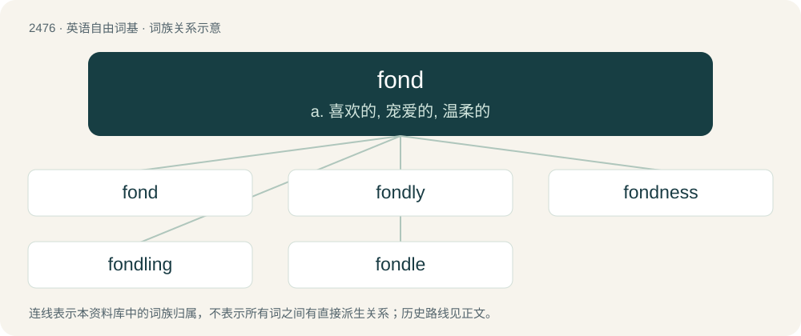

# 2576 · fond — a. 喜欢的, 宠爱的, 温柔的

[总目录](../00_总目录_按常用程度.md)

**类型**：英语自由词基　｜　**来源语言**：见词源记录

## 核心含义与来源

- 核心含义：a. 喜欢的, 宠爱的, 温柔的
- 英文含义：Having a liking or affection (for).
- 词形：fond

**多个词源／构词路径**：同一拼写可能有不同来源；以下按词性和含义分别列出。

**来源记录 1**（形容词；Having a liking or affection (for).）

From Middle English fond, fonned, past participle of fonnen (“to be foolish, be simple, dote”), equivalent to fon + -ed. More at fon.

**来源记录 2**（名词；The background design in lace-making.）

From French, ultimately from Latin fundus. Doublet of fund and fundus.

## 词族图

## 单词速览（常用到不常用）

| 单词 | 音标 | 释义 |
|---|---|---|
| [fond](#w-1) | 英 /fɒnd/；美 /fɑnd/ | a. 喜欢的, 宠爱的, 温柔的 |
| [fondly](#w-2) | 英 /ˈfɒndli/；美 /ˈfɑndli/ | adv. 溺爱地, 怜爱地, 情柔地 |
| [fondness](#w-3) | 英 /ˈfɒndnəs/；美 /ˈfɑndnəs/ | n. 溺爱；爱好 |
| [fondling](#w-4) | /ˈfɒndlɪŋ/ | n. 被溺爱的人, 爱子, 宠爱的动物 |
| [fondle](#w-5) | /ˈfɒndəl/ | vt. 爱, 爱抚, 溺爱；vi. 爱抚 |

## 逐词详解

### 1. fond

**词性**：形容词　｜　**音标**：英 /fɒnd/；美 /fɑnd/

**中文释义**：a. 喜欢的, 宠爱的, 温柔的

**英文义项**：Having a liking or affection (for). / Affectionate.

**构词拆分**：fon + -ed

**词源与演化**：

From Middle English fond, fonned, past participle of fonnen (“to be foolish, be simple, dote”), equivalent to fon + -ed. More at fon.

**例句**：

> Your fond dreams of flying to Jupiter have been quashed by the facts of reality.

该用例对应义项：Outlandish; foolish; silly.

### 2. fondly

**词性**：副词　｜　**音标**：英 /ˈfɒndli/；美 /ˈfɑndli/

**中文释义**：adv. 溺爱地, 怜爱地, 情柔地

**英文义项**：In a fond manner; affectionately; tenderly. / Foolishly.

**构词拆分**：fond + -ly

**词源与演化**：

From Middle English fondly, fondely, fonnedli, equivalent to fond + -ly.

**例句**：

> He looked fondly at the pictures of his high-school friends.

该用例对应义项：In a fond manner; affectionately; tenderly.

### 3. fondness

**词性**：名词　｜　**音标**：英 /ˈfɒndnəs/；美 /ˈfɑndnəs/

**中文释义**：n. 溺爱；爱好

**英文义项**：The quality of being fond: liking something, foolishness; doting affection; propensity.

**构词拆分**：fond + -ness

**词源与演化**：

From Middle English fondnes, fondnesse, fonnednesse, equivalent to fond + -ness.

**例句**：

> Fondness is one thing, sex with a minor is something else entirely.

### 4. fondling

**词性**：名词　｜　**音标**：/ˈfɒndlɪŋ/

**中文释义**：n. 被溺爱的人, 爱子, 宠爱的动物

**英文义项**：A pet or person who is fondled; someone who is much loved.

**构词拆分**：From fond + -ling.

**词源与演化**：

From fond + -ling.

**例句**：

> Skura woke up to find Yanni fondling her.

### 5. fondle

**词性**：动词　｜　**音标**：/ˈfɒndəl/

**中文释义**：vt. 爱, 爱抚, 溺爱；vi. 爱抚

**英文义项**：To touch or stroke lovingly. / To grasp.

**构词拆分**：fond + -le

**词源与演化**：

From fond (“love, admire”) + -le (frequentative suffix).

**例句**：

> Mothers fondle their babies.

该用例对应义项：To touch or stroke lovingly.
