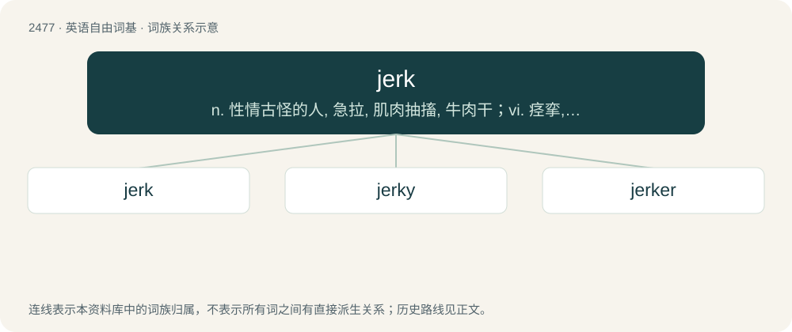

# 2577 · jerk — n. 性情古怪的人, 急拉, 肌肉抽搐, 牛肉干；vi. 痉挛, 急拉, 急推；vt. 猛拉

[总目录](../00_总目录_按常用程度.md)

**类型**：英语自由词基　｜　**来源语言**：见词源记录

## 核心含义与来源

- 核心含义：n. 性情古怪的人, 急拉, 肌肉抽搐, 牛肉干；vi. 痉挛, 急拉, 急推；vt. 猛拉
- 英文含义：A sudden, often uncontrolled movement, especially of the human body.
- 词形：jerk

**多个词源／构词路径**：同一拼写可能有不同来源；以下按词性和含义分别列出。

**来源记录 1**（名词；A sudden, often uncontrolled movement, especially of the human body.）

Probably from Middle English yerk (“sudden motion”) and Middle English yerkid (“tightly pulled”), from Old English ġearc (“ready, active, quick”) and Old English ġearcian (“to prepare, make ready, procure, furnish, supply”). Cognate with Scots yerk (“to jerk”). Related also to English yare (“ready”).

**来源记录 2**（名词；A rich, spicy Jamaican marinade.）

Denominal verb of jerky, itself borrowed from Spanish charqui, from Quechua ch'arki.

## 词族图

## 单词速览（常用到不常用）

| 单词 | 音标 | 释义 |
|---|---|---|
| [jerk](#w-1) | 英 /ˈd͡ʒɜːk/；美 /ˈd͡ʒɝk/ | n. 性情古怪的人, 急拉, 肌肉抽搐, 牛肉干；vi. 痉挛, 急拉, 急推；vt. 猛拉 |
| [jerky](#w-2) | 英 /ˈd͡ʒɜːki/；美 /ˈd͡ʒɝki/ | a. 急动的, 抽筋的, 不平稳的；n. 牛肉干 |
| [jerker](#w-3) |  | n. 小型单缸柱塞泵；海关检查员；肌肉抽搐 |

## 逐词详解

### 1. jerk

**词性**：名词　｜　**音标**：英 /ˈd͡ʒɜːk/；美 /ˈd͡ʒɝk/

**中文释义**：n. 性情古怪的人, 急拉, 肌肉抽搐, 牛肉干；vi. 痉挛, 急拉, 急推；vt. 猛拉

**英文义项**：A sudden, often uncontrolled movement, especially of the human body. / A quick pull on something.

**词源与演化**：

Probably from Middle English yerk (“sudden motion”) and Middle English yerkid (“tightly pulled”), from Old English ġearc (“ready, active, quick”) and Old English ġearcian (“to prepare, make ready, procure, furnish, supply”). Cognate with Scots yerk (“to jerk”). Related also to English yare (“ready”).

**例句**：

> I finally fired him, because he was being a real jerk to his customers, even to some of the staff.

该用例对应义项：A person with unlikable or obnoxious qualities and behavior, typically mean, immoral, self-centered, or disagreeable.

### 2. jerky

**词性**：形容词　｜　**音标**：英 /ˈd͡ʒɜːki/；美 /ˈd͡ʒɝki/

**中文释义**：a. 急动的, 抽筋的, 不平稳的；n. 牛肉干

**英文义项**：Characterized by physical jerking, or by sudden and uneven progress. / Having the behavior of a jerk (unpleasant person).

**构词拆分**：jerk + -y

**词源与演化**：

From jerk + -y.

**用法示例／搭配（非完整句）**：

> jerky behaviour

该用例对应义项：Having the behavior of a jerk (unpleasant person).

### 3. jerker

**词性**：名词

**中文释义**：n. 小型单缸柱塞泵；海关检查员；肌肉抽搐

**英文义项**：A North American river chub, a hornyhead chub (Nocomis biguttatus). / Someone or something that jerks.

**构词拆分**：jerk + -er

**词源与演化**：

From jerk + -er.
