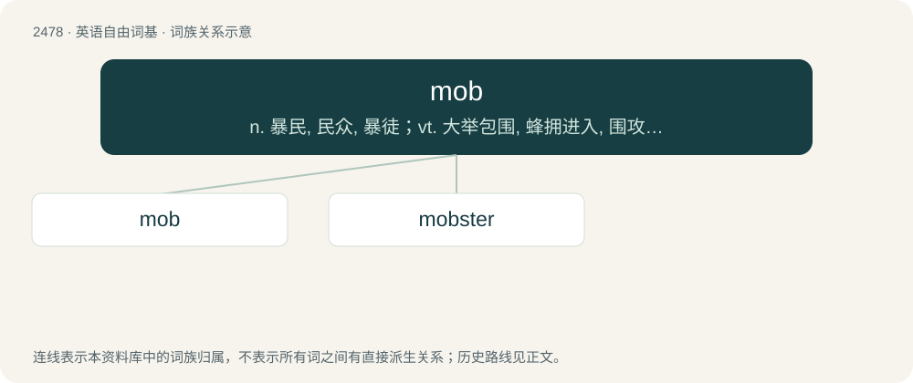

# 2578 · mob — n. 暴民, 民众, 暴徒；vt. 大举包围, 蜂拥进入, 围攻；vi. 聚众生事

[总目录](../00_总目录_按常用程度.md)

**类型**：英语自由词基　｜　**来源语言**：见词源记录

## 核心含义与来源

- 核心含义：n. 暴民, 民众, 暴徒；vt. 大举包围, 蜂拥进入, 围攻；vi. 聚众生事
- 英文含义：A large or disorderly group of people; especially one bent on riotous or destructive action.
- 词形：mob

**多个词源／构词路径**：同一拼写可能有不同来源；以下按词性和含义分别列出。

**来源记录 1**（名词；A large or disorderly group of people; especially one bent on riotous or destructive action.）

From Middle English mob, short for mobile, from Latin mōbile (vulgus) (“fickle (crowd)”).

**来源记录 2**（名词；A mob cap.）

Alteration of mab.

**来源记录 3**（名词；A creature or non-player character, especially one meant to be fought or killed.）

Clipping of mobile. The video-gaming sense is sometimes reported as an abbreviation of man or beast or of mobile object, but these are backronyms.

## 词族图

## 单词速览（常用到不常用）

| 单词 | 音标 | 释义 |
|---|---|---|
| [mob](#w-1) | 英 /mɒb/；美 /mɑb/ | n. 暴民, 民众, 暴徒；vt. 大举包围, 蜂拥进入, 围攻；vi. 聚众生事 |
| [mobster](#w-2) | 英 /ˈmɒb.stə/；美 /ˈmɑb.stɚ/ | n. 犯罪集团成员；\[法\] 暴徒, 盗匪 |

## 逐词详解

### 1. mob

**词性**：动词　｜　**音标**：英 /mɒb/；美 /mɑb/

**中文释义**：n. 暴民, 民众, 暴徒；vt. 大举包围, 蜂拥进入, 围攻；vi. 聚众生事

**英文义项**：To crowd around (someone), sometimes with hostility. / To crowd into or around a place.

**词源与演化**：

From Middle English mob, short for mobile, from Latin mōbile (vulgus) (“fickle (crowd)”).

**例句**：

> Mary and Tom were lynched to death by an angry Tatoeba mob.

### 2. mobster

**词性**：名词　｜　**音标**：英 /ˈmɒb.stə/；美 /ˈmɑb.stɚ/

**中文释义**：n. 犯罪集团成员；\[法\] 暴徒, 盗匪

**英文义项**：A member of a mob or Mafia.

**构词拆分**：mob + -ster

**词源与演化**：

From mob + -ster.

**例句**：

> Meyer Lansky was a Jewish mobster and close associate of "Lucky" Luciano.
