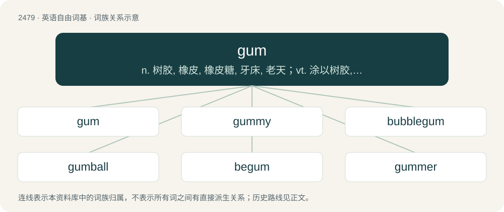

# 2579 · gum — n. 树胶, 橡皮, 橡皮糖, 牙床, 老天；vt. 涂以树胶, 用胶粘, 使有粘性；vi. 分泌树胶, 发粘

[总目录](../00_总目录_按常用程度.md)

**类型**：英语自由词基　｜　**来源语言**：见词源记录

## 核心含义与来源

- 核心含义：n. 树胶, 橡皮, 橡皮糖, 牙床, 老天；vt. 涂以树胶, 用胶粘, 使有粘性；vi. 分泌树胶, 发粘
- 英文含义：The flesh around the teeth.
- 词形：gum

**多个词源／构词路径**：同一拼写可能有不同来源；以下按词性和含义分别列出。

**来源记录 1**（名词；The flesh around the teeth.）

From Middle English gom, gome, gomme, goome, gum, gume, gumme, from Old English gōma (“palate”), from Proto-West Germanic \*gōmō, from Proto-Germanic \*gaumô, \*gōmô (“palate”), from Proto-Indo-European \*ǵʰeh₂- (“to gape, yawn”). Cognates Cognate with Cimbrian gaumo (“palate”), German Gaum, Gaumen (“palate”), Luxembourgish Gomm, Gumm (“palate”), Yiddish גומען (gumen, “palate”), Danish gumme (“gums”), Icelandic gómur (“gum”), Norwegian Nynorsk and Swedish gom (“palate”); also Latin hio (“to gape, yawn”), Ancient Greek χάσκω (kháskō, “to gape, yawn”), Lithuanian gomurỹs (“palate”), Bulgarian зе́я (zéja, “to gape”), Czech zát, zet (“to gape”), Polish ziać (“to pant”), Russian зия́ть (zijátʹ, “to gape, yawn”), Serbo-Croatian зи́јати, zíjati (“to gape, yawn”), Ukrainian зя́яти (zjájaty, “to gape”), Tocharian A koy- (“mouth”), Tocharian B koyn (“mouth”). More at yawn.

**来源记录 2**（名词；A viscous water-soluble carbohydrate exudate of certain plants that hardens when it becomes dry, or such a substance as a component of a plant exudate.）

From Middle English gomme, gumme, borrowed from Anglo-Norman gome, from Late Latin gumma, from Latin cummi, gummi, from Ancient Greek κόμμι (kómmi), from Egyptian qmy (“anointing oil”), qmyt (“acanthus resin, gum”). Cognate with Spanish goma (“rubber”). Doublet of gumma.

## 词族图

## 单词速览（常用到不常用）

| 单词 | 音标 | 释义 |
|---|---|---|
| [gum](#w-1) | /ɡʌm/ | n. 树胶, 橡皮, 橡皮糖, 牙床, 老天；vt. 涂以树胶, 用胶粘, 使有粘性；vi. 分泌树胶, 发粘 |
| [gummy](#w-2) | /ˈɡʌmi/ | a. 树胶的, 粘的；\[医\] 树胶状的, 梅毒瘤状的 |
| [bubblegum](#w-3) | /ˈbʌbəlɡʌm/ | &lt;美俚&gt;泡泡糖摇滚舞曲 |
| [gumball](#w-4) | /ɡʌmbɔl/ | n. 警车顶灯 |
| [begum](#w-5) | /bəˈɡʌm/ | n. 穆斯林国家的王后(或公主) |
| [gummer](#w-6) |  | 【英文】A person or machine that applies gum. |
| [gumshoe](#w-7) | 英 /ˈɡʌm.ʃuː/ | n. 套靴, 胶底运动靴, 警察；vi. 悄悄走, 秘密行走；a. 偷偷做的 |

## 逐词详解

### 1. gum

**词性**：名词　｜　**音标**：/ɡʌm/

**中文释义**：n. 树胶, 橡皮, 橡皮糖, 牙床, 老天；vt. 涂以树胶, 用胶粘, 使有粘性；vi. 分泌树胶, 发粘

**英文义项**：The flesh around the teeth.

**词源与演化**：

From Middle English gom, gome, gomme, goome, gum, gume, gumme, from Old English gōma (“palate”), from Proto-West Germanic \*gōmō, from Proto-Germanic \*gaumô, \*gōmô (“palate”), from Proto-Indo-European \*ǵʰeh₂- (“to gape, yawn”). Cognates Cognate with Cimbrian gaumo (“palate”), German Gaum, Gaumen (“palate”), Luxembourgish Gomm, Gumm (“palate”), Yiddish גומען (gumen, “palate”), Danish gumme (“gums”), Icelandic gómur (“gum”), Norwegian Nynorsk and Swedish gom (“palate”); also Latin hio (“to gape, yawn”), Ancient Greek χάσκω (kháskō, “to gape, yawn”), Lithuanian gomurỹs (“palate”), Bulgarian зе́я (zéja, “to gape”), Czech zát, zet (“to gape”), Polish ziać (“to pant”), Russian зия́ть (zijátʹ, “to gape, yawn”), Serbo-Croatian зи́јати, zíjati (“to gape, yawn”), Ukrainian зя́яти (zjájaty, “to gape”), Tocharian A koy- (“mouth”), Tocharian B koyn (“mouth”). More at yawn.

**例句**：

> Tom got some chewing gum stuck on the bottom of his shoe.

### 2. gummy

**词性**：形容词　｜　**音标**：/ˈɡʌmi/

**中文释义**：a. 树胶的, 粘的；\[医\] 树胶状的, 梅毒瘤状的

**英文义项**：Showing the gums.

**构词拆分**：gum + -y

**词源与演化**：

From gum (“flesh around teeth”) + -y.

**用法示例／搭配（非完整句）**：

> a gummy grin

该用例对应义项：Showing the gums.

### 3. bubblegum

**词性**：名词　｜　**音标**：/ˈbʌbəlɡʌm/

**中文释义**：&lt;美俚&gt;泡泡糖摇滚舞曲

**英文义项**：A sweet, stretchable chewing gum designed for blowing bubbles. / A type of pop music marked by sweetness, pep and charm (rather than depth or complexity).

**构词拆分**：bubble + gum

**词源与演化**：

From bubble + gum.

**例句**：

> Tom found some bubblegum and bought it for his son.

### 4. gumball

**词性**：名词　｜　**音标**：/ɡʌmbɔl/

**中文释义**：n. 警车顶灯

**英文义项**：Chewing gum sold as a ball usually coated with colored hard sugar. / A silly, laughable person.

**构词拆分**：gum + ball

**词源与演化**：

From gum + ball.

**例句**：

> Remember those clear globe dispensers with gumballs for a penny?

该用例对应义项：Chewing gum sold as a ball usually coated with colored hard sugar.

### 5. begum

**词性**：动词　｜　**音标**：/bəˈɡʌm/

**中文释义**：n. 穆斯林国家的王后(或公主)

**英文义项**：To daub or cover with gum.

**构词拆分**：be- + gum

**词源与演化**：

From be- + gum.

### 6. gummer

**词性**：名词

**英文义项**：A person or machine that applies gum. / A punch-cutting tool, or machine for deepening and enlarging the spaces between the teeth of a worn saw.

**构词拆分**：From gum + -er.

**词源与演化**：

From gum + -er.

### 7. gumshoe

**词性**：名词　｜　**音标**：英 /ˈɡʌm.ʃuː/

**中文释义**：n. 套靴, 胶底运动靴, 警察；vi. 悄悄走, 秘密行走；a. 偷偷做的

**英文义项**：A sneaker or rubber overshoe. / A detective.

**构词拆分**：gum + shoe

**词源与演化**：

From gum + shoe.
