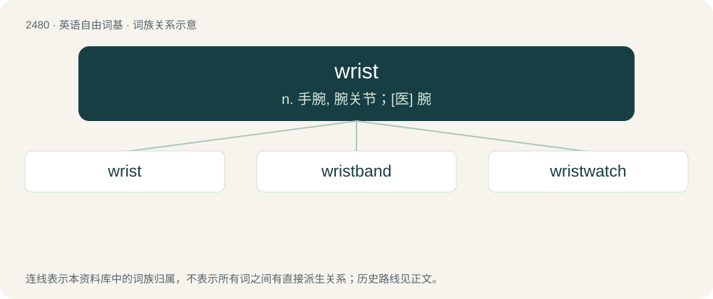

# 2580 · wrist — n. 手腕, 腕关节；\[医\] 腕

[总目录](../00_总目录_按常用程度.md)

**类型**：英语自由词基　｜　**来源语言**：见词源记录

## 核心含义与来源

- 核心含义：n. 手腕, 腕关节；\[医\] 腕
- 英文含义：The complex joint between forearm bones, carpus, and metacarpals where the hand is attached to the arm; the carpus in a narrow sense.
- 词形：wrist

**来源记录 1**（名词；The complex joint between forearm bones, carpus, and metacarpals where the hand is attached to the arm; the carpus in a narrow sense.）

From Middle English wrist, from Old English wrist, from Proto-West Germanic \*wristu, from Proto-Germanic \*wristuz (compare Old Frisian wrist, Low German Wrist, German Rist (“back of hand, instep, withers”), Swedish vrist), from Proto-Germanic \*wrīþaną (“to twist, turn”). More at writhe.

## 词族图

## 单词速览（常用到不常用）

| 单词 | 音标 | 释义 |
|---|---|---|
| [wrist](#w-1) | /ɹɪst/ | n. 手腕, 腕关节；\[医\] 腕 |
| [wristband](#w-2) | /ˈɹɪs(t)ˌbænd/ | n. 袖口 |
| [wristwatch](#w-3) | 英 /ˈɹɪstˌwɒt͡ʃ/；美 /ˈɹɪstˌwɔt͡ʃ/ | n. 手表 |

## 逐词详解

### 1. wrist

**词性**：名词　｜　**音标**：/ɹɪst/

**中文释义**：n. 手腕, 腕关节；\[医\] 腕

**英文义项**：The complex joint between forearm bones, carpus, and metacarpals where the hand is attached to the arm; the carpus in a narrow sense. / A stud or pin which forms a journal.

**词源与演化**：

From Middle English wrist, from Old English wrist, from Proto-West Germanic \*wristu, from Proto-Germanic \*wristuz (compare Old Frisian wrist, Low German Wrist, German Rist (“back of hand, instep, withers”), Swedish vrist), from Proto-Germanic \*wrīþaną (“to twist, turn”). More at writhe.

**例句**：

> With a flick of the wrist, he threw the frisbee to a team-mate.

该用例对应义项：The complex joint between forearm bones, carpus, and metacarpals where the hand is attached to the arm; the carpus in a narrow sense.

### 2. wristband

**词性**：名词　｜　**音标**：/ˈɹɪs(t)ˌbænd/

**中文释义**：n. 袖口

**英文义项**：The cuff of a sleeve that wraps around the wrist. / A strip of material worn around the wrist, e.g. to absorb perspiration, especially in sports.

**构词拆分**：From wrist + band.

**词源与演化**：

From wrist + band.

**例句**：

> Ziri wore a wristband to protest against what is happening in Palestine.

### 3. wristwatch

**词性**：名词　｜　**音标**：英 /ˈɹɪstˌwɒt͡ʃ/；美 /ˈɹɪstˌwɔt͡ʃ/

**中文释义**：n. 手表

**英文义项**：A watch that is worn on a strap or band fastened around the wrist.

**构词拆分**：wrist + watch

**词源与演化**：

From wrist + watch.

**例句**：

> He's lost his wristwatch and now he's looking for them.
