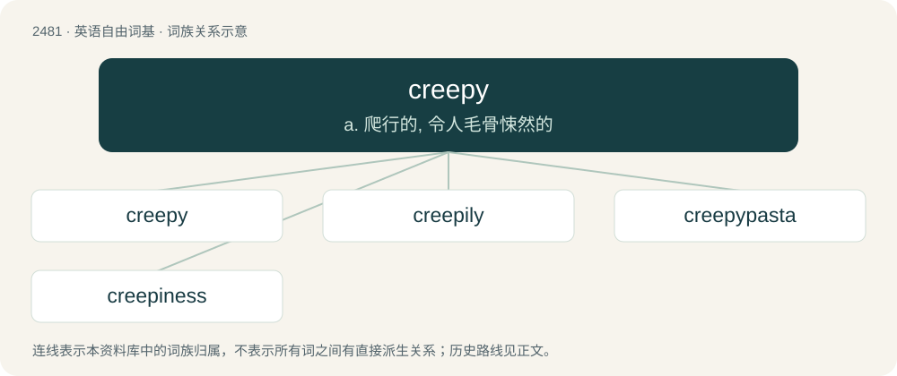

# 2581 · creepy — a. 爬行的, 令人毛骨悚然的

[总目录](../00_总目录_按常用程度.md)

**类型**：英语自由词基　｜　**来源语言**：见词源记录

## 核心含义与来源

- 核心含义：a. 爬行的, 令人毛骨悚然的
- 英文含义：Moving by creeping along.
- 词形：creepy

**来源记录 1**（形容词；Moving by creeping along.）

From creep + -y.

## 词族图

## 单词速览（常用到不常用）

| 单词 | 音标 | 释义 |
|---|---|---|
| [creepy](#w-1) | 英 /ˈkɹiːpi/；美 /ˈkɹipi/ | a. 爬行的, 令人毛骨悚然的 |
| [creepily](#w-2) | /kˈriːpɪlɪ/ | adv. 令人毛骨悚然地 |
| [creepypasta](#w-3) | 英 /ˈkɹiːpiˌpæstə/；美 /ˈkɹipiˌpɑstə/ | 【英文】Frightening urban legends and short stories in the horror genre, circulated on the Internet. |
| [creepiness](#w-4) |  | 毛骨悚然 |

## 逐词详解

### 1. creepy

**词性**：形容词　｜　**音标**：英 /ˈkɹiːpi/；美 /ˈkɹipi/

**中文释义**：a. 爬行的, 令人毛骨悚然的

**英文义项**：Moving by creeping along. / Producing an uneasy fearful sensation, as of things crawling over one's skin.

**构词拆分**：creep + -y

**词源与演化**：

From creep + -y.

**例句**：

> That creepy old man keeps leering at me!

该用例对应义项：Causing discomfort through exhibiting sexually inappropriate behavior.

### 2. creepily

**词性**：副词　｜　**音标**：/kˈriːpɪlɪ/

**中文释义**：adv. 令人毛骨悚然地

**英文义项**：In a creepy manner. / With a furtive creeping motion.

**构词拆分**：creepy + -ly

**词源与演化**：

From creepy + -ly.

**例句**：

> On Halloween, Ziri creepily decorated the backyard with fake ghosts and skeletons.

### 3. creepypasta

**词性**：名词　｜　**音标**：英 /ˈkɹiːpiˌpæstə/；美 /ˈkɹipiˌpɑstə/

**英文义项**：Frightening urban legends and short stories in the horror genre, circulated on the Internet.

**构词拆分**：creepy + copypasta

**词源与演化**：

Blend of creepy + copypasta. Originated from 4chan’s /x/ (paranormal) board sometime around 2006.

### 4. creepiness

**词性**：名词

**中文释义**：毛骨悚然

**英文义项**：The state of being creepy.

**构词拆分**：creepy + -ness

**词源与演化**：

From creepy + -ness.
