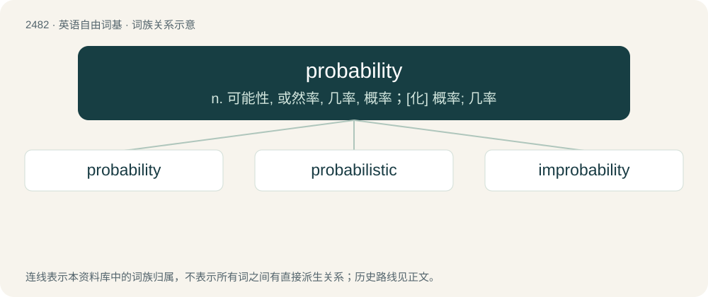

# 2582 · probability — n. 可能性, 或然率, 几率, 概率；\[化\] 概率; 几率

[总目录](../00_总目录_按常用程度.md)

**类型**：英语自由词基　｜　**来源语言**：见词源记录

## 核心含义与来源

- 核心含义：n. 可能性, 或然率, 几率, 概率；\[化\] 概率; 几率
- 英文含义：The state of being probable.
- 词形：probability

**来源记录 1**（名词；The state of being probable.）

From Middle French probabilité, from Latin probābilitās (“probability, credibility”), from probābilis (“probable, credible”).

## 词族图

## 单词速览（常用到不常用）

| 单词 | 音标 | 释义 |
|---|---|---|
| [probability](#w-1) | 英 /ˌpɹɒb.əˈbɪl.ɪ.ti/；美 /ˌpɹɑ.bəˈbɪl.ə.ti/ | n. 可能性, 或然率, 几率, 概率；\[化\] 概率; 几率 |
| [probabilistic](#w-2) | 英 /ˌpɹɒb.ə.bɪˈlɪs.tɪk/；美 /ˌpɹɑ.bə.bɪˈlɪs.tɪk/ | \[计\] 概率性的 |
| [improbability](#w-3) | 英 /ɪmˌpɹɒb.əˈbɪl.ɪ.ti/；美 /ɪmˌpɹɑb.əˈbɪl.ə.ti/ | n. 不大可能性, 不大可能的事 |

## 逐词详解

### 1. probability

**词性**：名词　｜　**音标**：英 /ˌpɹɒb.əˈbɪl.ɪ.ti/；美 /ˌpɹɑ.bəˈbɪl.ə.ti/

**中文释义**：n. 可能性, 或然率, 几率, 概率；\[化\] 概率; 几率

**英文义项**：The state of being probable. / An event that is likely to occur.

**词源与演化**：

From Middle French probabilité, from Latin probābilitās (“probability, credibility”), from probābilis (“probable, credible”).

**例句**：

> The probability of an event A occurring is denoted P(A).

该用例对应义项：A number, between 0 and 1, expressing the precise likelihood of an event happening.

### 2. probabilistic

**词性**：形容词　｜　**音标**：英 /ˌpɹɒb.ə.bɪˈlɪs.tɪk/；美 /ˌpɹɑ.bə.bɪˈlɪs.tɪk/

**中文释义**：\[计\] 概率性的

**英文义项**：Of, pertaining to, or derived using probability. / Of or pertaining to the Roman Catholic doctrine of probabilism.

**构词拆分**：probabil(ity) + -istic；probabil(ism) + -istic

**词源与演化**：

From probabil(ity) + -istic and probabil(ism) + -istic.

**例句**：

> The future is not determined by the present: the world is probabilistic.

### 3. improbability

**词性**：名词　｜　**音标**：英 /ɪmˌpɹɒb.əˈbɪl.ɪ.ti/；美 /ɪmˌpɹɑb.əˈbɪl.ə.ti/

**中文释义**：n. 不大可能性, 不大可能的事

**英文义项**：The quality or state of being improbable; unlikelihood. / That which is improbable; an improbable event or result.

**构词拆分**：in- + probability

**词源与演化**：

From im- + probability.

**例句**：

> Impossibility should never be confused with improbability.

该用例对应义项：the quality of being improbable
