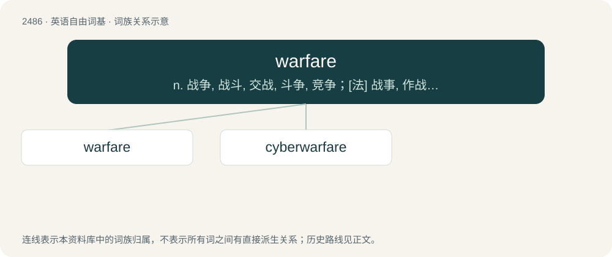

# 2585 · warfare — n. 战争, 战斗, 交战, 斗争, 竞争；\[法\] 战事, 作战, 交战

[总目录](../00_总目录_按常用程度.md)

**类型**：英语自由词基　｜　**来源语言**：见词源记录

## 核心含义与来源

- 核心含义：n. 战争, 战斗, 交战, 斗争, 竞争；\[法\] 战事, 作战, 交战
- 英文含义：The waging of war or armed conflict against an enemy.
- 词形：warfare

**来源记录 1**（名词；The waging of war or armed conflict against an enemy.）

From war + fare; perhaps a shortening of Middle English werre-faringe, werfarynge (“waging war, warfare”, literally “going to war”).

## 词族图

## 单词速览（常用到不常用）

| 单词 | 音标 | 释义 |
|---|---|---|
| [warfare](#w-1) | 英 /ˈwɔːfɛə/；美 /ˈwɔɹfɛɹ/ | n. 战争, 战斗, 交战, 斗争, 竞争；\[法\] 战事, 作战, 交战 |
| [cyberwarfare](#w-2) |  | 【英文】Warfare taking place on the Internet, as by disrupting critical online services. |

## 逐词详解

### 1. warfare

**词性**：名词　｜　**音标**：英 /ˈwɔːfɛə/；美 /ˈwɔɹfɛɹ/

**中文释义**：n. 战争, 战斗, 交战, 斗争, 竞争；\[法\] 战事, 作战, 交战

**英文义项**：The waging of war or armed conflict against an enemy. / Military operations of some particular kind e.g. guerrilla warfare.

**构词拆分**：war + fare

**词源与演化**：

From war + fare; perhaps a shortening of Middle English werre-faringe, werfarynge (“waging war, warfare”, literally “going to war”).

**例句**：

> They took to the field with all the panoply of modern warfare.

### 2. cyberwarfare

**词性**：名词

**英文义项**：Warfare taking place on the Internet, as by disrupting critical online services.

**构词拆分**：cyber- + warfare

**词源与演化**：

From cyber- + warfare.

**例句**：

> Contrary to the claims of politically opportunistic representatives, so-called "cyberwarfare" never causes anyone actual bodily harm.
