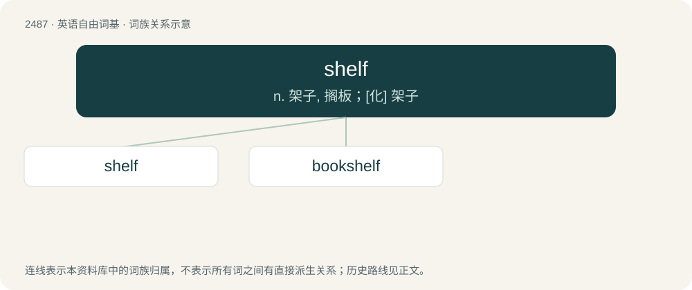

# 2588 · shelf — n. 架子, 搁板；\[化\] 架子

[总目录](../00_总目录_按常用程度.md)

**类型**：英语自由词基　｜　**来源语言**：见词源记录

## 核心含义与来源

- 核心含义：n. 架子, 搁板；\[化\] 架子
- 英文含义：A flat, rigid structure, fixed at right angles to a wall or forming a part of a cabinet, desk, etc., and used to display, store, or support objects.
- 词形：shelf

**多个词源／构词路径**：同一拼写可能有不同来源；以下按词性和含义分别列出。

**来源记录 1**（名词；A flat, rigid structure, fixed at right angles to a wall or forming a part of a cabinet, desk, etc., and used to display, store, or support objects.）

From Middle English schelfe, probably from Old English sċylfe, sċilfe (“shelf, ledge, deck of a ship”), from Proto-West Germanic \*skilfijā, from Proto-Germanic \*skelfō (“shelf, ledge, cliff”), from Proto-Indo-European \*(s)kelH- (“to cut”), distantly related to sculpt, carve and shell. Cognate with Dutch schelf (“hay loft, haystack”), German Low German Schelf (“haystack”), Old Norse skjalf (“bench”).

**来源记录 2**（名词；A reef, sandbar, or shoal.）

Of obscure origin; evidently identical to Middle English shelp (“sandbar in a river”), but the sound shift is unexpected. Shelp might be from Old English scylp (“crag”) or Middle Dutch schelp-.

## 词族图

## 单词速览（常用到不常用）

| 单词 | 音标 | 释义 |
|---|---|---|
| [shelf](#w-1) | /ʃɛlf/ | n. 架子, 搁板；\[化\] 架子 |
| [bookshelf](#w-2) | /ˈbʊkˌʃɛlf/ | n. 书架 |

## 逐词详解

### 1. shelf

**词性**：名词　｜　**音标**：/ʃɛlf/

**中文释义**：n. 架子, 搁板；\[化\] 架子

**英文义项**：A flat, rigid structure, fixed at right angles to a wall or forming a part of a cabinet, desk, etc., and used to display, store, or support objects. / The capacity of such an object

**词源与演化**：

From Middle English schelfe, probably from Old English sċylfe, sċilfe (“shelf, ledge, deck of a ship”), from Proto-West Germanic \*skilfijā, from Proto-Germanic \*skelfō (“shelf, ledge, cliff”), from Proto-Indo-European \*(s)kelH- (“to cut”), distantly related to sculpt, carve and shell. Cognate with Dutch schelf (“hay loft, haystack”), German Low German Schelf (“haystack”), Old Norse skjalf (“bench”).

**例句**：

> We keep the old newspapers on the bottom shelf of the cupboard, and our photos on the top shelf.

该用例对应义项：A flat, rigid structure, fixed at right angles to a wall or forming a part of a cabinet, desk, etc., and used to display, store, or support objects.

### 2. bookshelf

**词性**：名词　｜　**音标**：/ˈbʊkˌʃɛlf/

**中文释义**：n. 书架

**英文义项**：A shelf or shelves for storing books for easy visual reference.

**构词拆分**：book + shelf

**词源与演化**：

From book + shelf.

**例句**：

> In my bedroom are my computer and the bookshelf with my books.
