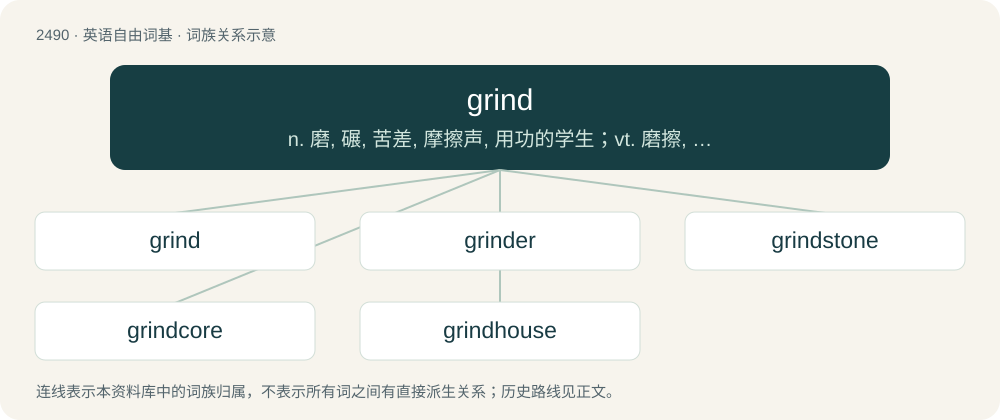

# 2591 · grind — n. 磨, 碾, 苦差, 摩擦声, 用功的学生；vt. 磨擦, 磨碎, 磨光, 折磨, 压榨；vi. 磨, 磨碎, 苦干

[总目录](../00_总目录_按常用程度.md)

**类型**：英语自由词基　｜　**来源语言**：见词源记录

## 核心含义与来源

- 核心含义：n. 磨, 碾, 苦差, 摩擦声, 用功的学生；vt. 磨擦, 磨碎, 磨光, 折磨, 压榨；vi. 磨, 磨碎, 苦干
- 英文含义：To reduce to smaller pieces by crushing with lateral motion.
- 词形：grind

**多个词源／构词路径**：同一拼写可能有不同来源；以下按词性和含义分别列出。

**来源记录 1**（动词；To reduce to smaller pieces by crushing with lateral motion.）

From Middle English grynden, from Old English grindan (“to grind”), from Proto-West Germanic \*grindan, from Proto-Germanic \*grindaną (“to crush, grind”). Cognate with Saterland Frisian gríende, griene (“to grind, mill”), West Frisian grintsje (“to crush, punish”), Dutch grinden (“to grind”, rare) and grind (“gravel, shingle”), Albanian grind (“to brawl, fight”).

**来源记录 2**（名词；A traditional communal pilot whale hunt in the Faroe Islands.）

From Faroese grind (“pilot-whale meat”).

## 词族图

## 单词速览（常用到不常用）

| 单词 | 音标 | 释义 |
|---|---|---|
| [grind](#w-1) | /ˈɡɹaɪnd/ | n. 磨, 碾, 苦差, 摩擦声, 用功的学生；vt. 磨擦, 磨碎, 磨光, 折磨, 压榨；vi. 磨, 磨碎, 苦干 |
| [grinder](#w-2) | 英 /ˈɡɹaɪndə/；美 /ˈɡɹaɪndəɹ/ | n. 推磨的人, 研磨者；\[化\] 磨床; 磨木机; 研磨机 |
| [grindstone](#w-3) | 英 /ˈɡɹaɪn(d)ˌstəʊn/；美 /ˈɡɹaɪn(d)ˌstoʊn/ | n. 磨石, 砂轮, 石磨；\[机\] 磨石 |
| [grindcore](#w-4) |  | 【英文】A fusion genre of extreme metal and hardcore punk, incorporating aggressive guitar riffs; extremely rapid drumming; and loud, largely unintelligible screaming. |
| [grindhouse](#w-5) |  | \[电影\]刑房 |

## 逐词详解

### 1. grind

**词性**：动词　｜　**音标**：/ˈɡɹaɪnd/

**中文释义**：n. 磨, 碾, 苦差, 摩擦声, 用功的学生；vt. 磨擦, 磨碎, 磨光, 折磨, 压榨；vi. 磨, 磨碎, 苦干

**英文义项**：To reduce to smaller pieces by crushing with lateral motion. / To shape with the force of friction.

**词源与演化**：

From Middle English grynden, from Old English grindan (“to grind”), from Proto-West Germanic \*grindan, from Proto-Germanic \*grindaną (“to crush, grind”). Cognate with Saterland Frisian gríende, griene (“to grind, mill”), West Frisian grintsje (“to crush, punish”), Dutch grinden (“to grind”, rare) and grind (“gravel, shingle”), Albanian grind (“to brawl, fight”).

**例句**：

> These enemies give lots of loot when killed, so many players fight them to grind for resources.

该用例对应义项：To repeat a task a large number of times in a row to achieve a specific goal.

### 2. grinder

**词性**：名词　｜　**音标**：英 /ˈɡɹaɪndə/；美 /ˈɡɹaɪndəɹ/

**中文释义**：n. 推磨的人, 研磨者；\[化\] 磨床; 磨木机; 研磨机

**英文义项**：One who grinds something, such as the teeth. / A molar.

**构词拆分**：grind + -er

**词源与演化**：

From Middle English grinder, grindere, from Old English grindere (“one or that which grinds; grinder”), equivalent to grind + -er.

**例句**：

> I am going to the deli to get a grinder for lunch.

该用例对应义项：A sandwich made on a long, cylindrical roll.

### 3. grindstone

**词性**：名词　｜　**音标**：英 /ˈɡɹaɪn(d)ˌstəʊn/；美 /ˈɡɹaɪn(d)ˌstoʊn/

**中文释义**：n. 磨石, 砂轮, 石磨；\[机\] 磨石

**英文义项**：An abrasive wheel for sharpening, polishing, or grinding. / Synonym of starry flounder.

**构词拆分**：grind + stone

**词源与演化**：

From Middle English grind-ston, grindistan, (also as grindel-ston), equivalent to grind + stone. Cognate with Scots grindstane.

**例句**：

> Now I'd better put my nose to the grindstone, I have a lot of work today.

### 4. grindcore

**词性**：名词

**英文义项**：A fusion genre of extreme metal and hardcore punk, incorporating aggressive guitar riffs; extremely rapid drumming; and loud, largely unintelligible screaming.

**构词拆分**：grind + -core

**词源与演化**：

From grind + -core.

### 5. grindhouse

**词性**：名词

**中文释义**：\[电影\]刑房

**英文义项**：A low-budget film theater that shows primarily exploitation films

**构词拆分**：grind + house

**词源与演化**：

From grind + house. \* Perhaps from the grinding or cranking motion employed by early projectionists. \* Perhaps from bump and grind (dubious). The term may originally have been used for burlesque houses in the 1940s.
