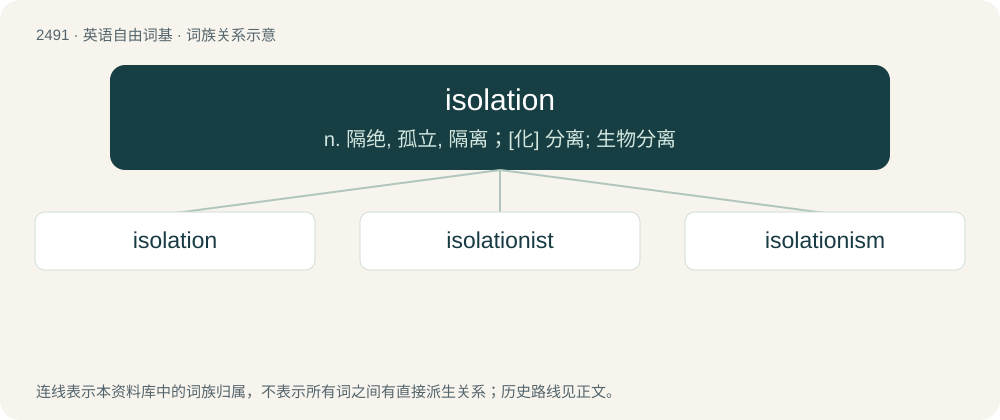

# 2592 · isolation — n. 隔绝, 孤立, 隔离；\[化\] 分离; 生物分离

[总目录](../00_总目录_按常用程度.md)

**类型**：英语自由词基　｜　**来源语言**：见词源记录

## 核心含义与来源

- 核心含义：n. 隔绝, 孤立, 隔离；\[化\] 分离; 生物分离
- 英文含义：The state of being isolated, detached, or separated; the state of being away from other people.
- 词形：isolation

**来源记录 1**（名词；The state of being isolated, detached, or separated; the state of being away from other people.）

First attested in 1800. From French isolation, from isolé, placed on an island (thus away from other people). Equivalent to isolate + -ion.

## 词族图

## 单词速览（常用到不常用）

| 单词 | 音标 | 释义 |
|---|---|---|
| [isolation](#w-1) | 英 /ˌaɪsəˈleɪʃən/ | n. 隔绝, 孤立, 隔离；\[化\] 分离; 生物分离 |
| [isolationist](#w-2) | /.aisəˈleiʃənist/ | n. 孤立主义者 |
| [isolationism](#w-3) | 美 /ˌaɪsəˈleɪʃəˌnɪzəm/ | n. 孤立主义 |

## 逐词详解

### 1. isolation

**词性**：名词　｜　**音标**：英 /ˌaɪsəˈleɪʃən/

**中文释义**：n. 隔绝, 孤立, 隔离；\[化\] 分离; 生物分离

**英文义项**：The state of being isolated, detached, or separated; the state of being away from other people. / The act of isolating.

**构词拆分**：isolate + -ion

**词源与演化**：

First attested in 1800. From French isolation, from isolé, placed on an island (thus away from other people). Equivalent to isolate + -ion.

**例句**：

> She lived her final year in complete isolation, not wanting to see anybody.

该用例对应义项：The state of being isolated, detached, or separated; the state of being away from other people.

### 2. isolationist

**词性**：形容词　｜　**音标**：/.aisəˈleiʃənist/

**中文释义**：n. 孤立主义者

**英文义项**：Relating to, or supporting, isolationism.

**构词拆分**：isolation + -ist

**词源与演化**：

From isolation + -ist.

**例句**：

> The isolationist policy of the US president is dangerous for the economy.

### 3. isolationism

**词性**：名词　｜　**音标**：美 /ˌaɪsəˈleɪʃəˌnɪzəm/

**中文释义**：n. 孤立主义

**英文义项**：A national (or group) policy of non-interaction with other nations (or groups).

**构词拆分**：isolation + -ism

**词源与演化**：

From isolation + -ism.

**例句**：

> The United States once favored a policy of isolationism.
