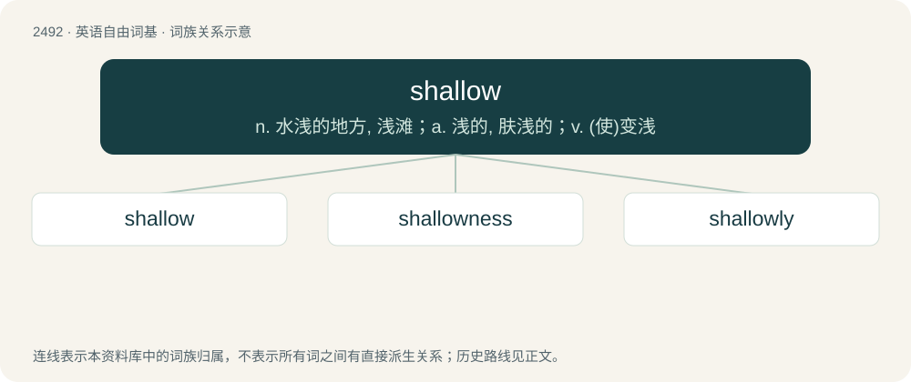

# 2593 · shallow — n. 水浅的地方, 浅滩；a. 浅的, 肤浅的；v. (使)变浅

[总目录](../00_总目录_按常用程度.md)

**类型**：英语自由词基　｜　**来源语言**：见词源记录

## 核心含义与来源

- 核心含义：n. 水浅的地方, 浅滩；a. 浅的, 肤浅的；v. (使)变浅
- 英文含义：Having little depth; significantly less deep than wide.
- 词形：shallow

**来源记录 1**（形容词；Having little depth; significantly less deep than wide.）

From Middle English schalowe (“not deep, shallow”); apparently related to Middle English schalde, schold, scheld, schealde (“shallow”), from Old English sċeald (“shallow”), from Proto-Germanic \*skal-, from Proto-Indo-European \*(s)kelh₁- (“to parch, dry out”). Related to Low German Scholl (“shallow water”). See also shoal.

## 词族图

## 单词速览（常用到不常用）

| 单词 | 音标 | 释义 |
|---|---|---|
| [shallow](#w-1) | 英 /ˈʃæləʊ/；美 /ˈʃæloʊ/ | n. 水浅的地方, 浅滩；a. 浅的, 肤浅的；v. (使)变浅 |
| [shallowness](#w-2) | /ˈʃæləunis/ | n. 浅；肤浅 |
| [shallowly](#w-3) | /ˈʃæləʊlɪ/ | adv. 浅浅地; 不深地; 肤浅地; 浅薄地 |

## 逐词详解

### 1. shallow

**词性**：形容词　｜　**音标**：英 /ˈʃæləʊ/；美 /ˈʃæloʊ/

**中文释义**：n. 水浅的地方, 浅滩；a. 浅的, 肤浅的；v. (使)变浅

**英文义项**：Having little depth; significantly less deep than wide. / Extending not far downward.

**词源与演化**：

From Middle English schalowe (“not deep, shallow”); apparently related to Middle English schalde, schold, scheld, schealde (“shallow”), from Old English sċeald (“shallow”), from Proto-Germanic \*skal-, from Proto-Indo-European \*(s)kelh₁- (“to parch, dry out”). Related to Low German Scholl (“shallow water”). See also shoal.

**例句**：

> The acting is good, but the characters are shallow.

该用例对应义项：Lacking interest or substance; flat; one-dimensional.

### 2. shallowness

**词性**：名词　｜　**音标**：/ˈʃæləunis/

**中文释义**：n. 浅；肤浅

**英文义项**：The property of being shallow; having little depth.

**构词拆分**：shallow + -ness

**词源与演化**：

From shallow + -ness.

**例句**：

> Take into account the shallowness at that end of the pool before you dive.

该用例对应义项：the quality of lacking physical depth

### 3. shallowly

**词性**：副词　｜　**音标**：/ˈʃæləʊlɪ/

**中文释义**：adv. 浅浅地; 不深地; 肤浅地; 浅薄地

**英文义项**：In a shallow manner, without depth.

**构词拆分**：shallow + -ly

**词源与演化**：

From shallow + -ly.
