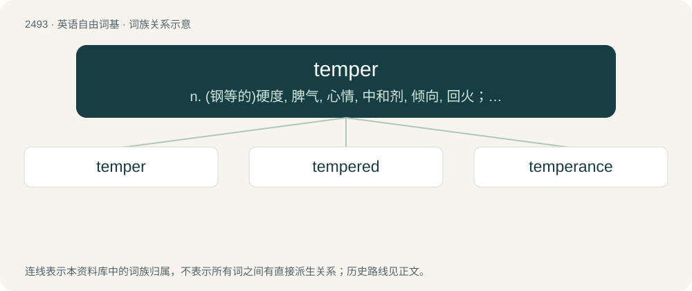

# 2594 · temper — n. (钢等的)硬度, 脾气, 心情, 中和剂, 倾向, 回火；vt. 使回火, 锻炼, 调和, 使缓和；vi. 回火

[总目录](../00_总目录_按常用程度.md)

**类型**：英语自由词基　｜　**来源语言**：见词源记录

## 核心含义与来源

- 核心含义：n. (钢等的)硬度, 脾气, 心情, 中和剂, 倾向, 回火；vt. 使回火, 锻炼, 调和, 使缓和；vi. 回火
- 英文含义：A general tendency or orientation towards a certain type of mood, a volatile state; a habitual way of thinking, behaving or reacting.
- 词形：temper

**来源记录 1**（名词；A general tendency or orientation towards a certain type of mood, a volatile state; a habitual way of thinking, behaving or reacting.）

From Middle English temperen, tempren, from Old English ġetemprian, temprian, borrowed from Latin temperō (“(transitive) to divide or proportion duly, to moderate, to regulate; (intransitive) to be moderate, temperate”), from tempus (“time, fit season”). Compare also French tempérer. Doublet of tamper. See temporal.

## 词族图

## 单词速览（常用到不常用）

| 单词 | 音标 | 释义 |
|---|---|---|
| [temper](#w-1) | 英 /ˈtɛmpə/；美 /ˈtɛmpɚ/ | n. (钢等的)硬度, 脾气, 心情, 中和剂, 倾向, 回火；vt. 使回火, 锻炼, 调和, 使缓和；vi. 回火 |
| [tempered](#w-2) | /ˈtempəd/ | a. 回火的, 缓和的, 脾气...的 |
| [temperance](#w-3) | /ˈtɛmpəɹəns/ | n. 节欲, 戒酒, 禁酒, 节制；\[医\] 节制(饮食等), 戒酒 |

## 逐词详解

### 1. temper

**词性**：名词　｜　**音标**：英 /ˈtɛmpə/；美 /ˈtɛmpɚ/

**中文释义**：n. (钢等的)硬度, 脾气, 心情, 中和剂, 倾向, 回火；vt. 使回火, 锻炼, 调和, 使缓和；vi. 回火

**英文义项**：A general tendency or orientation towards a certain type of mood, a volatile state; a habitual way of thinking, behaving or reacting. / State of mind; mood.

**词源与演化**：

From Middle English temperen, tempren, from Old English ġetemprian, temprian, borrowed from Latin temperō (“(transitive) to divide or proportion duly, to moderate, to regulate; (intransitive) to be moderate, temperate”), from tempus (“time, fit season”). Compare also French tempérer. Doublet of tamper. See temporal.

**例句**：

> When I heard about it I got myself into a terrible temper.

该用例对应义项：Anger; a fit of anger.

### 2. tempered

**词性**：形容词　｜　**音标**：/ˈtempəd/

**中文释义**：a. 回火的, 缓和的, 脾气...的

**英文义项**：Having a specified disposition or temper. / Pertaining to the metallurgical process for finishing metals.

**构词拆分**：temper + -ed

**词源与演化**：

From Middle English tempred, itempered, ytempred, ytemprid, from Old English ġetemprod (“tempered, moderate, goverened, cured”), past participle of Old English ġetemprian (“to temper, moderate, govern, cure”), equivalent to temper + -ed.

**用法示例／搭配（非完整句）**：

> even-tempered

该用例对应义项：Having a specified disposition or temper.

### 3. temperance

**词性**：名词　｜　**音标**：/ˈtɛmpəɹəns/

**中文释义**：n. 节欲, 戒酒, 禁酒, 节制；\[医\] 节制(饮食等), 戒酒

**英文义项**：Habitual moderation in regard to the indulgence of the natural appetites and passions; restrained or moderate indulgence. / Moderation, and sometimes abstinence, in respect to using intoxicating liquors.

**构词拆分**：temper + -ance

**词源与演化**：

From Anglo-Norman temperance, from Latin temperantia (“moderation, sobriety, discretion, self-control”), from temperans, present participle of temperare (“to moderate”). See temper. English equivalent temper + -ance.

**用法示例／搭配（非完整句）**：

> temperance in the indulgence of joy

该用例对应义项：Habitual moderation in regard to the indulgence of the natural appetites and passions; restrained or moderate indulgence.
