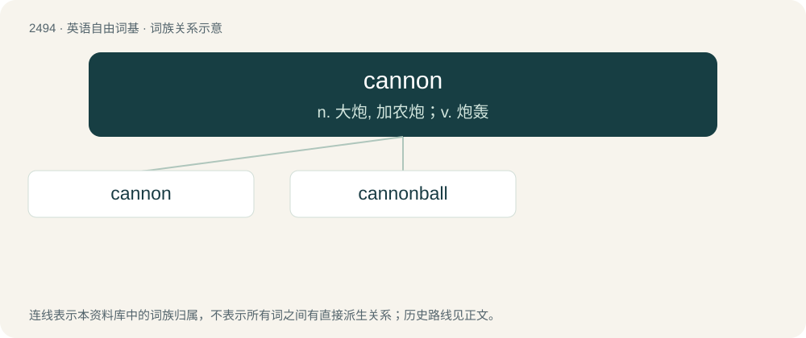

# 2595 · cannon — n. 大炮, 加农炮；v. 炮轰

[总目录](../00_总目录_按常用程度.md)

**类型**：英语自由词基　｜　**来源语言**：见词源记录

## 核心含义与来源

- 核心含义：n. 大炮, 加农炮；v. 炮轰
- 英文含义：A complete assembly, consisting of an artillery tube and a breech mechanism, firing mechanism or base cap, which is a component of a gun, howitzer or mortar, which may include muzzle appendages.
- 词形：cannon

**来源记录 1**（名词；A complete assembly, consisting of an artillery tube and a breech mechanism, firing mechanism or base cap, which is a component of a gun, howitzer or mortar, which may include muzzle appendages.）

Attested from around 1400 as Middle English canon, canoun, from Old French canon, from Italian cannone, from Latin canna, from Ancient Greek κάννα (kánna, “reed”), from Akkadian 𒄀 (qanû, “reed”), from Sumerian 𒄀𒈾 (gi.na) (for more, see cane). Doublet of canyon. This spelling was not fixed until about 1800.

## 词族图

## 单词速览（常用到不常用）

| 单词 | 音标 | 释义 |
|---|---|---|
| [cannon](#w-1) | /ˈkæn.ən/ | n. 大炮, 加农炮；v. 炮轰 |
| [cannonball](#w-2) | /ˈkænənˌbɔːl/ | n. 炮弹 |

## 逐词详解

### 1. cannon

**词性**：名词　｜　**音标**：/ˈkæn.ən/

**中文释义**：n. 大炮, 加农炮；v. 炮轰

**英文义项**：A complete assembly, consisting of an artillery tube and a breech mechanism, firing mechanism or base cap, which is a component of a gun, howitzer or mortar, which may include muzzle appendages. / Any similar device for shooting material out of a tube.

**词源与演化**：

Attested from around 1400 as Middle English canon, canoun, from Old French canon, from Italian cannone, from Latin canna, from Ancient Greek κάννα (kánna, “reed”), from Akkadian 𒄀 (qanû, “reed”), from Sumerian 𒄀𒈾 (gi.na) (for more, see cane). Doublet of canyon. This spelling was not fixed until about 1800.

**例句**：

> He’s got a cannon out in right.

该用例对应义项：The arm of a player who can throw well.

### 2. cannonball

**词性**：名词　｜　**音标**：/ˈkænənˌbɔːl/

**中文释义**：n. 炮弹

**英文义项**：A spherical projectile fired from a smoothbore cannon. / An explosive-filled hollow iron sphere fused through a hole and intended to explode at a calculated distance rather than explode on impact.

**构词拆分**：cannon + ball

**词源与演化**：

From cannon + ball from being a round ball that is fired from a cannon.

**例句**：

> Meetings of the model train club always begin with the song "Wabash Cannonball".

该用例对应义项：Something that moves fast, especially a fast train.
