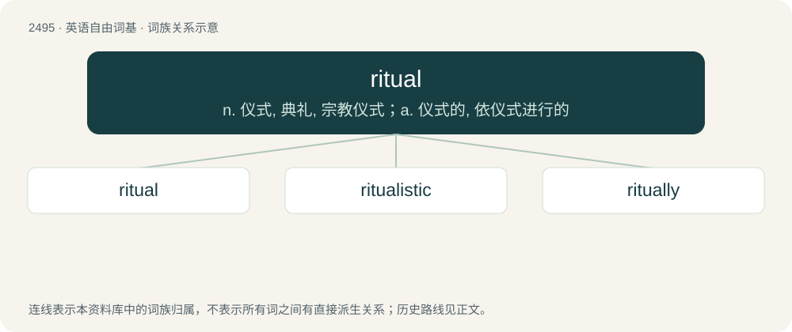

# 2596 · ritual — n. 仪式, 典礼, 宗教仪式；a. 仪式的, 依仪式进行的

[总目录](../00_总目录_按常用程度.md)

**类型**：英语自由词基　｜　**来源语言**：见词源记录

## 核心含义与来源

- 核心含义：n. 仪式, 典礼, 宗教仪式；a. 仪式的, 依仪式进行的
- 英文含义：Related to a rite or repeated set of actions.
- 词形：ritual

**来源记录 1**（形容词；Related to a rite or repeated set of actions.）

From Latin rītuālis (adjective), from rītus (“rite”) + -ālis. Displaced native Old English ġewuna and wuna.

## 词族图

## 单词速览（常用到不常用）

| 单词 | 音标 | 释义 |
|---|---|---|
| [ritual](#w-1) | 英 /ˈɹɪt͡ʃ.u.əl/ | n. 仪式, 典礼, 宗教仪式；a. 仪式的, 依仪式进行的 |
| [ritualistic](#w-2) | /ˌɹɪt͡ʃuəˈlɪstɪk/ | a. 仪式的, 遵守仪式的 |
| [ritually](#w-3) | 美 /ˈɹɪt͡ʃu.əli/ | adv. 按照仪式地 |

## 逐词详解

### 1. ritual

**词性**：形容词　｜　**音标**：英 /ˈɹɪt͡ʃ.u.əl/

**中文释义**：n. 仪式, 典礼, 宗教仪式；a. 仪式的, 依仪式进行的

**英文义项**：Related to a rite or repeated set of actions.

**词源与演化**：

From Latin rītuālis (adjective), from rītus (“rite”) + -ālis. Displaced native Old English ġewuna and wuna.

**例句**：

> They performed the ritual lighting of the candles.

该用例对应义项：Related to a rite or repeated set of actions.

### 2. ritualistic

**词性**：形容词　｜　**音标**：/ˌɹɪt͡ʃuəˈlɪstɪk/

**中文释义**：a. 仪式的, 遵守仪式的

**英文义项**：In the manner of a ritual. / Of or relating to habitual behavior.

**构词拆分**：ritual + -istic

**词源与演化**：

From ritual + -istic.

### 3. ritually

**词性**：副词　｜　**音标**：美 /ˈɹɪt͡ʃu.əli/

**中文释义**：adv. 按照仪式地

**英文义项**：In a ritual manner. / By habit.

**构词拆分**：ritual + -ly

**词源与演化**：

From ritual + -ly.

**例句**：

> The blood libel was the antisemitic accusation that Jews ritually murdered children in order to bake their blood into Passover matzos.
