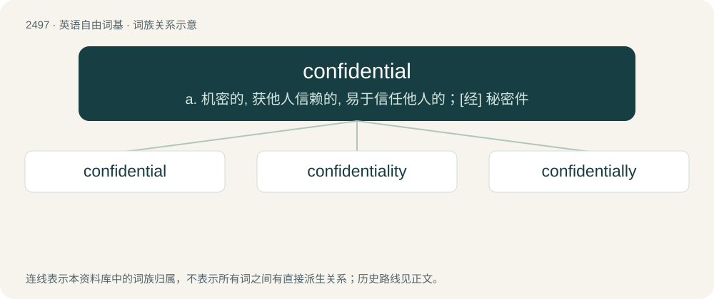

# 2598 · confidential — a. 机密的, 获他人信赖的, 易于信任他人的；\[经\] 秘密件

[总目录](../00_总目录_按常用程度.md)

**类型**：英语自由词基　｜　**来源语言**：见词源记录

## 核心含义与来源

- 核心含义：a. 机密的, 获他人信赖的, 易于信任他人的；\[经\] 秘密件
- 英文含义：Kept, or meant to be kept, secret within a certain circle of persons; not intended to be known publicly.
- 词形：confidential

**来源记录 1**（形容词；Kept, or meant to be kept, secret within a certain circle of persons; not intended to be known publicly.）

From Latin cōnfīdentia + English -al. Possibly a calque of French confidentiel. First attested in 1641.

## 词族图

## 单词速览（常用到不常用）

| 单词 | 音标 | 释义 |
|---|---|---|
| [confidential](#w-1) | 英 /ˌkɒn.fɪˈdɛn.ʃəl/；美 /ˌkɔn.fɪˈdɛn.ʃəl/ | a. 机密的, 获他人信赖的, 易于信任他人的；\[经\] 秘密件 |
| [confidentiality](#w-2) |  | \[计\] 机密性；\[经\] 保密 |
| [confidentially](#w-3) |  | adv. 秘密地；作为心腹话地 |

## 逐词详解

### 1. confidential

**词性**：形容词　｜　**音标**：英 /ˌkɒn.fɪˈdɛn.ʃəl/；美 /ˌkɔn.fɪˈdɛn.ʃəl/

**中文释义**：a. 机密的, 获他人信赖的, 易于信任他人的；\[经\] 秘密件

**英文义项**：Kept, or meant to be kept, secret within a certain circle of persons; not intended to be known publicly. / Inclined to share confidences; (of things) making people inclined to share confidences; involving the sharing of confidences.

**词源与演化**：

From Latin cōnfīdentia + English -al. Possibly a calque of French confidentiel. First attested in 1641.

**例句**：

> Sitting in front of the fire, they became quite confidential, and began to gossip.

该用例对应义项：Inclined to share confidences; (of things) making people inclined to share confidences; involving the sharing of confidences.

### 2. confidentiality

**词性**：名词

**中文释义**：\[计\] 机密性；\[经\] 保密

**英文义项**：The property of being confidential. / Something told in confidence; a secret.

**构词拆分**：confidential + -ity

**词源与演化**：

From confidential + -ity.

**例句**：

> You must respect the confidentiality of your client's communications.

该用例对应义项：the state of being secret

### 3. confidentially

**词性**：副词

**中文释义**：adv. 秘密地；作为心腹话地

**英文义项**：In a confidential manner.

**构词拆分**：confidential + -ly

**词源与演化**：

From confidential + -ly.

**例句**：

> Spoke to him intimately and confidentially.

该用例对应义项：in a confidential manner
