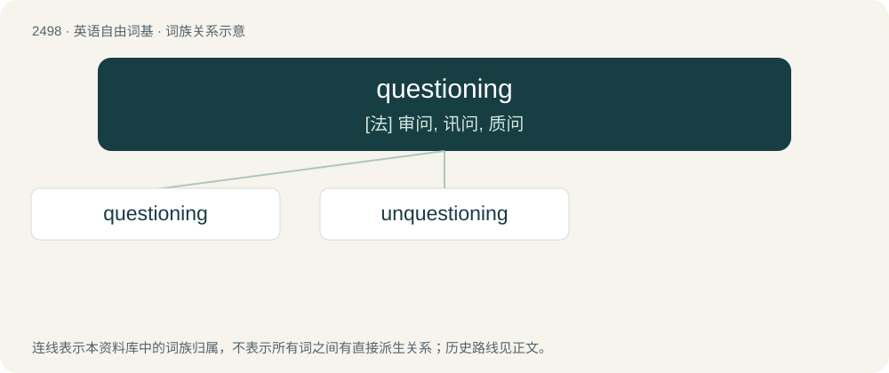

# 2600 · questioning — \[法\] 审问, 讯问, 质问

[总目录](../00_总目录_按常用程度.md)

**类型**：英语自由词基　｜　**来源语言**：见词源记录

## 核心含义与来源

- 核心含义：\[法\] 审问, 讯问, 质问
- 英文含义：The action of asking questions; a survey; an inquiry.
- 词形：questioning

**来源记录 1**（名词；The action of asking questions; a survey; an inquiry.）

From question + -ing (noun via Middle English questionyng).

## 词族图

## 单词速览（常用到不常用）

| 单词 | 音标 | 释义 |
|---|---|---|
| [questioning](#w-1) | 美 /ˈkwɛʃ.tə.nɪŋ/；/ˈkwɛs.t͡ʃə.nɪŋ/ | \[法\] 审问, 讯问, 质问 |
| [unquestioning](#w-2) | /ʌnˈkwestʃəniŋ/ | a. 不提出疑问的, 不提出质询的, 不犹豫的；\[法\] 不问是非的, 盲目的 |

## 逐词详解

### 1. questioning

**词性**：形容词　｜　**音标**：美 /ˈkwɛʃ.tə.nɪŋ/；/ˈkwɛs.t͡ʃə.nɪŋ/

**中文释义**：\[法\] 审问, 讯问, 质问

**英文义项**：Characterized by questions, inquisitiveness, doubt, or wonder; quizzical. / Unsure of one's sexual orientation or gender identity.

**构词拆分**：question + -ing

**词源与演化**：

From question + -ing (noun via Middle English questionyng).

**例句**：

> Why do you have a questioning look? Are you puzzled about something?

该用例对应义项：Characterized by questions, inquisitiveness, doubt, or wonder; quizzical.

### 2. unquestioning

**词性**：形容词　｜　**音标**：/ʌnˈkwestʃəniŋ/

**中文释义**：a. 不提出疑问的, 不提出质询的, 不犹豫的；\[法\] 不问是非的, 盲目的

**英文义项**：Believing without question; having absolute loyalty. / Naive, blind, uncritical.

**构词拆分**：From un- + questioning.

**词源与演化**：

From un- + questioning.

**用法示例／搭配（非完整句）**：

> unquestioning faith

该用例对应义项：Naive, blind, uncritical.
