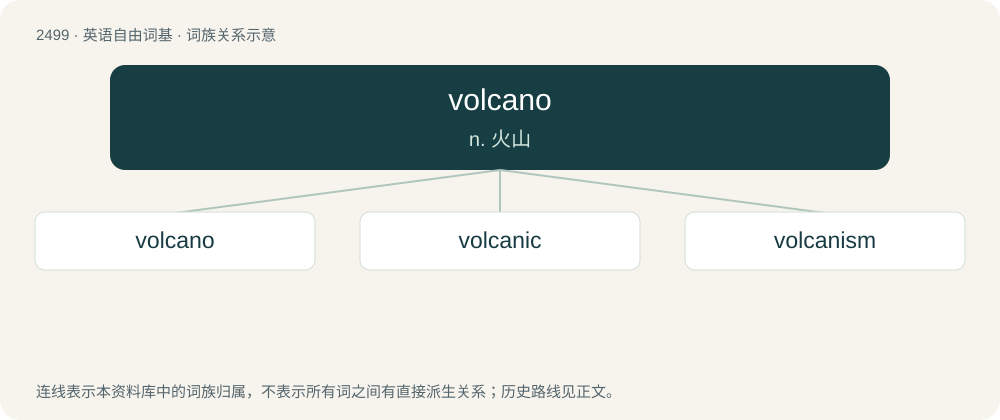

# 2601 · volcano — n. 火山

[总目录](../00_总目录_按常用程度.md)

**类型**：英语自由词基　｜　**来源语言**：见词源记录

## 核心含义与来源

- 核心含义：n. 火山
- 英文含义：A vent or fissure on the surface of a planet (usually in a mountainous form) with a magma chamber attached to the mantle of a planet or moon, periodically erupting forth lava and volcanic gases onto the surface.
- 词形：volcano

**来源记录 1**（名词；A vent or fissure on the surface of a planet (usually in a mountainous form) with a magma chamber attached to the mantle of a planet or moon, periodically erupting forth lava and volcanic gases onto the surface.）

From Italian vulcano, from Vulcano (“a small volcanic island in the Tyrrhenian Sea”), from Latin Vulcānus (“Vulcan, the Roman god of fire and metalworking”). Doublet of bolcane and Vulcan.

## 词族图

## 单词速览（常用到不常用）

| 单词 | 音标 | 释义 |
|---|---|---|
| [volcano](#w-1) | 英 /vɒlˈkeɪ.nəʊ/；美 /vɑlˈkeɪ.noʊ/ | n. 火山 |
| [volcanic](#w-2) | 英 /vɒlˈkænɪk/；美 /vɔlˈkænɪk/ | a. 火山的, 猛烈的；n. 火山岩 |
| [volcanism](#w-3) | /ˈvɒlkənizm/ | n. 火山作用 |

## 逐词详解

### 1. volcano

**词性**：名词　｜　**音标**：英 /vɒlˈkeɪ.nəʊ/；美 /vɑlˈkeɪ.noʊ/

**中文释义**：n. 火山

**英文义项**：A vent or fissure on the surface of a planet (usually in a mountainous form) with a magma chamber attached to the mantle of a planet or moon, periodically erupting forth lava and volcanic gases onto the surface. / A kind of firework producing an upward plume of sparks.

**词源与演化**：

From Italian vulcano, from Vulcano (“a small volcanic island in the Tyrrhenian Sea”), from Latin Vulcānus (“Vulcan, the Roman god of fire and metalworking”). Doublet of bolcane and Vulcan.

**例句**：

> Iceland's volcanoes are among the most active on Earth.

该用例对应义项：A vent or fissure on the surface of a planet (usually in a mountainous form) with a magma chamber attached to the mantle of a planet or moon, periodically erupting forth lava and volcanic gases onto the surface.

### 2. volcanic

**词性**：形容词　｜　**音标**：英 /vɒlˈkænɪk/；美 /vɔlˈkænɪk/

**中文释义**：a. 火山的, 猛烈的；n. 火山岩

**英文义项**：Of or pertaining to a volcano or volcanoes. / Produced by a volcano, or, more generally, by igneous agencies.

**构词拆分**：volcan(o) + -ic

**词源与演化**：

From French volcanique, from volcan (“volcano”); and/or directly from volcan(o) + -ic.

**用法示例／搭配（非完整句）**：

> volcanic activity

该用例对应义项：Of or pertaining to a volcano or volcanoes.

### 3. volcanism

**词性**：名词　｜　**音标**：/ˈvɒlkənizm/

**中文释义**：n. 火山作用

**英文义项**：Any of the natural phenomena and processes associated with the action of volcanos, geysers and fumaroles

**构词拆分**：volcan(o) + -ism

**词源与演化**：

From French volcanisme, from volcan (“volcano”); and/or directly from volcan(o) + -ism.
