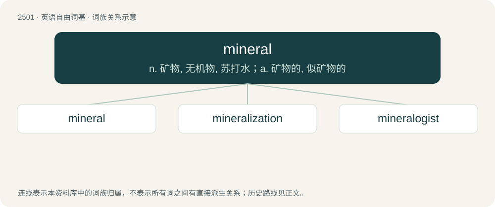

# 2603 · mineral — n. 矿物, 无机物, 苏打水；a. 矿物的, 似矿物的

[总目录](../00_总目录_按常用程度.md)

**类型**：英语自由词基　｜　**来源语言**：见词源记录

## 核心含义与来源

- 核心含义：n. 矿物, 无机物, 苏打水；a. 矿物的, 似矿物的
- 英文含义：Any naturally occurring solid material that has a (more or less) definite chemical composition and characteristic physical properties; especially, an inorganic and crystalline one.
- 词形：mineral

**来源记录 1**（名词；Any naturally occurring solid material that has a (more or less) definite chemical composition and characteristic physical properties; especially, an inorganic and crystalline one.）

From Middle English mineral, borrowed from Old French mineral, (French minéral), from Medieval Latin minerale, from minera (“ore”), probably ultimately derived from Latin mina (“ore, mine”).

## 词族图

## 单词速览（常用到不常用）

| 单词 | 音标 | 释义 |
|---|---|---|
| [mineral](#w-1) | 英 /ˈmɪn.ə.ɹəl/；美 /ˈmɪn.ə.ɹəl/ | n. 矿物, 无机物, 苏打水；a. 矿物的, 似矿物的 |
| [mineralization](#w-2) | /ˌmɪ.nə.ɹə.laɪˈzeɪ.ʃən/ | n. 矿化, 使含矿物；\[化\] 矿化 |
| [mineralogist](#w-3) | /.minəˈrælədʒist/ | n. 矿物学者 |

## 逐词详解

### 1. mineral

**词性**：名词　｜　**音标**：英 /ˈmɪn.ə.ɹəl/；美 /ˈmɪn.ə.ɹəl/

**中文释义**：n. 矿物, 无机物, 苏打水；a. 矿物的, 似矿物的

**英文义项**：Any naturally occurring solid material that has a (more or less) definite chemical composition and characteristic physical properties; especially, an inorganic and crystalline one. / Any inorganic material (as distinguished from animal or vegetable).

**词源与演化**：

From Middle English mineral, borrowed from Old French mineral, (French minéral), from Medieval Latin minerale, from minera (“ore”), probably ultimately derived from Latin mina (“ore, mine”).

**例句**：

> Natural mineral water contains calcium, magnesium, sodium, potassium as well as nitrate.

### 2. mineralization

**词性**：名词　｜　**音标**：/ˌmɪ.nə.ɹə.laɪˈzeɪ.ʃən/

**中文释义**：n. 矿化, 使含矿物；\[化\] 矿化

**英文义项**：A form of fossilization in which the organic parts of an organism are replaced by minerals. / The breakdown of organic matter in the soil to form soluble inorganic compounds.

**构词拆分**：mineral + -ization

**词源与演化**：

From mineral + -ization.

### 3. mineralogist

**词性**：名词　｜　**音标**：/.minəˈrælədʒist/

**中文释义**：n. 矿物学者

**英文义项**：An expert in mineralogy.

**构词拆分**：mineral + -logist

**词源与演化**：

From mineral + -logist. Compare later mineralogy and French minéralogiste.

**例句**：

> The space agency's mineralogist says this asteroid was unique because researchers can compare the data collected before it came down, with the recovered fragments.
