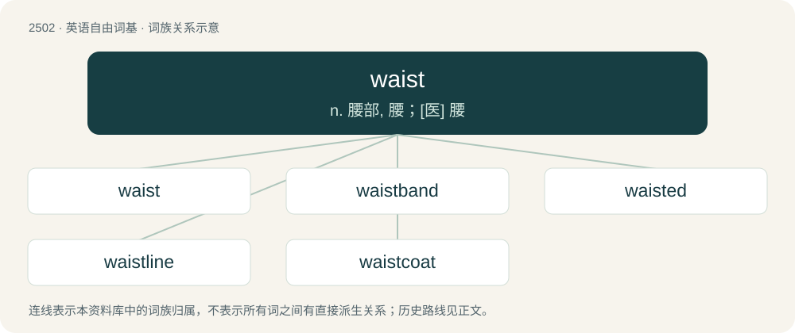

# 2605 · waist — n. 腰部, 腰；\[医\] 腰

[总目录](../00_总目录_按常用程度.md)

**类型**：英语自由词基　｜　**来源语言**：见词源记录

## 核心含义与来源

- 核心含义：n. 腰部, 腰；\[医\] 腰
- 英文含义：The part of the body between the pelvis and the stomach.
- 词形：waist

**来源记录 1**（名词；The part of the body between the pelvis and the stomach.）

Inherited from Middle English wast (“waist”), probably from Old English \*wæst, \*wǣst, \*weaxt, \*wæhst, from Proto-West Germanic \*wahstu, from Proto-Germanic \*wahstuz (“growth, development, stature, build”), from Proto-Indo-European \*h₂weks- (“to multiply, increase”). Cognate with Middle English wacste (“growth, increase, might, power”), Middle High German wahst (“growth”), Danish vækst (“growth”), Swedish växt (“growth, development, size”), Icelandic vöxtur (“growth”), Gothic 𐍅𐌰𐌷𐍃𐍄𐌿𐍃 (wahstus, “growth”). Related to Old English weaxan (“to grow, increase”). More at wax.

## 词族图

## 单词速览（常用到不常用）

| 单词 | 音标 | 释义 |
|---|---|---|
| [waist](#w-1) | /weɪst/ | n. 腰部, 腰；\[医\] 腰 |
| [waistband](#w-2) | /ˈweɪstˌbænd/ | n. 腰带, 束腰带 |
| [waisted](#w-3) | /ˈweɪstɪd/ | (waist 的过去时) n. 腰部, 腰；\[医\] 腰 |
| [waistline](#w-4) | 美 /ˈweɪstˌlaɪn/ | n. 腰围；\[医\] 腰围 |
| [waistcoat](#w-5) | /ˈweɪs(t)kəʊt/ | n. 西装背心, 马甲 |

## 逐词详解

### 1. waist

**词性**：名词　｜　**音标**：/weɪst/

**中文释义**：n. 腰部, 腰；\[医\] 腰

**英文义项**：The part of the body between the pelvis and the stomach. / A part of a piece of clothing that covers the waist.

**词源与演化**：

Inherited from Middle English wast (“waist”), probably from Old English \*wæst, \*wǣst, \*weaxt, \*wæhst, from Proto-West Germanic \*wahstu, from Proto-Germanic \*wahstuz (“growth, development, stature, build”), from Proto-Indo-European \*h₂weks- (“to multiply, increase”). Cognate with Middle English wacste (“growth, increase, might, power”), Middle High German wahst (“growth”), Danish vækst (“growth”), Swedish växt (“growth, development, size”), Icelandic vöxtur (“growth”), Gothic 𐍅𐌰𐌷𐍃𐍄𐌿𐍃 (wahstus, “growth”). Related to Old English weaxan (“to grow, increase”). More at wax.

**例句**：

> The waist of a bell widens into the lip.

该用例对应义项：The middle part of anything.

### 2. waistband

**词性**：名词　｜　**音标**：/ˈweɪstˌbænd/

**中文释义**：n. 腰带, 束腰带

**英文义项**：A band of fabric encircling the waist, especially a part of a pair of pants or a skirt.

**构词拆分**：waist + band

**词源与演化**：

From waist + band.

**例句**：

> Ziri lifted his T-shirt to reveal a handgun tucked into his waistband.

### 3. waisted

**词性**：形容词　｜　**音标**：/ˈweɪstɪd/

**中文释义**：(waist 的过去时) n. 腰部, 腰；\[医\] 腰

**英文义项**：Having some specific type of waist. / Narrower in the middle.

**构词拆分**：From waist + -ed.

**词源与演化**：

From waist + -ed.

### 4. waistline

**词性**：名词　｜　**音标**：美 /ˈweɪstˌlaɪn/

**中文释义**：n. 腰围；\[医\] 腰围

**英文义项**：a line around the body at the waist; its measurement / the narrowest part of a garment, usually at the waist, but may be above or below depending on the dictates of fashion or the whim of the designer

**构词拆分**：waist + line

**词源与演化**：

From waist + line.

**例句**：

> Because of his expanding waistline, he switched from belts to braces.

### 5. waistcoat

**词性**：名词　｜　**音标**：/ˈweɪs(t)kəʊt/

**中文释义**：n. 西装背心, 马甲

**英文义项**：An ornamental garment worn under a doublet. / A sleeveless, collarless garment worn over a shirt and under a suit jacket.

**构词拆分**：waist + coat

**词源与演化**：

From waist + coat. Compare Yola wauscoat, wazcoote.

**例句**：

> Your waistcoat is inside out. Put it on the right way round.
