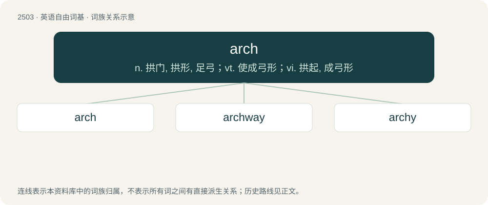

# 2606 · arch — n. 拱门, 拱形, 足弓；vt. 使成弓形；vi. 拱起, 成弓形

[总目录](../00_总目录_按常用程度.md)

**类型**：英语自由词基　｜　**来源语言**：见词源记录

## 核心含义与来源

- 核心含义：n. 拱门, 拱形, 足弓；vt. 使成弓形；vi. 拱起, 成弓形
- 英文含义：An inverted U shape.
- 词形：arch

**多个词源／构词路径**：同一拼写可能有不同来源；以下按词性和含义分别列出。

**来源记录 1**（名词；An inverted U shape.）

From Middle English arch, arche, from Old French arche (“an arch”), a feminine form of arc, from Latin arcus (“a bow, arc, arch”). Doublet of arc and arco. Displaced native Old English bīeġels and Old English hwealf.

**来源记录 2**（形容词；Knowing, clever, mischievous.）

From the prefix arch-. "Principal" is the original sense; "mischievous" is via onetime frequent collocation with rogue, knave, etc.

**来源记录 3**（名词；An architecture; a computer architecture or instruction set architecture.）

Clipping of architecture.

## 词族图

## 单词速览（常用到不常用）

| 单词 | 音标 | 释义 |
|---|---|---|
| [arch](#w-1) | 英 /ɑːt͡ʃ/；美 /ɑɹt͡ʃ/ | n. 拱门, 拱形, 足弓；vt. 使成弓形；vi. 拱起, 成弓形 |
| [archway](#w-2) | /ˈɑɹt͡ʃˌweɪ/ | n. 拱门, 拱道 |
| [archy](#w-3) | /ˈɑɹt͡ʃi/ | a. 拱形的, 曲线形的 |

## 逐词详解

### 1. arch

**词性**：名词　｜　**音标**：英 /ɑːt͡ʃ/；美 /ɑɹt͡ʃ/

**中文释义**：n. 拱门, 拱形, 足弓；vt. 使成弓形；vi. 拱起, 成弓形

**英文义项**：An inverted U shape. / An arch-shaped arrangement of trapezoidal stones, designed to redistribute downward force outward.

**词源与演化**：

From Middle English arch, arche, from Old French arche (“an arch”), a feminine form of arc, from Latin arcus (“a bow, arc, arch”). Doublet of arc and arco. Displaced native Old English bīeġels and Old English hwealf.

**用法示例／搭配（非完整句）**：

> to pass into the arch of a bridge

该用例对应义项：Any place covered by an arch; an archway.

### 2. archway

**词性**：名词　｜　**音标**：/ˈɑɹt͡ʃˌweɪ/

**中文释义**：n. 拱门, 拱道

**英文义项**：A passageway covered by an arch, particularly one made of masonry. / A doorway with a semilunar-shaped top.

**构词拆分**：arch + way

**词源与演化**：

From arch + way.

**例句**：

> The soffit of the archway is ornamented with deeply recessed coffers, and a relief in the centre represents the apotheosis of Titus.

### 3. archy

**词性**：形容词　｜　**音标**：/ˈɑɹt͡ʃi/

**中文释义**：a. 拱形的, 曲线形的

**英文义项**：Resembling an arch; having arches; arched; arching

**构词拆分**：arch + -y

**词源与演化**：

From arch + -y.
