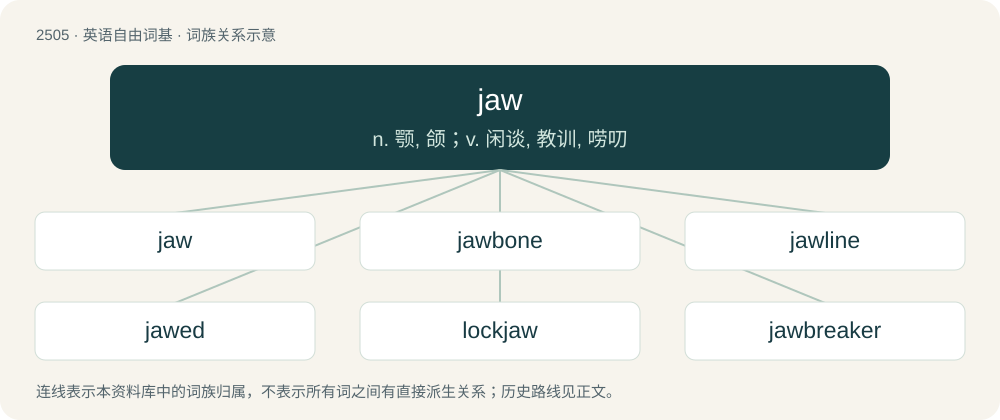

# 2607 · jaw — n. 颚, 颌；v. 闲谈, 教训, 唠叨

[总目录](../00_总目录_按常用程度.md)

**类型**：英语自由词基　｜　**来源语言**：见词源记录

## 核心含义与来源

- 核心含义：n. 颚, 颌；v. 闲谈, 教训, 唠叨
- 英文含义：One of the bones, usually bearing teeth, which form the framework of the mouth.
- 词形：jaw

**多个词源／构词路径**：同一拼写可能有不同来源；以下按词性和含义分别列出。

**来源记录 1**（名词；One of the bones, usually bearing teeth, which form the framework of the mouth.）

From Middle English jawe/jowe (“jaw; sides of the lower face”, 14th century), the further origin of which is disputed. Either: \* From Anglo-Norman jowe, from Old French joe (“cheek; jaw”), from Vulgar Latin \*ga(v)ota (“cheek”), of uncertain further origin. \*\* It has been objected that the rhyming of jowe (“jaw”) with clowe (“claw”) in Middle English demonstrates that it did not have the vowel /uː/. This would be a concern if /uː/ were the vowel to expect from a borrowing of the Old French word, which it is not. Compare English paw &lt; Middle English pawe/powe &lt; Anglo-Norman powe &lt; Old French poe. \* From Middle English \*chowe, from Old English \*ċēowe. The main difficulties with this theory are the notable lack of evidence and the late attestation of chaw (early 16th century). If it is correct, then the further origin would be Proto-West Germanic \*keuwā (“jaw”), whence Saterland Frisian Kiuwe, Dutch kieuw, German Keu, Käu. For the initial consonant, compare jowl as a variant of chavel/chawl. It is also conceivable that the word is a merger of two coincidentally similar sources. Gradually displaced Middle English chavel (from Old English ċeafl).

**来源记录 2**（动词；To pour or throw out.）

Uncertain. Attested since 1513 (as a verb and noun) in Scots. The DSL speculates that it might be related to Scots (and Northern English dialectal) jall, joll "knock, bump; toll (a bell)" via the notion of knocking "one thing against another, as waves on a rock". The EDD compares Old Norse jaga (“move to and fro”).

## 词族图

## 单词速览（常用到不常用）

| 单词 | 音标 | 释义 |
|---|---|---|
| [jaw](#w-1) | 英 /d͡ʒɔː/；/d͡ʒɔ/ | n. 颚, 颌；v. 闲谈, 教训, 唠叨 |
| [jawbone](#w-2) | /ˈdʒɒːbəun/ | n. 颚骨, 下颚骨, 信用；v. 赊买 |
| [jawline](#w-3) | /ˈd͡ʒɔːˌlaɪn/ | n. 下颌的轮廓,下巴的外形 |
| [jawed](#w-4) | 英 /ˈd͡ʒɔːd/；美 /ˈd͡ʒɔd/ | a. 有颌的, 有颚的 |
| [lockjaw](#w-5) | /ˈlɒkdʒɒː/ | n. 破伤风, 牙关紧闭；\[医\] 牙关紧闭, 破伤风 |
| [jawbreaker](#w-6) | /ˈdʒɒːbreikə/ | n. 难发音的字, 大块硬糖 |

## 逐词详解

### 1. jaw

**词性**：名词　｜　**音标**：英 /d͡ʒɔː/；/d͡ʒɔ/

**中文释义**：n. 颚, 颌；v. 闲谈, 教训, 唠叨

**英文义项**：One of the bones, usually bearing teeth, which form the framework of the mouth. / The part of the face below the mouth.

**词源与演化**：

From Middle English jawe/jowe (“jaw; sides of the lower face”, 14th century), the further origin of which is disputed. Either: \* From Anglo-Norman jowe, from Old French joe (“cheek; jaw”), from Vulgar Latin \*ga(v)ota (“cheek”), of uncertain further origin. \*\* It has been objected that the rhyming of jowe (“jaw”) with clowe (“claw”) in Middle English demonstrates that it did not have the vowel /uː/. This would be a concern if /uː/ were the vowel to expect from a borrowing of the Old French word, which it is not. Compare English paw &lt; Middle English pawe/powe &lt; Anglo-Norman powe &lt; Old French poe. \* From Middle English \*chowe, from Old English \*ċēowe. The main difficulties with this theory are the notable lack of evidence and the late attestation of chaw (early 16th century). If it is correct, then the further origin would be Proto-West Germanic \*keuwā (“jaw”), whence Saterland Frisian Kiuwe, Dutch kieuw, German Keu, Käu. For the initial consonant, compare jowl as a variant of chavel/chawl. It is also conceivable that the word is a merger of two coincidentally similar sources. Gradually displaced Middle English chavel (from Old English ċeafl).

**例句**：

> the jaws of a pass; the jaws of darkness; the jaws of death.

该用例对应义项：Anything resembling the jaw (sense 1) of an animal in form or action; the mouth or way of entrance.

### 2. jawbone

**词性**：名词　｜　**音标**：/ˈdʒɒːbəun/

**中文释义**：n. 颚骨, 下颚骨, 信用；v. 赊买

**英文义项**：The bone of the lower jaw; the mandible. / Any of the bones in the lower or upper jaw.

**构词拆分**：jaw + bone

**词源与演化**：

From Middle English jawe bone, a partial calque of earlier Middle English chawlbone, chawylbon, chavylbone, chawle boon, chavyl bon (“jaw bone”, literally “chavel bone”), see chavel-bone; equivalent to jaw + bone.

### 3. jawline

**词性**：名词　｜　**音标**：/ˈd͡ʒɔːˌlaɪn/

**中文释义**：n. 下颌的轮廓,下巴的外形

**英文义项**：The lower edge of the side of the face (below the cheek), defined by the jawbone.

**构词拆分**：jaw + line

**词源与演化**：

From jaw + line.

**例句**：

> Sandra swooned over Pierce's manly jawline.

该用例对应义项：The lower edge of the side of the face (below the cheek), defined by the jawbone.

### 4. jawed

**词性**：形容词　｜　**音标**：英 /ˈd͡ʒɔːd/；美 /ˈd͡ʒɔd/

**中文释义**：a. 有颌的, 有颚的

**英文义项**：Having jaws. / Having a specified type of jaw.

**构词拆分**：jaw + -ed

**词源与演化**：

From jaw + -ed.

### 5. lockjaw

**词性**：名词　｜　**音标**：/ˈlɒkdʒɒː/

**中文释义**：n. 破伤风, 牙关紧闭；\[医\] 牙关紧闭, 破伤风

**英文义项**：A spasmodic, nervous system disease brought on by the tetanus bacteria, causing muscles to seize up and may cause death by suffocation.

**构词拆分**：lock + jaw

**词源与演化**：

From lock + jaw.

### 6. jawbreaker

**词性**：名词　｜　**音标**：/ˈdʒɒːbreikə/

**中文释义**：n. 难发音的字, 大块硬糖

**英文义项**：A large, extremely hard, boiled candy, typically spherical. / A long, hard-to-pronounce word.

**构词拆分**：jaw + breaker

**词源与演化**：

From jaw + breaker.

**例句**：

> The word “callipygous” is something of a jawbreaker.

该用例对应义项：A long, hard-to-pronounce word.
