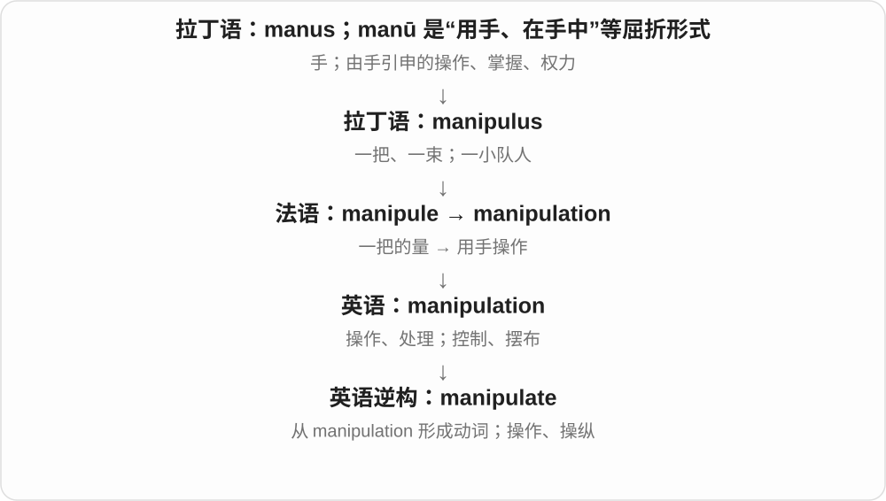
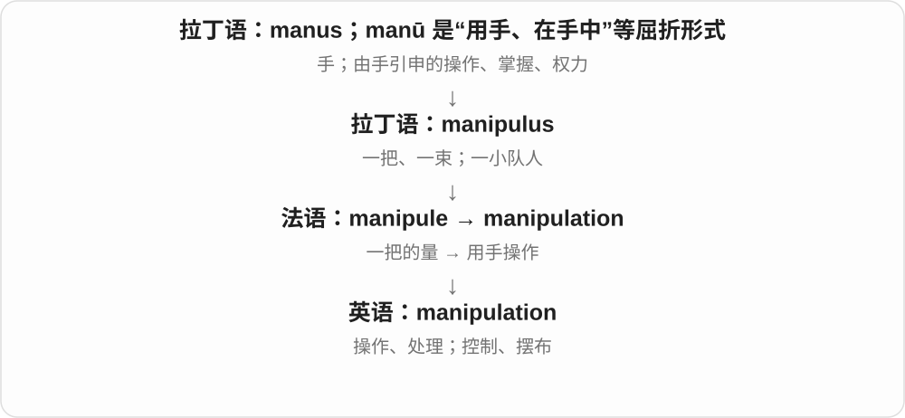
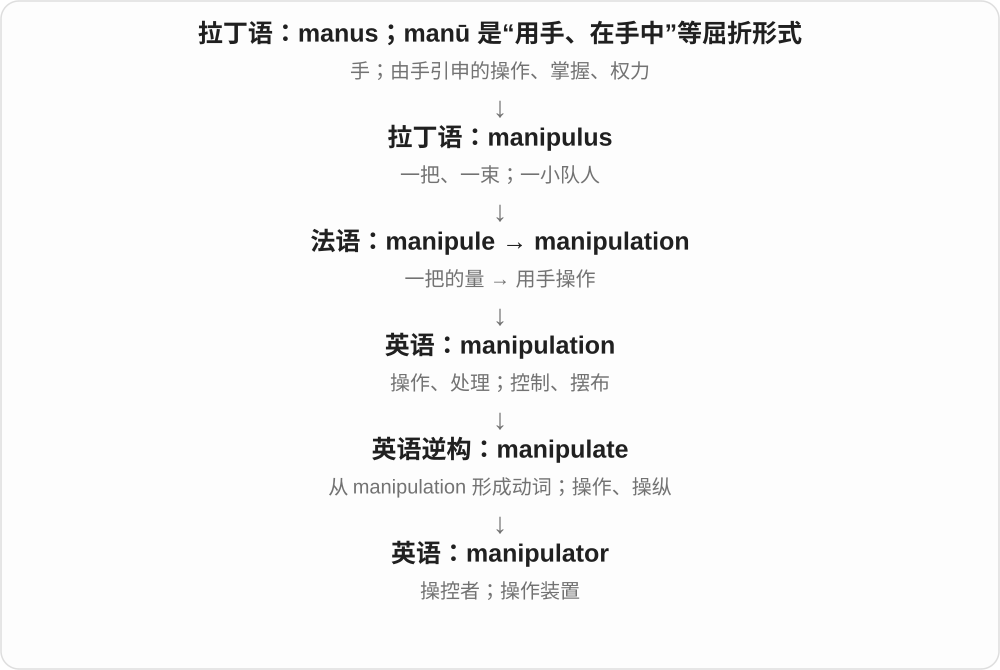

# 2607 · manipulate — 操纵；操作；处理

[逐词精讲目录](../00_逐词精讲目录.md) · [总目录](../00_总目录_按常用程度.md)

## 核心词根与来源

manipulate 由 manipulation 逆构，远接拉丁 manipulus 一把。manipulative 常指操控性的，manipulator 可以是操纵者或机械操作装置。

**MANIPULATE：灵巧处理，也可能控制别人**

手上调整仪器是中性操作，暗中左右人则常带贬义。

- **处理动作和过程**：manipulate · manipulation
- **方式与执行者**：manipulative · manipulator

## 词形与演化规律

现代 manipulate 与 manipulation 有动名对应，但历史上名词先于这个动词。-or 不一定指人。

## 单词速览（按词族由简到繁）

同一基础词的相关扩展放在一起，先读基础形式，再读扩展；各组之间优先读常用的。具体词源关系见各词讲解。

| 单词 | 音标 | 核心意思 |
|---|---|---|
| [manipulate](#w-2) | 英 /məˈnɪpjʊleɪt/；美 /məˈnɪpjəleɪt/ | 操作、摆弄；操控；篡改 |
| [manipulation](#w-1) | 英 /məˌnɪpjuˈleɪʃən/；美 /məˌnɪpjəˈleɪʃən/ | 操作、处理；操纵、摆布 |
| [manipulative](#w-3) | 英 /məˈnɪpjələtɪv/；美 /məˈnɪpjəleɪtɪv/ | 善于操控他人的；操作性的；数学操作教具 |
| [manipulator](#w-4) | 英 /məˈnɪpjʊleɪtə/；美 /məˈnɪpjəleɪtər/ | 操纵者；机械操作臂；操作装置 |

## 逐词讲解

### 1. manipulate — 操作、摆弄；操控；篡改

**音标**：英 /məˈnɪpjʊleɪt/；美 /məˈnɪpjəleɪt/

**先抓住这个画面**

manipulate 像灵巧地拨弄手里的东西；对象变成人或数据时，可能是为了自己的目的暗中改变它们。

**怎么拆**

由 manipulation 逆构成动词；远连拉丁 manipulus“一把”。不能因为现代有 manipulate + -ion 的对应，就把历史次序倒过来。

**怎么变成今天的意思**

manipulate a tool 可是中性操作；manipulate someone 常是操控；manipulate figures 可能暗示篡改数字，需看上下文。

**常见搭配与例句**

manipulate an object；manipulate data；manipulate someone into doing something。

> The robot can manipulate small objects with great precision.

这个机器人能非常精确地操作小物体。

> He tried to manipulate her into accepting the blame.

他试图操控她，让她承担责任。

**别混淆**

handle 强调处理、拿用；manipulate 更突出细致控制，也更容易含暗中摆布的意味。

### 2. manipulation — 操作、处理；操纵、摆布

**音标**：英 /məˌnɪpjuˈleɪʃən/；美 /məˌnɪpjəˈleɪʃən/

**先抓住这个画面**

manipulation 像手指拨动零件，也像有人躲在后面拨动别人选择的方向；前者可以中性，后者常有欺骗意味。

**怎么拆**

借自法语 manipulation，远连拉丁 manipulus“一把”；英语 manipulate 反而由这个名词逆构，别把历史顺序画反。

**怎么变成今天的意思**

data manipulation 可以只是整理、转换数据；emotional manipulation 常是利用情绪控制他人。不要见到这个词就一律判成造假。

**常见搭配与例句**

data manipulation；image manipulation；emotional manipulation。

> The software allows basic image manipulation.

这款软件支持基本图像处理。

> She recognized the repeated guilt trips as emotional manipulation.

她意识到，对方反复让她内疚是在操控她的情绪。

**别混淆**

operation 是一般操作；manipulation 更突出细致调整，有时突出为了自己的目的控制或篡改。

### 3. manipulative — 善于操控他人的；操作性的；数学操作教具

**音标**：英 /məˈnɪpjələtɪv/；美 /məˈnɪpjəleɪtɪv/

**先抓住这个画面**

manipulative 形容人时像暗中拉线，让别人照自己的意思走；教学中则可能是可以拿在手里摆弄的实物。

**怎么拆**

manipulate + -ive；动词本身由 manipulation 逆构。

**怎么变成今天的意思**

a manipulative person 常含贬义；math manipulatives 是积木、计数片等教具，名词复数没有阴险的意思。

**常见搭配与例句**

manipulative behaviour；a manipulative tactic；math manipulatives。

> The message used a manipulative appeal to guilt.

那条消息利用内疚感来操控对方。

> The teacher used manipulatives to explain fractions.

老师用实物教具解释分数。

**别混淆**

persuasive 是有说服力；manipulative 往往暗示绕过别人清楚、自主的判断，为自己谋求结果。

### 4. manipulator — 操纵者；机械操作臂；操作装置

**音标**：英 /məˈnɪpjʊleɪtə/；美 /məˈnɪpjəleɪtər/

**先抓住这个画面**

manipulator 可以是暗中摆布人的人，也可以是替人抓取、移动物体的机械“手”。

**怎么拆**

manipulate 去 e 加 -or，表示执行操作的人或装置。

**怎么变成今天的意思**

人物评价里常是贬义；robotic manipulator 是机械学中性名称，不能译成阴谋家。

**常见搭配与例句**

a skilled manipulator；a robotic manipulator；a remote manipulator。

> The robotic manipulator moved the sample into the chamber.

机械操作臂把样品移进了舱室。

> The novel gradually reveals him as a skilled manipulator.

小说逐渐揭示出他是个善于操控他人的人。

**别混淆**

operator 常指操作设备的人；manipulator 既可能是人，也可能是实际执行抓取动作的机械装置。

## 这一组要分清什么

manipulate data 可说处理数据，也可说篡改，须看语境；不能所有用法都加上欺骗评价。

## 串起来练习

The robotic manipulator can manipulate small objects precisely.

机械操作臂能够精确处理小物体。
