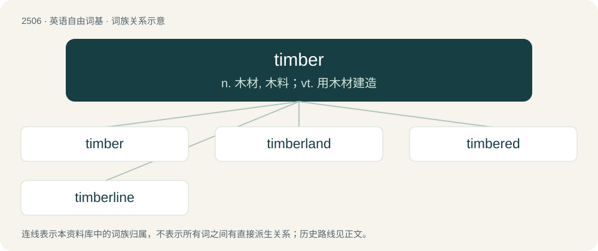

# 2610 · timber — n. 木材, 木料；vt. 用木材建造

[总目录](../00_总目录_按常用程度.md)

**类型**：英语自由词基　｜　**来源语言**：见词源记录

## 核心含义与来源

- 核心含义：n. 木材, 木料；vt. 用木材建造
- 英文含义：Trees in a forest regarded as a source of wood.
- 词形：timber

**来源记录 1**（名词；Trees in a forest regarded as a source of wood.）

From Middle English tymber, from Old English timber, from Proto-West Germanic \*timr, from Proto-Germanic \*timrą (“building; timber”), from Proto-Indo-European \*dem- (“to build; to arrange”) (see Proto-Indo-European \*dṓm (“home, house”)). Cognates Cognate with Dutch timmer (“building, construction; chamber, room”), German Zimmer (“room, timber”), Luxembourgish Zëmmer (“room”), Yiddish צימער (tsimer, “room”), Danish and Norwegian Bokmål tømmer (“timber”), Faroese and Icelandic timbur (“timber, wood”), Norwegian Nynorsk timber, tymbur, tømmer (“timber”), Swedish timmer (“timber”), Gothic 𐍄𐌹𐌼𐌱𐍂𐌾𐌰𐌽 (timbrjan), 𐍄𐌹𐌼𐍂𐌾𐌰𐌽 (timrjan, “to build, construct; to edify, strengthen”); also Breton danvez (“material, matter; fabric; fortune, wealth”), Cornish devnydh (“inhredient, material, stuff; use”), Irish and Scottish Gaelic damhna (“matter”), Welsh defnydd (“material, stuff; gear, implement, instrument; application; cause, occasion, reason”), Latin domus (“home, house”), Ancient Greek δόμος (dómos, “house; household”), Albanian dhomë (“chamber, room”), Latgalian noms (“house”), Latvian nams (“house”), Lithuanian namas (“house”), Belarusian, Bulgarian, Macedonian, and Russian дом (dom, “home, house”), Czech dům (“house”), Polish, Slovak, and Slovene dom (“home, house”), Serbo-Croatian до̑м, dȏm (“home, house”), Ukrainian дім (dim, “home, house; building”), Armenian տուն (tun, “home, house; family, household”), Avestan 𐬛𐬀𐬨 (dam, “house”), Sanskrit दम् (dam, “house”), दम (dama, “home”).

## 词族图

## 单词速览（常用到不常用）

| 单词 | 音标 | 释义 |
|---|---|---|
| [timber](#w-1) | 英 /ˈtɪmbə/；美 /ˈtɪmbɚ/ | n. 木材, 木料；vt. 用木材建造 |
| [timberland](#w-2) | /ˈtimbəlænd/ | n. 森林, 林地 |
| [timbered](#w-3) | /ˈtimbəd/ | a. 长满树木的, 树木茂盛的, 木制的 |
| [timberline](#w-4) | 美 /ˈtɪmbɚˌlaɪn/ | n. 林木线 |

## 逐词详解

### 1. timber

**词性**：名词　｜　**音标**：英 /ˈtɪmbə/；美 /ˈtɪmbɚ/

**中文释义**：n. 木材, 木料；vt. 用木材建造

**英文义项**：Trees in a forest regarded as a source of wood. / Wood that has been pre-cut and is ready for use in construction.

**词源与演化**：

From Middle English tymber, from Old English timber, from Proto-West Germanic \*timr, from Proto-Germanic \*timrą (“building; timber”), from Proto-Indo-European \*dem- (“to build; to arrange”) (see Proto-Indo-European \*dṓm (“home, house”)). Cognates Cognate with Dutch timmer (“building, construction; chamber, room”), German Zimmer (“room, timber”), Luxembourgish Zëmmer (“room”), Yiddish צימער (tsimer, “room”), Danish and Norwegian Bokmål tømmer (“timber”), Faroese and Icelandic timbur (“timber, wood”), Norwegian Nynorsk timber, tymbur, tømmer (“timber”), Swedish timmer (“timber”), Gothic 𐍄𐌹𐌼𐌱𐍂𐌾𐌰𐌽 (timbrjan), 𐍄𐌹𐌼𐍂𐌾𐌰𐌽 (timrjan, “to build, construct; to edify, strengthen”); also Breton danvez (“material, matter; fabric; fortune, wealth”), Cornish devnydh (“inhredient, material, stuff; use”), Irish and Scottish Gaelic damhna (“matter”), Welsh defnydd (“material, stuff; gear, implement, instrument; application; cause, occasion, reason”), Latin domus (“home, house”), Ancient Greek δόμος (dómos, “house; household”), Albanian dhomë (“chamber, room”), Latgalian noms (“house”), Latvian nams (“house”), Lithuanian namas (“house”), Belarusian, Bulgarian, Macedonian, and Russian дом (dom, “home, house”), Czech dům (“house”), Polish, Slovak, and Slovene dom (“home, house”), Serbo-Croatian до̑м, dȏm (“home, house”), Ukrainian дім (dim, “home, house; building”), Armenian տուն (tun, “home, house; family, household”), Avestan 𐬛𐬀𐬨 (dam, “house”), Sanskrit दम् (dam, “house”), दम (dama, “home”).

**用法示例／搭配（非完整句）**：

> the timbers of a ship

该用例对应义项：A heavy wooden beam, generally a whole log that has been squared off and used to provide heavy support for something such as a roof.

### 2. timberland

**词性**：名词　｜　**音标**：/ˈtimbəlænd/

**中文释义**：n. 森林, 林地

**英文义项**：Forested land thought of in terms of its potential and value as timber.

**构词拆分**：timber + land

**词源与演化**：

From Middle English \*tymbre-lond, from Old English timberland, tymberlond, equivalent to timber + land.

### 3. timbered

**词性**：形容词　｜　**音标**：/ˈtimbəd/

**中文释义**：a. 长满树木的, 树木茂盛的, 木制的

**英文义项**：Wooded; bearing timber; forested. / Made from timber, especially large or coarsely finished timber.

**构词拆分**：From timber + -ed.

**词源与演化**：

From timber + -ed.

**例句**：

> Thickly timbered ridges clothed with loblolly pine and holly.

该用例对应义项：covered with growing timber

### 4. timberline

**词性**：名词　｜　**音标**：美 /ˈtɪmbɚˌlaɪn/

**中文释义**：n. 林木线

**英文义项**：The height or limit beyond which trees do not grow in mountainous or Arctic regions.

**构词拆分**：timber + line

**词源与演化**：

From timber + line.
