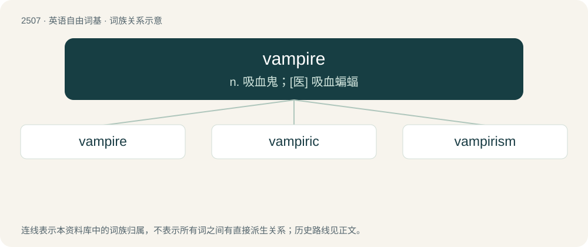

# 2611 · vampire — n. 吸血鬼；\[医\] 吸血蝙蝠

[总目录](../00_总目录_按常用程度.md)

**类型**：英语自由词基　｜　**来源语言**：见词源记录

## 核心含义与来源

- 核心含义：n. 吸血鬼；\[医\] 吸血蝙蝠
- 英文含义：A mythological creature (usually humanoid and undead) said to feed on the blood or life energy of the living.
- 词形：vampire

**来源记录 1**（名词；A mythological creature (usually humanoid and undead) said to feed on the blood or life energy of the living.）

From French vampire, from German Vampir, via Hungarian from a Slavic word, probably Serbo-Croatian vàmpīr /ва̀мпӣр, from Proto-Slavic \*ǫpyrь, further possibly from Proto-Turkic \*ōpur (“glutton, witch, evil spirit”), or from native construction. Doublet of dhampir and oupire.

## 词族图

## 单词速览（常用到不常用）

| 单词 | 音标 | 释义 |
|---|---|---|
| [vampire](#w-1) | 美 /ˈvæm.paɪ.ə(ɹ)/ | n. 吸血鬼；\[医\] 吸血蝙蝠 |
| [vampiric](#w-2) | /væmˈpɪɹɪk/ | a. （似）吸血鬼的 |
| [vampirism](#w-3) | /ˈvæmpaiərizəm/ | n. 勾引, 诱惑, 吮人膏血, 勒索钱财 |

## 逐词详解

### 1. vampire

**词性**：名词　｜　**音标**：美 /ˈvæm.paɪ.ə(ɹ)/

**中文释义**：n. 吸血鬼；\[医\] 吸血蝙蝠

**英文义项**：A mythological creature (usually humanoid and undead) said to feed on the blood or life energy of the living. / A person with habits traditionally ascribed to (literal) vampires, such as heliophobia, being a night owl, having pale skin, and so on.

**词源与演化**：

From French vampire, from German Vampir, via Hungarian from a Slavic word, probably Serbo-Croatian vàmpīr /ва̀мпӣр, from Proto-Slavic \*ǫpyrь, further possibly from Proto-Turkic \*ōpur (“glutton, witch, evil spirit”), or from native construction. Doublet of dhampir and oupire.

**例句**：

> You have to be careful what you tell her, because she's such a vampire for drama.

该用例对应义项：A person who drains one's time, energy, money, etc.

### 2. vampiric

**词性**：形容词　｜　**音标**：/væmˈpɪɹɪk/

**中文释义**：a. （似）吸血鬼的

**英文义项**：Having the traits of a vampire.

**构词拆分**：vampire + -ic

**词源与演化**：

From vampire + -ic.

### 3. vampirism

**词性**：名词　｜　**音标**：/ˈvæmpaiərizəm/

**中文释义**：n. 勾引, 诱惑, 吮人膏血, 勒索钱财

**英文义项**：Systemic lupus erythematosus (autoimmune disease) / The state of being a vampire.

**构词拆分**：vampire + -ism

**词源与演化**：

From vampire + -ism.

**例句**：

> Sami was attracted to the life of vampirism.
