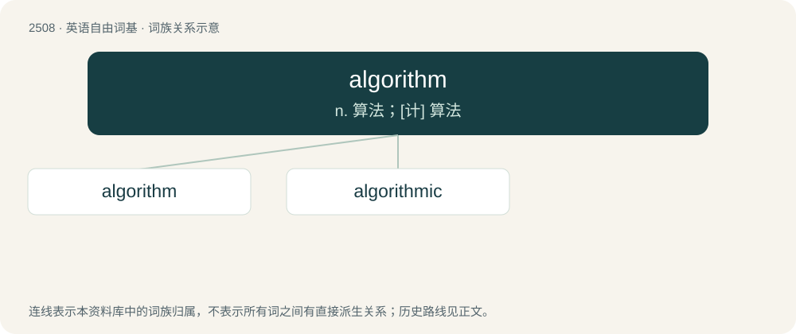

# 2612 · algorithm — n. 算法；\[计\] 算法

[总目录](../00_总目录_按常用程度.md)

**类型**：英语自由词基　｜　**来源语言**：见词源记录

## 核心含义与来源

- 核心含义：n. 算法；\[计\] 算法
- 英文含义：A collection of ordered steps that solve a mathematical problem. A precise step-by-step plan for a computational procedure that possibly begins with an input value and yields an output value in a finite number of steps.
- 词形：algorithm

**来源记录 1**（名词；A collection of ordered steps that solve a mathematical problem. A precise step-by-step plan for a computational procedure that possibly begins with an input value and yields an output value in a finite number of steps.）

From Middle English algorisme, augrym, from Anglo-Norman algorisme, augrim, from Medieval Latin algorismus, from Arabic الخَوَارِزْمِيّ (al-ḵawārizmiyy), the nisba of Persian mathematician Muḥammad ibn Mūsā al-Khwārizmī and a toponymic name meaning "the Chorasmian". The spelling change (-s- &gt; -th-) was influenced by unrelated Ancient Greek ἀριθμός (arithmós) (whence English arithmo-).

## 词族图

## 单词速览（常用到不常用）

| 单词 | 音标 | 释义 |
|---|---|---|
| [algorithm](#w-1) | /ˈælɡəɹɪðm̩/ | n. 算法；\[计\] 算法 |
| [algorithmic](#w-2) | 英 /ˌælɡəˈɹɪðmɪk/ | \[计\] 算法的 |

## 逐词详解

### 1. algorithm

**词性**：名词　｜　**音标**：/ˈælɡəɹɪðm̩/

**中文释义**：n. 算法；\[计\] 算法

**英文义项**：A collection of ordered steps that solve a mathematical problem. A precise step-by-step plan for a computational procedure that possibly begins with an input value and yields an output value in a finite number of steps. / A flowchart illustrating a decision-making process for human users, especially health care professionals.

**词源与演化**：

From Middle English algorisme, augrym, from Anglo-Norman algorisme, augrim, from Medieval Latin algorismus, from Arabic الخَوَارِزْمِيّ (al-ḵawārizmiyy), the nisba of Persian mathematician Muḥammad ibn Mūsā al-Khwārizmī and a toponymic name meaning "the Chorasmian". The spelling change (-s- &gt; -th-) was influenced by unrelated Ancient Greek ἀριθμός (arithmós) (whence English arithmo-).

**例句**：

> An algorithm is a recipe for solving a problem, step by step.

### 2. algorithmic

**词性**：形容词　｜　**音标**：英 /ˌælɡəˈɹɪðmɪk/

**中文释义**：\[计\] 算法的

**英文义项**：Of, relating to, or being an algorithm.

**构词拆分**：algorithm + -ic

**词源与演化**：

From algorithm + -ic.

**例句**：

> Our consciousness must exist prior to our algorithmic computer capacity.
