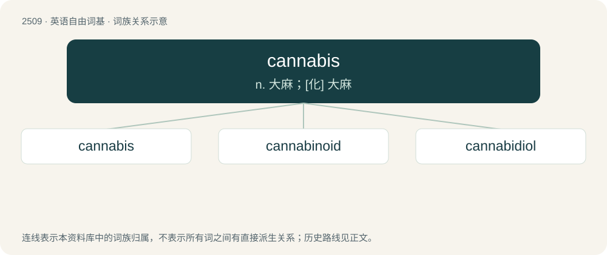

# 2613 · cannabis — n. 大麻；\[化\] 大麻

[总目录](../00_总目录_按常用程度.md)

**类型**：英语自由词基　｜　**来源语言**：见词源记录

## 核心含义与来源

- 核心含义：n. 大麻；\[化\] 大麻
- 英文含义：A tall annual dioecious plant (Cannabis, especially Cannabis sativa), native to central Asia and having alternate, palmately divided leaves and tough bast fibers.
- 词形：cannabis

**来源记录 1**（名词；A tall annual dioecious plant (Cannabis, especially Cannabis sativa), native to central Asia and having alternate, palmately divided leaves and tough bast fibers.）

Learned borrowing from Latin cannabis (“hemp”), borrowed from Ancient Greek κάνναβις (kánnabis). See there for more. Further reading at Etymology of cannabis on Wikipedia. Doublet of canvas and hemp.

## 词族图

## 单词速览（常用到不常用）

| 单词 | 音标 | 释义 |
|---|---|---|
| [cannabis](#w-1) | 英 /ˈkæ.nə.bɪs/ | n. 大麻；\[化\] 大麻 |
| [cannabinoid](#w-2) | /ˈkænəbəˌnɔɪd/ | n. 大麻的化学成分（可指任何一种, 如四氢大麻醇、大麻醇等） |
| [cannabidiol](#w-3) | 英 /kan.əb.ɪˈdʌɪ.ɒl/；美 /kæn.əb.ɪˈdaɪ.ɔl/ | \[化\] 大麻二酚；\[医\] 大麻二酚 |

## 逐词详解

### 1. cannabis

**词性**：名词　｜　**音标**：英 /ˈkæ.nə.bɪs/

**中文释义**：n. 大麻；\[化\] 大麻

**英文义项**：A tall annual dioecious plant (Cannabis, especially Cannabis sativa), native to central Asia and having alternate, palmately divided leaves and tough bast fibers. / A mildly euphoriant or sedating, intoxicating hallucinogenic drug prepared from various parts of this plant.

**词源与演化**：

Learned borrowing from Latin cannabis (“hemp”), borrowed from Ancient Greek κάνναβις (kánnabis). See there for more. Further reading at Etymology of cannabis on Wikipedia. Doublet of canvas and hemp.

**例句**：

> The dinosaurs did not consume cannabis, as it had not evolved yet.

### 2. cannabinoid

**词性**：名词　｜　**音标**：/ˈkænəbəˌnɔɪd/

**中文释义**：n. 大麻的化学成分（可指任何一种, 如四氢大麻醇、大麻醇等）

**英文义项**：Substance that is structurally related to tetrahydrocannabinol (THC), a psychoactive compound present in cannabis, or that bind to cannabinoid receptors.

**构词拆分**：cannabis + -in + -oid

**词源与演化**：

From cannab(is) + -in + -oid.

**例句**：

> Dinosaurs had cannabinoid receptors, but there was no cannabis plant yet.

### 3. cannabidiol

**词性**：名词　｜　**音标**：英 /kan.əb.ɪˈdʌɪ.ɒl/；美 /kæn.əb.ɪˈdaɪ.ɔl/

**中文释义**：\[化\] 大麻二酚；\[医\] 大麻二酚

**英文义项**：A nonintoxicating cannabinoid found in the hemp plant Cannabis sativa.

**构词拆分**：cannabis + -i- + di- + -ol

**词源与演化**：

From cannab(is) + -i- + di- + -ol.
