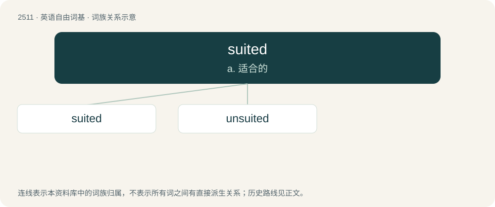

# 2615 · suited — a. 适合的

[总目录](../00_总目录_按常用程度.md)

**类型**：英语自由词基　｜　**来源语言**：见词源记录

## 核心含义与来源

- 核心含义：a. 适合的
- 英文含义：Suitable.
- 词形：suited

**来源记录 1**（形容词；Suitable.）

From suit + -ed.

## 词族图

## 单词速览（常用到不常用）

| 单词 | 音标 | 释义 |
|---|---|---|
| [suited](#w-1) | 英 /ˈsuːtɪd/；美 /ˈsutɪd/ | a. 适合的 |
| [unsuited](#w-2) | /.ʌnˈsjuːtid/ | a. 不适宜的, 不适合的, 不适当的 |

## 逐词详解

### 1. suited

**词性**：形容词　｜　**音标**：英 /ˈsuːtɪd/；美 /ˈsutɪd/

**中文释义**：a. 适合的

**英文义项**：Suitable. / Having the specified kind or number of suits.

**构词拆分**：suit + -ed

**词源与演化**：

From suit + -ed.

**用法示例／搭配（非完整句）**：

> Brunson has ace-king suited in the small blind

该用例对应义项：Of the same suit.

### 2. unsuited

**词性**：形容词　｜　**音标**：/.ʌnˈsjuːtid/

**中文释义**：a. 不适宜的, 不适合的, 不适当的

**英文义项**：Not suited to a specific purpose. / Not compatible; mismatched.

**构词拆分**：un- + suited

**词源与演化**：

From un- + suited.

**用法示例／搭配（非完整句）**：

> an unsuited astronaut

该用例对应义项：Not wearing a suit.
