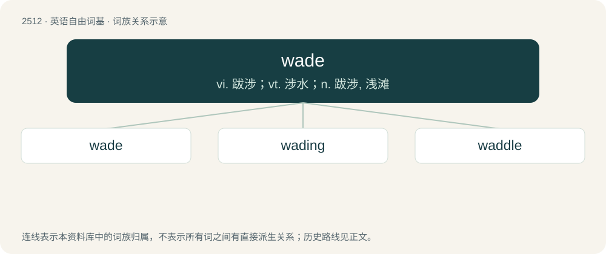

# 2616 · wade — vi. 跋涉；vt. 涉水；n. 跋涉, 浅滩

[总目录](../00_总目录_按常用程度.md)

**类型**：英语自由词基　｜　**来源语言**：见词源记录

## 核心含义与来源

- 核心含义：vi. 跋涉；vt. 涉水；n. 跋涉, 浅滩
- 英文含义：To walk through water or something that impedes progress.
- 词形：wade

**来源记录 1**（动词；To walk through water or something that impedes progress.）

From Middle English waden, from Old English wadan, from Proto-West Germanic \*wadan, from Proto-Germanic \*wadaną (“to go, pass through”), from Proto-Indo-European \*weh₂dʰ- (“to go”). Cognates include Saterland Frisian waadje (“to wade”), West Frisian wâdzje (“to wade”), Dutch waden (“to wade”), German Low German waden (“to wade”), German waten (“to wade”), Danish vade (“to wade”), Swedish vada (“to wade”), Icelandic vaða (“to wade”), and Latin vādō (“go, walk; rush”).

## 词族图

## 单词速览（常用到不常用）

| 单词 | 音标 | 释义 |
|---|---|---|
| [wade](#w-1) | /weɪd/ | vi. 跋涉；vt. 涉水；n. 跋涉, 浅滩 |
| [wading](#w-2) | /ˈweidiŋ/ | a. 涉水的 |
| [waddle](#w-3) | 英 /ˈwɒd.əl/；美 /ˈwɑd.əl/ | vi. 摇摇摆摆地走, 蹒跚而行；n. 蹒跚 |

## 逐词详解

### 1. wade

**词性**：动词　｜　**音标**：/weɪd/

**中文释义**：vi. 跋涉；vt. 涉水；n. 跋涉, 浅滩

**英文义项**：To walk through water or something that impedes progress. / To progress with difficulty.

**词源与演化**：

From Middle English waden, from Old English wadan, from Proto-West Germanic \*wadan, from Proto-Germanic \*wadaną (“to go, pass through”), from Proto-Indo-European \*weh₂dʰ- (“to go”). Cognates include Saterland Frisian waadje (“to wade”), West Frisian wâdzje (“to wade”), Dutch waden (“to wade”), German Low German waden (“to wade”), German waten (“to wade”), Danish vade (“to wade”), Swedish vada (“to wade”), Icelandic vaða (“to wade”), and Latin vādō (“go, walk; rush”).

**用法示例／搭配（非完整句）**：

> to wade into a fight or a debate

该用例对应义项：To enter recklessly.

### 2. wading

**词性**：形容词　｜　**音标**：/ˈweidiŋ/

**中文释义**：a. 涉水的

**英文义项**：Appropriate to wade in. / Usually of a bird: which wades.

**构词拆分**：wade + -ing

**词源与演化**：

From wade + -ing.

**例句**：

> The pool is too small for doing laps: it’s only a wading pool.

该用例对应义项：Appropriate to wade in.

### 3. waddle

**词性**：名词　｜　**音标**：英 /ˈwɒd.əl/；美 /ˈwɑd.əl/

**中文释义**：vi. 摇摇摆摆地走, 蹒跚而行；n. 蹒跚

**英文义项**：A squat, swaying gait. / A group of birds, such as ducks and penguins, when walking.

**构词拆分**：wade + -le

**词源与演化**：

From Middle English wadelen, frequentative form of waden, equivalent to wade + -le. Compare Saterland Frisian wuttelje (“to waddle”), Old High German wadalōn (“to roam; wander”), Middle High German wadelen, wedelen (“to wander; rove”), German wedeln (“to waggle”). First known use in English in a version of the Song of Roland around the year 1400.

**用法示例／搭配（非完整句）**：

> the waddle of a duck

该用例对应义项：A squat, swaying gait.
