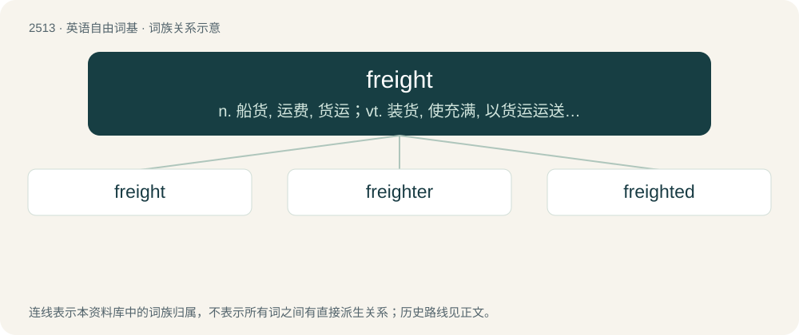

# 2617 · freight — n. 船货, 运费, 货运；vt. 装货, 使充满, 以货运运送, 租(或出租)(船等)

[总目录](../00_总目录_按常用程度.md)

**类型**：英语自由词基　｜　**来源语言**：见词源记录

## 核心含义与来源

- 核心含义：n. 船货, 运费, 货运；vt. 装货, 使充满, 以货运运送, 租(或出租)(船等)
- 英文含义：The transportation of goods (originally by water; now also (chiefly US) by land); also, the hiring of a vehicle or vessel for such transportation.
- 词形：freight

**多个词源／构词路径**：同一拼写可能有不同来源；以下按词性和含义分别列出。

**来源记录 1**（名词；The transportation of goods (originally by water; now also (chiefly US) by land); also, the hiring of a vehicle or vessel for such transportation.）

From Late Middle English freight, freght, freyght \[and other forms\], a variant of fraught, fraght (“transport of goods or people, usually by water; transportation fee; transportation facilities; cargo or passengers of a ship; (figuratively) burden; ballast of a ship; goods; a charge”), from Middle Dutch vracht, vrecht, and Middle Low German vrecht (“cargo, freight; transportation fee”), from Old Saxon frāht, frēht, from Proto-West Germanic \*fra- (from Proto-Germanic \*fra- (prefix meaning ‘completely, fully’)) + \*aihti (from Proto-Germanic \*aihtiz (“possessions, property”), ultimately from Proto-Indo-European \*h₂eyḱ- (“to come into possession of, obtain; to own, possess”)). The English word can be analysed as for- + aught, and is a doublet of fraught. Cognates \* French fret (“cargo, freight; transportation fees; rental of a ship”) \* Old English ǣht (“livestock; possession, property; power”) \* Old High German frēht (“earnings”) \* Portuguese frete (“cargo, freight; transportation fees”) \* Spanish flete (“cargo, freight; charter (hire of a vehicle for transporting cargo)”) \* Swedish frakt c (“cargo, freight; transportation fees”)

**来源记录 2**（动词；To load (a vehicle or vessel) with freight (cargo); also, to hire or rent out (a vehicle or vessel) to carry cargo or passengers.）

The verb is derived from Late Middle English freighten, freghten, a variant of fraughten, fraghten (“to load (a ship with cargo or passengers); to hire (a ship) for transporting goods; to provide fully (with goods, money, etc.); to stow away”), and then either: \* from fraught, fraght (noun) (see etymology 1) + -en (suffix forming the infinitive form of verbs); or \* from Middle Dutch vrachten, vrechten (“to load (a ship with cargo or passengers); to hire (a ship) for transporting goods, to fraught”), from vracht, vrecht (noun) (see etymology 1) + -en (suffix forming the infinitive form of verbs). The adjective is: \* derived from Middle English freght, freight, freyght, the past participle of fraughten (verb) (see above); and/or \* a contraction of freighted, the past participle of the verb.

## 词族图

## 单词速览（常用到不常用）

| 单词 | 音标 | 释义 |
|---|---|---|
| [freight](#w-1) | 英 /fɹeɪt/ | n. 船货, 运费, 货运；vt. 装货, 使充满, 以货运运送, 租(或出租)(船等) |
| [freighter](#w-2) | 英 /ˈfɹeɪtə/；美 /ˈfɹeɪtɚ/ | n. 租船人, 承运人, 托运人, 货船, 运输机；\[经\] 装货人, 货主, 承运人 |
| [freighted](#w-3) | 英 /ˈfɹeɪtɪd/ | vbl. 运输 |

## 逐词详解

### 1. freight

**词性**：名词　｜　**音标**：英 /fɹeɪt/

**中文释义**：n. 船货, 运费, 货运；vt. 装货, 使充满, 以货运运送, 租(或出租)(船等)

**英文义项**：The transportation of goods (originally by water; now also (chiefly US) by land); also, the hiring of a vehicle or vessel for such transportation. / Goods or items in transport; cargo, luggage.

**构词拆分**：for- + aught

**词源与演化**：

From Late Middle English freight, freght, freyght \[and other forms\], a variant of fraught, fraght (“transport of goods or people, usually by water; transportation fee; transportation facilities; cargo or passengers of a ship; (figuratively) burden; ballast of a ship; goods; a charge”), from Middle Dutch vracht, vrecht, and Middle Low German vrecht (“cargo, freight; transportation fee”), from Old Saxon frāht, frēht, from Proto-West Germanic \*fra- (from Proto-Germanic \*fra- (prefix meaning ‘completely, fully’)) + \*aihti (from Proto-Germanic \*aihtiz (“possessions, property”), ultimately from Proto-Indo-European \*h₂eyḱ- (“to come into possession of, obtain; to own, possess”)). The English word can be analysed as for- + aught, and is a doublet of fraught. Cognates \* French fret (“cargo, freight; transportation fees; rental of a ship”) \* Old English ǣht (“livestock; possession, property; power”) \* Old High German frēht (“earnings”) \* Portuguese frete (“cargo, freight; transportation fees”) \* Spanish flete (“cargo, freight; charter (hire of a vehicle for transporting cargo)”) \* Swedish frakt c (“cargo, freight; transportation fees”)

**例句**：

> The freight shifted and the trailer turned over on the highway.

该用例对应义项：Goods or items in transport; cargo, luggage.

### 2. freighter

**词性**：名词　｜　**音标**：英 /ˈfɹeɪtə/；美 /ˈfɹeɪtɚ/

**中文释义**：n. 租船人, 承运人, 托运人, 货船, 运输机；\[经\] 装货人, 货主, 承运人

**英文义项**：One who loads a ship. / One who charters and loads a ship.

**构词拆分**：freight + -er

**词源与演化**：

From freight + -er.

**例句**：

> The cargo was shipped across the ocean on a large freighter.

该用例对应义项：A ship used mainly to carry freight.

### 3. freighted

**词性**：形容词　｜　**音标**：英 /ˈfɹeɪtɪd/

**中文释义**：vbl. 运输

**英文义项**：Loaded with cargo; charged.

**构词拆分**：freight + -ed

**词源与演化**：

From freight + -ed.
