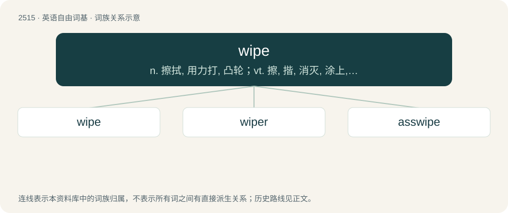

# 2618 · wipe — n. 擦拭, 用力打, 凸轮；vt. 擦, 揩, 消灭, 涂上, 拭去；vi. 擦, 打

[总目录](../00_总目录_按常用程度.md)

**类型**：英语自由词基　｜　**来源语言**：见词源记录

## 核心含义与来源

- 核心含义：n. 擦拭, 用力打, 凸轮；vt. 擦, 揩, 消灭, 涂上, 拭去；vi. 擦, 打
- 英文含义：To move an object over, maintaining contact, with the intention of removing some substance from the surface. (Compare rub.)
- 词形：wipe

**多个词源／构词路径**：同一拼写可能有不同来源；以下按词性和含义分别列出。

**来源记录 1**（动词；To move an object over, maintaining contact, with the intention of removing some substance from the surface. (Compare rub.)）

From Middle English wipen, from Old English wīpian (“to wipe, rub, cleanse”), from Proto-West Germanic \*wīpōn (“to wipe”), from Proto-Indo-European \*weyp- (“to twist, wind around”). Cognate with German wippen (“to bob”), Swedish veva (“to turn, wind, crank”), Gothic 𐍅𐌴𐌹𐍀𐌰𐌽 (weipan, “to wreathe, crown”), Old English swīfan (“to revolve, sweep, wend, intervene”), Sanskrit वेपते (vépate, “to tremble”). More at swivel, swift.

**来源记录 2**（名词；A lapwing, especially a northern lapwing (Vanellus vanellus).）

Compare Swedish vipa, Danish vibe (“lapwing”).

**来源记录 3**（动词；To have all members of a party die in a single campaign, event, or battle; to be wiped out.）

From wipe out (verb) and wipeout (noun) by shortening.

## 词族图

## 单词速览（常用到不常用）

| 单词 | 音标 | 释义 |
|---|---|---|
| [wipe](#w-1) | /waɪp/ | n. 擦拭, 用力打, 凸轮；vt. 擦, 揩, 消灭, 涂上, 拭去；vi. 擦, 打 |
| [wiper](#w-2) | 美 /ˈwaɪpɚ/ | n. 揩擦的人, 刮水器, 接触电刷；\[电\] 接帚 |
| [asswipe](#w-3) | 美 /ˈæswaɪp/ | 【英文】An annoying, contemptible, or worthless person. |

## 逐词详解

### 1. wipe

**词性**：动词　｜　**音标**：/waɪp/

**中文释义**：n. 擦拭, 用力打, 凸轮；vt. 擦, 揩, 消灭, 涂上, 拭去；vi. 擦, 打

**英文义项**：To move an object over, maintaining contact, with the intention of removing some substance from the surface. (Compare rub.) / To smear (a substance) with this kind of motion.

**词源与演化**：

From Middle English wipen, from Old English wīpian (“to wipe, rub, cleanse”), from Proto-West Germanic \*wīpōn (“to wipe”), from Proto-Indo-European \*weyp- (“to twist, wind around”). Cognate with German wippen (“to bob”), Swedish veva (“to turn, wind, crank”), Gothic 𐍅𐌴𐌹𐍀𐌰𐌽 (weipan, “to wreathe, crown”), Old English swīfan (“to revolve, sweep, wend, intervene”), Sanskrit वेपते (vépate, “to tremble”). More at swivel, swift.

**例句**：

> Even if you wipe very carefully, you still have to wash your hands afterward.

该用例对应义项：To clean (the anus, buttocks and/or genitals) after defecation or urination.

### 2. wiper

**词性**：名词　｜　**音标**：美 /ˈwaɪpɚ/

**中文释义**：n. 揩擦的人, 刮水器, 接触电刷；\[电\] 接帚

**英文义项**：Someone who wipes. / Something, such as a towel, that is used for wiping.

**构词拆分**：wipe + -er

**词源与演化**：

From wipe + -er.

**例句**：

> I used my windshield wiper to clean the snow on my window.

### 3. asswipe

**词性**：名词　｜　**音标**：美 /ˈæswaɪp/

**英文义项**：An annoying, contemptible, or worthless person. / Toilet paper.

**构词拆分**：ass + wipe

**词源与演化**：

Bahuvrihi compound of ass + wipe. First use appears c. 1947 in the writings of Mari Sandoz.

**例句**：

> He is such an asswipe!

该用例对应义项：An annoying, contemptible, or worthless person.
