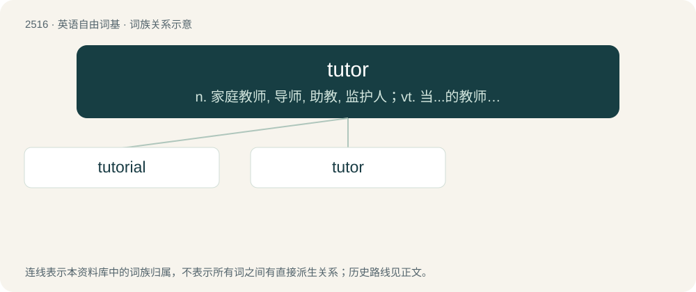

# 2619 · tutor — n. 家庭教师, 导师, 助教, 监护人；vt. 当...的教师, 教, 指导, 约束, 克制；vi. 当家庭教师, 受家庭教师的指导

[总目录](../00_总目录_按常用程度.md)

**类型**：英语自由词基　｜　**来源语言**：见词源记录

## 核心含义与来源

- 核心含义：n. 家庭教师, 导师, 助教, 监护人；vt. 当...的教师, 教, 指导, 约束, 克制；vi. 当家庭教师, 受家庭教师的指导
- 英文含义：One who teaches another (usually called a student, learner, or tutee) in a one-on-one or small-group interaction.
- 词形：tutor

**多个词源／构词路径**：同一拼写可能有不同来源；以下按词性和含义分别列出。

**来源记录 1**（名词；One who teaches another (usually called a student, learner, or tutee) in a one-on-one or small-group interaction.）

From Middle English tutour, from Old French tuteur (French tuteur), from Latin tūtor (“a watcher, protector, guardian”), from tueor (“protect”); see tuition.

**来源记录 2**（名词；A card that allows one to search one's deck for one or more other cards.）

Ellipsis of Demonic tutor, name of an early Magic: The Gathering card with this effect.

## 词族图

## 单词速览（常用到不常用）

| 单词 | 音标 | 释义 |
|---|---|---|
| [tutorial](#w-1) | /ˌtjuːˈtɔːɹɪəl/ | n. 个别指导, 论文, 学习指南, 指导手册；a. 个别指导的, 家庭教师的, 辅导的；\[计\] 教程 |
| [tutor](#w-2) | /ˈtjuːtəː/ | n. 家庭教师, 导师, 助教, 监护人；vt. 当...的教师, 教, 指导, 约束, 克制；vi. 当家庭教师, 受家庭教师的指导 |

## 逐词详解

### 1. tutorial

**词性**：形容词　｜　**音标**：/ˌtjuːˈtɔːɹɪəl/

**中文释义**：n. 个别指导, 论文, 学习指南, 指导手册；a. 个别指导的, 家庭教师的, 辅导的；\[计\] 教程

**英文义项**：Of or pertaining to a tutor; belonging to, or exercised by, a tutor.

**构词拆分**：tutor (noun) + -ial

**词源与演化**：

The adjective is from tutor (noun) + -ial, ultimately from Latin tūtor (“watcher, protector, defender”). The noun is transferred from the adjective.

**例句**：

> It's a tutorial on how to sew a dress shirt with cuffs.

### 2. tutor

**词性**：名词　｜　**音标**：/ˈtjuːtəː/

**中文释义**：n. 家庭教师, 导师, 助教, 监护人；vt. 当...的教师, 教, 指导, 约束, 克制；vi. 当家庭教师, 受家庭教师的指导

**英文义项**：One who teaches another (usually called a student, learner, or tutee) in a one-on-one or small-group interaction. / A university officer responsible for students in a particular hall.

**词源与演化**：

From Middle English tutour, from Old French tuteur (French tuteur), from Latin tūtor (“a watcher, protector, guardian”), from tueor (“protect”); see tuition.

**例句**：

> He passed the difficult class with help from his tutor.

该用例对应义项：One who teaches another (usually called a student, learner, or tutee) in a one-on-one or small-group interaction.
