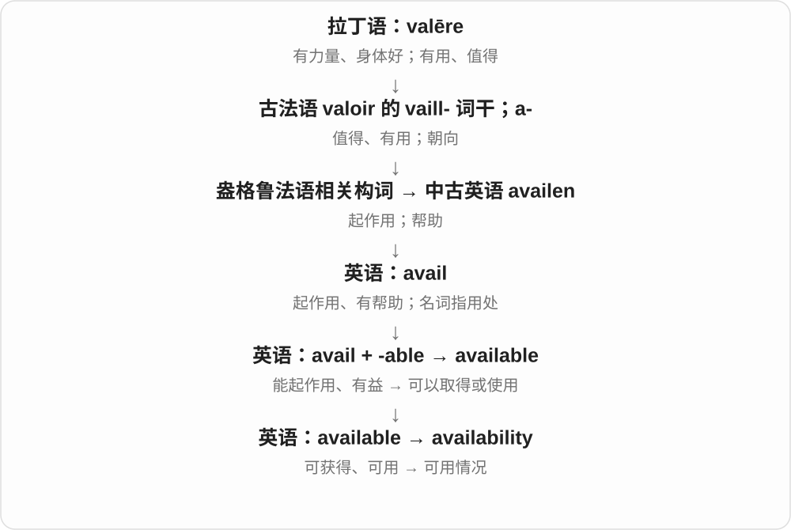

# 2620 · availability — 可用、可获得的状态及其否定

[逐词精讲目录](../00_逐词精讲目录.md) · [总目录](../00_总目录_按常用程度.md)

## 核心词根与来源

日常先看时间、库存和场地条件。bioavailability 已有独立精讲，它有专门的生物、药学含义，不等于货架有没有货。

**AVAILABILITY：需要的时候，是否拿得到、用得上**

availability → unavailability；bioavailability 是专门领域的生物利用度。

- **可用及不可用**：availability · unavailability
- **专门利用度名称**：bioavailability

## 词形与演化规律

available → availability；un- 否定可用状态；bio- 连接专门生物学用法。

## 单词速览（按词族由简到繁）

同一基础词的相关扩展放在一起，先读基础形式，再读扩展；各组之间优先读常用的。具体词源关系见各词讲解。

| 单词 | 音标 | 核心意思 |
|---|---|---|
| [availability](#w-1) | 英、美 /əˌveɪləˈbɪləti/ | 可获得性；有货、可用情况；空闲时间 |
| [bioavailability](#w-2) | 英 /ˌbaɪəʊəˌveɪləˈbɪləti/；美 /ˌbaɪoʊəˌveɪləˈbɪləti/ | 生物利用度 |
| [unavailability](#w-3) | /ˌʌnəveɪləˈbɪləti/ | 无法获得、不能使用的状态；无法到场、没有空 |

## 逐词讲解

### 1. availability — 可获得性；有货、可用情况；空闲时间

**音标**：英、美 /əˌveɪləˈbɪləti/

**先抓住这个画面**

不只问“有没有”，还问什么时间、多少数量、哪些人能用到。

**怎么拆**

available 的 -able 变为 -ability，形成状态名词。

**怎么变成今天的意思**

check availability 可以查房间、票或人的时间。limited availability 是供应或可用名额有限，不一定已经完全没有。

**常见搭配与例句**

check availability；subject to availability；staff availability。

> Please send me your availability for next week.

请把你下周有空的时间发给我。

> The website shows the current availability of each room.

网站显示每个房间目前是否可订。

**别混淆**

availability 看有得用的情况；affordability 看价格是否负担得起。

### 2. bioavailability — 生物利用度

**音标**：英 /ˌbaɪəʊəˌveɪləˈbɪləti/；美 /ˌbaɪoʊəˌveɪləˈbɪləti/

**先抓住这个画面**

吃进去了多少，不等于身体真正能用上多少；还要看它怎样到达作用位置。

**怎么拆**

bio-“生物体” + availability“可利用性”，是把“能够取得、使用”具体化到生物体内。

**怎么变成今天的意思**

**希腊 bios（βίος）**  
生命、一生、生活方式

↓

**近代构词成分 bio-**  
生命；生物；与生物有关的

↓

**英语 bio- + availability → bioavailability**  
生物体内的可利用程度

药物语境中 bioavailability 关注活性成分从制剂中被吸收、到达作用部位的速度和程度。口服后的一些成分可能没有被吸收，或在到达前已被处理掉。因此它不同于包装上写的含量，也不直接等于药效强弱。

**常见搭配与例句**

oral bioavailability；low bioavailability；improve bioavailability。

> The two formulations have different oral bioavailability.

这两种制剂的口服生物利用度不同。

> The study measured the compound’s bioavailability.

研究测量了这种化合物的生物利用度。

**别混淆**

dose 是给了多少；bioavailability 是给进去以后有多少、以多快速度能到达相关位置供作用。

### 3. unavailability — 无法获得、不能使用的状态；无法到场、没有空

**音标**：/ˌʌnəveɪləˈbɪləti/

**先抓住这个画面**

东西拿不到、人没空、场地用不了，都可说 unavailability；共同点是这次需要时，相关资源不在可用范围里。

**怎么拆**

un- + availability；也可按 unavailable + -ity 的对应关系认识，-able 一族形成 -ability 名词形式。

**怎么变成今天的意思**

**available 可获得、可用**  
能够得到，或时间安排允许

↓

**availability → unavailability**  
可用性 → 不可用、无法到场的状态

the unavailability of a venue 场地无法使用，staff unavailability 员工无法到场，temporary unavailability 暂时不可用。

**常见搭配与例句**

the unavailability of；temporary unavailability。

> The meeting was postponed because of the speaker’s unavailability.

发言人无法到场，会议因此延期。

> The notice explained the temporary unavailability of the booking service.

通知解释了预订服务暂时无法使用的情况。

**别混淆**

unavailability 不必表示永远不存在：可能只是在所需时间、地区或条件下无法获得。

## 这一组要分清什么

不可用可能暂时；生物利用度与库存可得性分清。

## 串起来练习

Check room availability before announcing a date; unavailability could force a change.

公布日期前先查房间能否使用，否则可能不得不改期。
