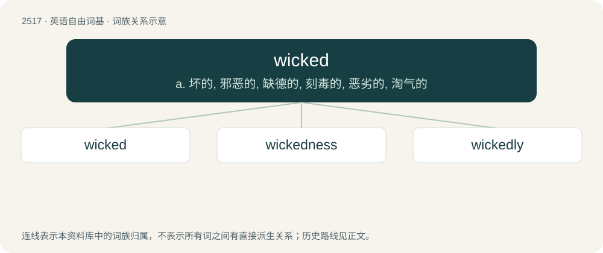

# 2620 · wicked — a. 坏的, 邪恶的, 缺德的, 刻毒的, 恶劣的, 淘气的

[总目录](../00_总目录_按常用程度.md)

**类型**：英语自由词基　｜　**来源语言**：见词源记录

## 核心含义与来源

- 核心含义：a. 坏的, 邪恶的, 缺德的, 刻毒的, 恶劣的, 淘气的
- 英文含义：Evil or mischievous by nature; morally reprehensible.
- 词形：wicked

**多个词源／构词路径**：同一拼写可能有不同来源；以下按词性和含义分别列出。

**来源记录 1**（形容词；Evil or mischievous by nature; morally reprehensible.）

From Middle English wicked, wikked, an alteration of Middle English wicke, wikke (“morally perverse, evil, wicked”). Of uncertain origin. Possibly from an adjectival use of Old English wiċċa (“wizard, sorcerer”), from Proto-West Germanic \*wikkō (“necromancer, sorcerer”), though the phonology makes this theory difficult to explain. Alternatively, perhaps related to English wicker, Old Norse víkja (“to bend to, yield, turn, move”), Swedish vika (“to bend, fold, give way to”), English weak. The "excellent, awesome" sense is an ameliorative semantic shift from the original sense of "evil, mischievous". Compare similar semantic development in terrific and sick.

**来源记录 2**（形容词；Having a wick.）

See wick.

## 词族图

## 单词速览（常用到不常用）

| 单词 | 音标 | 释义 |
|---|---|---|
| [wicked](#w-1) | 英 /ˈwɪk.ɪd/ | a. 坏的, 邪恶的, 缺德的, 刻毒的, 恶劣的, 淘气的 |
| [wickedness](#w-2) | /ˈwɪkɪdnəs/ | n. 邪恶, 不道德 |
| [wickedly](#w-3) | /ˈwɪkɪdli/ | adv. 坏透地, 不愉快地, 顽皮地 |

## 逐词详解

### 1. wicked

**词性**：形容词　｜　**音标**：英 /ˈwɪk.ɪd/

**中文释义**：a. 坏的, 邪恶的, 缺德的, 刻毒的, 恶劣的, 淘气的

**英文义项**：Evil or mischievous by nature; morally reprehensible. / Harsh; severe.

**词源与演化**：

From Middle English wicked, wikked, an alteration of Middle English wicke, wikke (“morally perverse, evil, wicked”). Of uncertain origin. Possibly from an adjectival use of Old English wiċċa (“wizard, sorcerer”), from Proto-West Germanic \*wikkō (“necromancer, sorcerer”), though the phonology makes this theory difficult to explain. Alternatively, perhaps related to English wicker, Old Norse víkja (“to bend to, yield, turn, move”), Swedish vika (“to bend, fold, give way to”), English weak. The "excellent, awesome" sense is an ameliorative semantic shift from the original sense of "evil, mischievous". Compare similar semantic development in terrific and sick.

**例句**：

> Genuine cowards follow wicked people and cannot reliably sustain any virtue.

该用例对应义项：Evil or mischievous by nature; morally reprehensible.

### 2. wickedness

**词性**：名词　｜　**音标**：/ˈwɪkɪdnəs/

**中文释义**：n. 邪恶, 不道德

**英文义项**：The state of being wicked; evil disposition; immorality. / A wicked or sinful thing or act; morally bad or objectionable behaviour.

**构词拆分**：wicked + -ness

**词源与演化**：

Inherited from Middle English wikkednesse, wikkednes, equivalent to wicked + -ness.

**例句**：

> Human nature is good and wickedness is essentially unnatural.

### 3. wickedly

**词性**：副词　｜　**音标**：/ˈwɪkɪdli/

**中文释义**：adv. 坏透地, 不愉快地, 顽皮地

**英文义项**：In a wicked manner. / very

**构词拆分**：wicked + -ly

**词源与演化**：

From Middle English wyckedly, wykkedlyche, equivalent to wicked + -ly.

**例句**：

> The film was wickedly funny.

该用例对应义项：very
