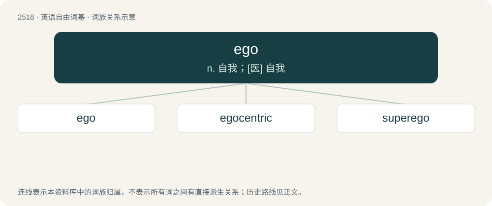

# 2622 · ego — n. 自我；\[医\] 自我

[总目录](../00_总目录_按常用程度.md)

**类型**：英语自由词基　｜　**来源语言**：见词源记录

## 核心含义与来源

- 核心含义：n. 自我；\[医\] 自我
- 英文含义：The self, especially with a sense of self-importance.
- 词形：ego

**来源记录 1**（名词；The self, especially with a sense of self-importance.）

Borrowed from Latin ego (“I”). Chosen by Freud’s translator as a translation of his use of German Ich as a noun for this concept from the pronoun ich (“I”). Doublet of I and Ich.

## 词族图

## 单词速览（常用到不常用）

| 单词 | 音标 | 释义 |
|---|---|---|
| [ego](#w-1) | 英 /ˈiːɡəʊ/；美 /ˈiɡoʊ/ | n. 自我；\[医\] 自我 |
| [egocentric](#w-2) | 英 /ˌiːɡəʊˈsɛntɹɪk/；美 /ˌiɡoʊˈsɛntɹɪk/ | a. 自我中心的, 利己主义的；n. 利己主义者 |
| [superego](#w-3) | 美 /ˈsupɚˌiɡoʊ/ | n. 超自我 |

## 逐词详解

### 1. ego

**词性**：名词　｜　**音标**：英 /ˈiːɡəʊ/；美 /ˈiɡoʊ/

**中文释义**：n. 自我；\[医\] 自我

**英文义项**：The self, especially with a sense of self-importance. / The most central part of the mind, which mediates with one's surroundings.

**词源与演化**：

Borrowed from Latin ego (“I”). Chosen by Freud’s translator as a translation of his use of German Ich as a noun for this concept from the pronoun ich (“I”). Doublet of I and Ich.

**用法示例／搭配（非完整句）**：

> the cousin of ego on the father's side

该用例对应义项：The individual from whose point of view a family tree or pedigree chart is drawn, or the reference point from whom kinship terminology is relative. (Used without the definite article the.)

### 2. egocentric

**词性**：形容词　｜　**音标**：英 /ˌiːɡəʊˈsɛntɹɪk/；美 /ˌiɡoʊˈsɛntɹɪk/

**中文释义**：a. 自我中心的, 利己主义的；n. 利己主义者

**英文义项**：Selfish, self-centered, self-absorbed. / Egotistical.

**构词拆分**：ego + -centric

**词源与演化**：

From ego- + -centric.

**例句**：

> Our genetic material is being constantly invaded by small egocentric molecular parasites.

### 3. superego

**词性**：名词　｜　**音标**：美 /ˈsupɚˌiɡoʊ/

**中文释义**：n. 超自我

**英文义项**：The part of the mind that acts as a self-critical conscience, reflecting social standards that have been learnt.

**构词拆分**：super + ego

**词源与演化**：

From super + ego, from earlier form super-ego, calqued after German Über-Ich, from über- (“super-”) + Ich (“ego”), from the pronoun ich (“I”).

**例句**：

> In psychoanalysis, this voice is called the superego, which Freud conceived as the infantile internalizing of parental authority.
