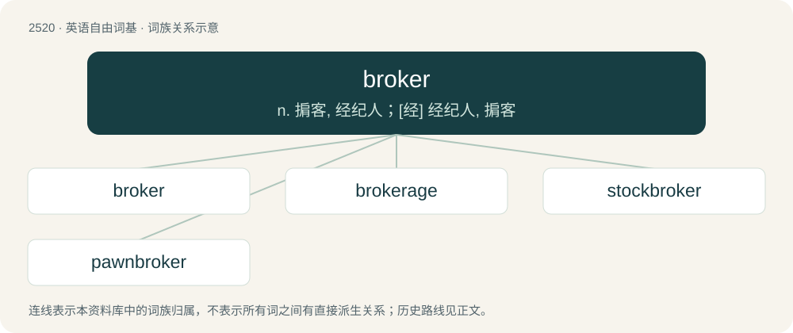

# 2624 · broker — n. 掮客, 经纪人；\[经\] 经纪人, 掮客

[总目录](../00_总目录_按常用程度.md)

**类型**：英语自由词基　｜　**来源语言**：见词源记录

## 核心含义与来源

- 核心含义：n. 掮客, 经纪人；\[经\] 经纪人, 掮客
- 英文含义：A mediator between a buyer and seller.
- 词形：broker

**来源记录 1**（名词；A mediator between a buyer and seller.）

From Middle English broker, brokour, brocour, from Anglo-Norman brocour (“small trader”) (compare also abroker (“to act as a broker”)), from Old Dutch \*brokere (“one who determines the usages of trade, manager”), from broke, bruyck, breuck (“use, usage, trade”), from Proto-West Germanic \*brūkī (“use, custom”), from Proto-Germanic \*brūkiz (“use, custom”), from Proto-Indo-European \*bʰruHg- (“to use, enjoy”), equivalent to brook + -er. Cognates Cognate with Middle Low German brukere (“a broker”), Danish bruger (“a broker, user, handler”), Swedish bruk (“use, custom, trade, business”), Old English broc (“use, profit, advantage, foredeal”). Compare also French brocanter (“to deal in second-hand goods”) from the same Germanic source. More at brook.

## 词族图

## 单词速览（常用到不常用）

| 单词 | 音标 | 释义 |
|---|---|---|
| [broker](#w-1) | 英 /ˈbɹəʊkə/；美 /ˈbɹoʊkɚ/ | n. 掮客, 经纪人；\[经\] 经纪人, 掮客 |
| [brokerage](#w-2) | 英 /ˈbɹəʊkəɹɪd͡ʒ/；美 /ˈbɹoʊkəɹɪd͡ʒ/ | n. 经纪人, 回扣, 佣金, 中间人业务；\[经\] 经纪业, 佣金, 手续费 |
| [stockbroker](#w-3) | /ˈstɒk.brəukə/ | n. 股票经纪人 |
| [pawnbroker](#w-4) | 英 /ˈpɔːnˌbɹəʊ.kə(ɹ)/ | n. 典当商, 当铺老板 |

## 逐词详解

### 1. broker

**词性**：名词　｜　**音标**：英 /ˈbɹəʊkə/；美 /ˈbɹoʊkɚ/

**中文释义**：n. 掮客, 经纪人；\[经\] 经纪人, 掮客

**英文义项**：A mediator between a buyer and seller. / A stockbroker.

**构词拆分**：brook + -er

**词源与演化**：

From Middle English broker, brokour, brocour, from Anglo-Norman brocour (“small trader”) (compare also abroker (“to act as a broker”)), from Old Dutch \*brokere (“one who determines the usages of trade, manager”), from broke, bruyck, breuck (“use, usage, trade”), from Proto-West Germanic \*brūkī (“use, custom”), from Proto-Germanic \*brūkiz (“use, custom”), from Proto-Indo-European \*bʰruHg- (“to use, enjoy”), equivalent to brook + -er. Cognates Cognate with Middle Low German brukere (“a broker”), Danish bruger (“a broker, user, handler”), Swedish bruk (“use, custom, trade, business”), Old English broc (“use, profit, advantage, foredeal”). Compare also French brocanter (“to deal in second-hand goods”) from the same Germanic source. More at brook.

**例句**：

> My insurance broker sells both home and vehicle insurance but not life insurance.

### 2. brokerage

**词性**：名词　｜　**音标**：英 /ˈbɹəʊkəɹɪd͡ʒ/；美 /ˈbɹoʊkəɹɪd͡ʒ/

**中文释义**：n. 经纪人, 回扣, 佣金, 中间人业务；\[经\] 经纪业, 佣金, 手续费

**英文义项**：A business, firm, or company whose business is to act as a broker (e.g., stockbroker). / The occupation of being a broker.

**构词拆分**：broker + -age

**词源与演化**：

From broker + -age.

**例句**：

> When you see the sign for the stock brokerage, take the next right.

### 3. stockbroker

**词性**：名词　｜　**音标**：/ˈstɒk.brəukə/

**中文释义**：n. 股票经纪人

**英文义项**：A person who buys and sells shares (stock) on a stock exchange on behalf of clients. May also provide investment advice and/or company information, depending on the level of service offered (or chosen by the client).

**构词拆分**：stock + broker

**词源与演化**：

From stock + broker.

**例句**：

> The stockbroker advised investing in safe assets.

### 4. pawnbroker

**词性**：名词　｜　**音标**：英 /ˈpɔːnˌbɹəʊ.kə(ɹ)/

**中文释义**：n. 典当商, 当铺老板

**英文义项**：A person who makes monetary loans at interest, taking personal property as security – which may be sold if not redeemed.

**构词拆分**：From pawn + broker.

**词源与演化**：

From pawn + broker.
