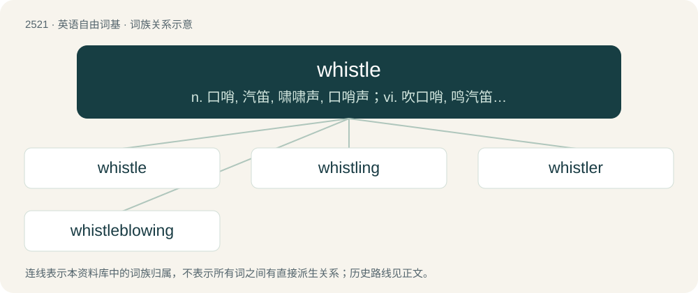

# 2626 · whistle — n. 口哨, 汽笛, 啸啸声, 口哨声；vi. 吹口哨, 鸣汽笛, 发嘘嘘声；vt. 用口哨或吹哨传意, 用口哨演奏

[总目录](../00_总目录_按常用程度.md)

**类型**：英语自由词基　｜　**来源语言**：见词源记录

## 核心含义与来源

- 核心含义：n. 口哨, 汽笛, 啸啸声, 口哨声；vi. 吹口哨, 鸣汽笛, 发嘘嘘声；vt. 用口哨或吹哨传意, 用口哨演奏
- 英文含义：A device designed to be placed in the mouth and blown, or driven by steam or some other mechanism, to make a whistling sound.
- 词形：whistle

**多个词源／构词路径**：同一拼写可能有不同来源；以下按词性和含义分别列出。

**来源记录 1**（名词；A device designed to be placed in the mouth and blown, or driven by steam or some other mechanism, to make a whistling sound.）

From Middle English whistel, whistil, whistle, from Old English hwistle, from the verb (see below).

**来源记录 2**（动词；To make a shrill, high-pitched sound by forcing air through the mouth. To produce a whistling sound, restrictions to the flow of air are created using the teeth, tongue and lips.）

From Middle English whistlen, from Old English hwistlan, hwistlian (“to whistle”), from Proto-West Germanic \*hwistlōn, from Proto-Germanic \*hwistlōną (“to make a hissing sound”). Cognate with Swedish vissla (“to whistle”), Icelandic hvísla (“to whisper”), Russian свистеть (svistetʹ, “to whistle”).

## 词族图

## 单词速览（常用到不常用）

| 单词 | 音标 | 释义 |
|---|---|---|
| [whistle](#w-1) | /ˈwɪs(ə)l/ | n. 口哨, 汽笛, 啸啸声, 口哨声；vi. 吹口哨, 鸣汽笛, 发嘘嘘声；vt. 用口哨或吹哨传意, 用口哨演奏 |
| [whistling](#w-2) | /ˈwɪs(ə)lɪŋ/ | n. 吹哨, 吹笛；鸣汽笛 |
| [whistler](#w-3) | /ˈʍɪslə(ɹ)/ | n. 吹口哨的人, 发啸声的东西；\[机\] 通气孔 |
| [whistleblowing](#w-4) | /wɪslbˈləʊɪŋ/ | 告密，揭发 |

## 逐词详解

### 1. whistle

**词性**：名词　｜　**音标**：/ˈwɪs(ə)l/

**中文释义**：n. 口哨, 汽笛, 啸啸声, 口哨声；vi. 吹口哨, 鸣汽笛, 发嘘嘘声；vt. 用口哨或吹哨传意, 用口哨演奏

**英文义项**：A device designed to be placed in the mouth and blown, or driven by steam or some other mechanism, to make a whistling sound. / An act of whistling.

**词源与演化**：

From Middle English whistel, whistil, whistle, from Old English hwistle, from the verb (see below).

**例句**：

> The whistle signalled the end of the game.

该用例对应义项：the act of signalling (e.g., summoning) by whistling or blowing a whistle

### 2. whistling

**词性**：名词　｜　**音标**：/ˈwɪs(ə)lɪŋ/

**中文释义**：n. 吹哨, 吹笛；鸣汽笛

**英文义项**：A shrill, breathy sound; a whistle.

**构词拆分**：whistle + -ing

**词源与演化**：

From Middle English whistlinge, whystlynge, from Old English hwistlung, equivalent to whistle + -ing.

**例句**：

> The whistling of the wind through the rigging sounded like funereal wailings.

### 3. whistler

**词性**：名词　｜　**音标**：/ˈʍɪslə(ɹ)/

**中文释义**：n. 吹口哨的人, 发啸声的东西；\[机\] 通气孔

**英文义项**：Someone or something that whistles, or who plays a whistle as a musical instrument. / Any of several passerine birds of the genera Pachycephala and Coracornis, of Australasia and the western Pacific.

**构词拆分**：whistle + -er

**词源与演化**：

From Middle English whisteler, whistlar, whystelare, from Old English hwistlere (“a player on a flute; a piper”), equivalent to whistle + -er.

**例句**：

> Tom is a very good whistler.

### 4. whistleblowing

**词性**：名词　｜　**音标**：/wɪslbˈləʊɪŋ/

**中文释义**：告密，揭发

**英文义项**：The disclosure to the public or to authorities, such as by an employee, of wrongdoing.

**构词拆分**：whistle + blowing

**词源与演化**：

From whistle + blowing.
